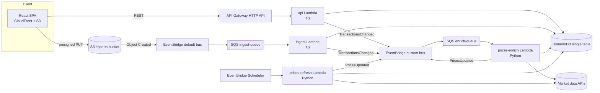
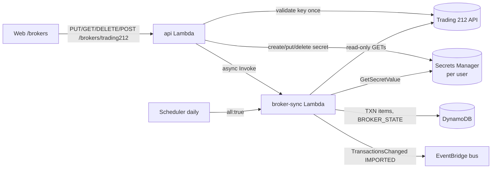
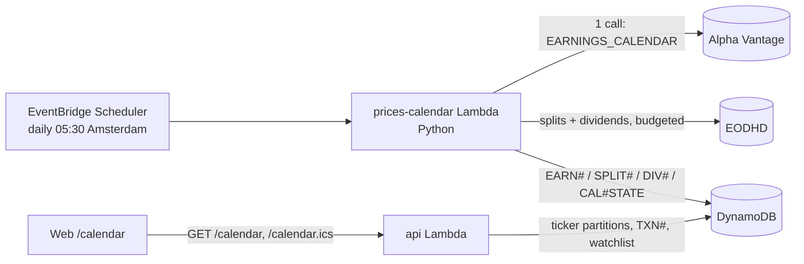
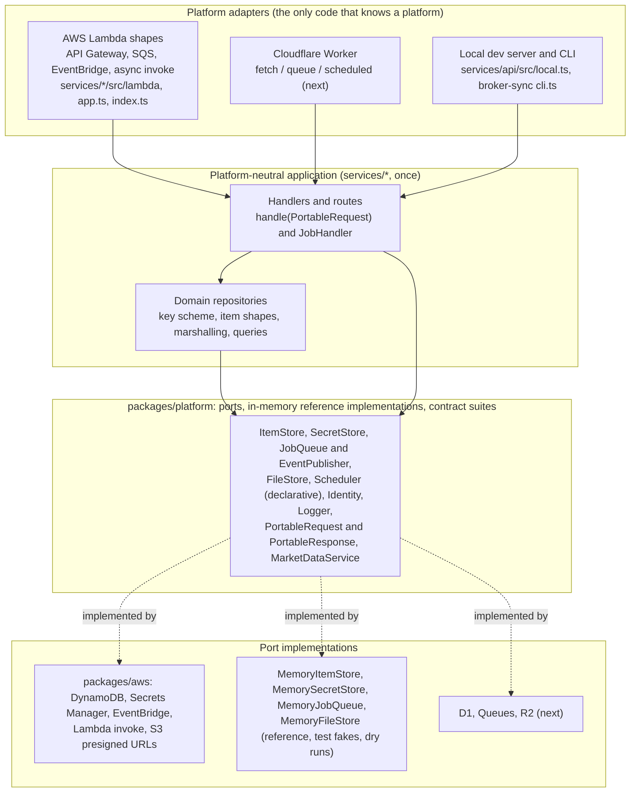
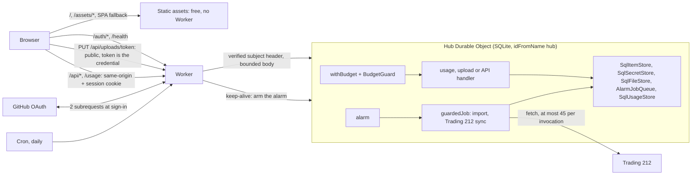
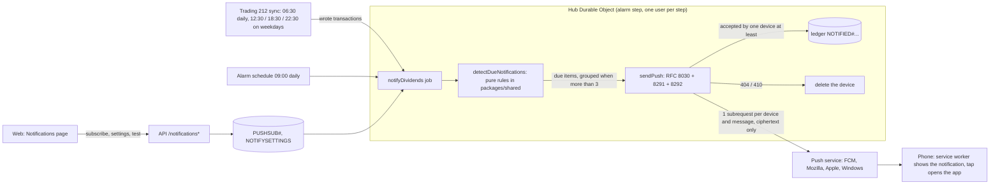

# Architecture & cross-team contracts

Source of truth for conventions shared between `web/`, `services/*`, and `infra/`.
Domain types, API shapes, DynamoDB keys and event schemas live in code in
[`packages/shared/src`](../packages/shared/src) — this document covers everything else.

## Overview



Every SQS queue has a DLQ (`maxReceiveCount = 3`). SQS-triggered Lambdas use
`ReportBatchItemFailures` (partial batch responses) and must be idempotent.

## Naming

`{app}-{component}-{env}` with `app = portfolio-tracker`, `env ∈ {local, dev, prod}`.

| Resource | Name |
|---|---|
| DynamoDB table | `portfolio-tracker-{env}` (PK/SK strings, PAY_PER_REQUEST) |
| Imports bucket | `portfolio-tracker-imports-{env}-{accountId}` (`portfolio-tracker-imports-local` locally) |
| Custom event bus | `portfolio-tracker-{env}` |
| Ingest queue / DLQ | `portfolio-tracker-ingest-{env}` / `…-ingest-dlq-{env}` |
| Enrich queue / DLQ | `portfolio-tracker-enrich-{env}` / `…-enrich-dlq-{env}` |
| Lambdas | `portfolio-tracker-api-{env}`, `…-ingest-{env}`, `…-prices-refresh-{env}`, `…-prices-enrich-{env}` |
| SSM params | `/portfolio-tracker/{env}/<provider>-api-key` (SecureString) |

## Environment variables (all Lambdas)

| Var | Used by | Notes |
|---|---|---|
| `TABLE_NAME` | all | |
| `EVENT_BUS_NAME` | api, ingest, prices | |
| `IMPORT_BUCKET` | api, ingest | |
| `BASE_CURRENCY` | api, prices | default `EUR` |
| `AUTH_MODE` | api | `cognito` (default; JWT `sub` required, else 401) or `demo` (local dev/tests only) — see [Authentication](#authentication) |
| `DEMO_USER_ID` | api | default `demo`; only used with `AUTH_MODE=demo` |
| `CORS_ALLOWED_ORIGIN` | api | |
| `LOG_LEVEL` | all | default `INFO` |
| `MARKET_DATA_PROVIDER` | prices | `mock` or a real provider id (see services/prices README) |
| `*_API_KEY_PARAM` | prices | SSM parameter name(s) holding provider API keys |
| `BROKER_SECRET_PREFIX` | api, broker-sync | Secrets Manager prefix of the per-user Trading 212 credentials (see "Trading 212 sync") |
| `BROKER_SYNC_FUNCTION` | api | name of the broker-sync Lambda; unset locally (sync runs in-process) |
| `AWS_ENDPOINT_URL` | all (local only) | `http://localhost:4566` (LocalStack); both AWS SDK v3 and boto3 honour it |

## Build artifacts (consumed by Terraform)

| Service | Command | Artifact | Handler | Runtime |
|---|---|---|---|---|
| `services/api` | `pnpm --filter @portfolio/api package` | `services/api/dist/api.zip` | `index.handler` | nodejs22.x, arm64 |
| `services/ingest` | `pnpm --filter @portfolio/ingest package` | `services/ingest/dist/ingest.zip` | `index.handler` | nodejs22.x, arm64 |
| `services/broker-sync` | `pnpm --filter @portfolio/broker-sync package` | `services/broker-sync/dist/broker-sync.zip` | `index.handler` | nodejs22.x, arm64 |
| `services/prices` | `services/prices/scripts/package.sh` | `services/prices/dist/prices.zip` | `prices.handlers.scheduled_refresh` / `prices.handlers.on_transactions_changed` | python3.12, arm64 |

TS bundles: esbuild, ESM (`index.mjs`), `--platform=node --target=node22`, AWS SDK v3 **bundled** (pinned version; the presign fix `requestChecksumCalculation` needs a recent SDK).

## Symbols

Canonical symbols are Yahoo-style: US tickers bare (`AAPL`), exchange suffix otherwise
(`ASML.AS` Euronext Amsterdam, `SAP.DE` XETRA, `MC.PA` Paris, `VWRL.AS`), crypto `BTC-EUR`.
Market-data adapters map canonical ↔ provider symbols.

## CSV import format

Header (case-insensitive, any order): `date,type,symbol,quantity,price,fee,currency[,note][,fxRate]`.
`fxRate` = units of `currency` per 1 EUR as applied by the broker (optional; ECB fixing used when empty).
Validated by `csvRowSchema`. Max 1 MB / 5000 rows. **All-or-nothing**: if any row fails validation
or the import would oversell a position, nothing is written and the import is `FAILED` with
row-level errors. Transaction ids from imports are deterministic (`{importId}-{rowNumber}`) so
SQS redelivery is idempotent.

## API & item conventions

- HTTP status: `200` reads, `201` POST create (body = created resource), `204` DELETE (no body),
  `400 VALIDATION_ERROR`, `404 NOT_FOUND`, `422 UNPROCESSABLE` (e.g. oversell), `503 FX_UNAVAILABLE`, `500 INTERNAL`.
- Import `errors[].row`: 1-based CSV data row (header excluded); `0` = file-level error (size, header, encoding).
- Same-day ordering: `buildPositions` orders by `date`, then `createdAt`. Writers must make `createdAt`
  strictly increasing within a batch (ingest uses processing time + row number in ms).
- Registry items: `USERS` → `{ userId, createdAt, updatedAt }`; `TRACKED` → `TrackedTicker` (`currency` optional; written with
  `if_not_exists` / conditional puts so concurrent writers never clobber `createdAt`).
- Profile `country`: full English name (`United States`, `Netherlands`); `Global` for world funds/crypto.
  `sector`: free text from the provider, `Diversified` for broad ETFs.
- FX items (`LATEST` and `DAY#{date}`, entityType `FX` / `FX_DAY`): `rates` is a DynamoDB **map** (exception to
  "stored flat") and excludes the base currency. `FX_DAY` also stores `date`.
- Minor-unit quotes (`GBX`/`GBp`, LSE) are converted to the major currency (`GBP`, ÷100) by the prices
  service before writing, so every stored price/amount is in an ISO-4217 major currency.

## Local development

`docker compose up -d` starts LocalStack (dynamodb, s3, sqs, events, ssm). An init hook in
`infra/localstack/` creates the local table, bucket, bus, queues and an S3 → SQS notification
on the ingest queue (S3 *notification* shape locally vs. EventBridge shape in AWS — the ingest
handler accepts both). Then:

1. `pnpm --filter @portfolio/api seed` — demo user, transactions, profiles, 1y EOD prices, FX, dividend events.
2. `pnpm --filter @portfolio/api dev` — local HTTP server on `:3001` serving the same portable `handle(PortableRequest)` as the Lambda adapter (see [Platform ports](#platform-ports)).
3. `pnpm --filter @portfolio/ingest dev` — long-polls the local ingest queue and invokes the handler.
4. `pnpm --filter @portfolio/web dev` — Vite on `:5173`, proxies `/api/*` → `:3001` (prefix stripped).
5. Optional: `cd services/prices && python -m prices.local refresh` with `MARKET_DATA_PROVIDER=mock`.

## Portfolios

A user owns 1..`MAX_PORTFOLIOS` (20) portfolios, e.g. one per broker account. `default` ("Main portfolio")
is created on first `GET /portfolios`. Transactions live under `USER#{userId}` with sort key
`TXN#{portfolioId}#{date}#{id}`, so one portfolio is a `begins_with(TXN#{portfolioId}#)` query and the
combined view is `begins_with(TXN#)` — no GSI needed.

- Read endpoints take `?portfolioId=`; omitted or `all` = all portfolios combined (same symbol is merged).
- Writes (manual transactions, CSV imports) target one portfolio; oversell checks use that portfolio only.
- A symbol must have the same currency in every portfolio of a user, so the combined view never mixes currencies.
- Deleting a non-empty portfolio needs `?force=true` (cascades); the last portfolio cannot be deleted.
- All portfolios share the global base currency (EUR).
- The web header has a native `<select>` labelled **Scope** ("All portfolios", then one option per portfolio) plus a
  "Manage portfolios" button; it is deliberately not called "Portfolio" because the **Portfolio** navigation menu
  (Holdings, Transactions, …) sits next to it. While a page inside that menu is shown, the menu button stays named
  "Portfolio" and is described to screen readers by a visually hidden "(current section)" (`aria-describedby`),
  besides the visual active style.
- `TransactionsChanged` events carry `portfolioId`; the prices service ignores it (prices are per ticker).

## Currency conversion (base currency EUR)

Every monetary value in API responses is in the portfolio base currency (`DEFAULT_BASE_CURRENCY = 'EUR'`)
unless its field name ends in `Local`. Conversion is done only in `packages/shared` (`FxTimeline`):

| Amount | Rate used |
|---|---|
| BUY cost, SELL proceeds, DIVIDEND received | `transaction.fxRate` (broker-applied) → ECB fixing of the transaction date (previous business day on weekends/holidays) → latest rate |
| Market value, day change, upcoming dividends | latest rate (`FX#EUR` / `LATEST`) |
| Value history | ECB fixing of each day; `invested` = cost basis at purchase-date rates |

Realized P&L = proceeds at sell-date rate − average cost at purchase-date rates. `currencyEffect` = market value −
value at the cost-weighted purchase rates, i.e. the part of unrealized P&L caused by EUR moving against the
instrument currency. Daily fixings come from Frankfurter (ECB reference rates) and are stored as
`FX#EUR` / `DAY#{date}` items by the prices service (backfilled from `FX_HISTORY_START`).

## Known limitations

- Single demo user in local development and the GitHub Pages demo; deployed environments use Cognito users (see Authentication).

## Authentication

Deployed environments authenticate every API call with an Amazon Cognito user pool; local development and the
GitHub Pages demo run without login.

```
Browser (SPA)                         Cognito user pool                 API Gateway (HTTP API)        api Lambda
  SRP sign-in ───────────────────────► new password / TOTP challenge
  ◄──────────── ID + access + refresh tokens
  Authorization: Bearer <ID token> ─────────────────────────────────────► JWT authorizer (issuer + client id)
                                                                           └─ claims.sub ───────────────► resolveUserId()
```

- **Pool** (`infra/terraform/auth.tf`): self sign-up disabled (users are created with `admin-create-user`),
  email username, 12+ character password with upper/lower/number/symbol, **MFA `ON` with software-token (TOTP)
  only — SMS is not configured**, account recovery by verified email, advanced security off (cost), deletion
  protection in prod. App client: no secret, `ALLOW_USER_SRP_AUTH` + `ALLOW_REFRESH_TOKEN_AUTH`, 30-minute
  ID/access tokens, 30-day refresh token, token revocation on, user-existence errors hidden.
- **Fail closed.** `enable_auth` (Terraform) is `true` for `env=prod` when unset, must be chosen explicitly
  for other environments, and `false` is rejected for prod (`terraform_data.auth_guard` preconditions). With auth on the
  Lambda gets `AUTH_MODE=cognito`: `resolveUserId` (`services/api/src/lib/auth.ts`) requires
  `requestContext.authorizer.jwt.claims.sub` (also validated against `^[A-Za-z0-9._-]{1,128}$`) and answers
  `401 UNAUTHENTICATED` otherwise — evaluated before routing, so even unknown routes and `/health` need a token
  (CORS preflight is answered by API Gateway). An unset `AUTH_MODE` means `cognito`; unknown values fail at cold start.
  `AUTH_MODE=demo` (the `pnpm --filter @portfolio/api dev` default, tests) serves requests without claims as
  `DEMO_USER_ID`, and still honours a validated `sub` when present.
- **User isolation.** The user id is derived in exactly one place and handed to handlers as `RouteContext.userId`.
  DynamoDB keys (`USER#<sub>`) and S3 import keys (`imports/<sub>/<importId>.csv`) are built from it only; the
  request body and query string are never consulted (`services/api/src/auth.test.ts` proves it with two users
  across transactions, portfolios, imports and upload keys).
- **Web** (`web/src/features/auth/`): `amazon-cognito-identity-js` (SRP, the password is never sent). Screens:
  sign in, new-password challenge (first login with the temporary password), TOTP enrolment (QR code rendered locally
  as inline SVG + manual key; the secret never leaves the page), TOTP code entry, forgot password (emailed code).
  `AuthGate` guards every route; the API client sends `Authorization: Bearer <ID token>`, refreshes silently when
  the token expired (concurrent requests share one refresh) and the app signs out automatically on a `401`
  (clearing the React Query cache). Tokens: ID/access tokens in memory only; the refresh token + "last user" pointer in
  `localStorage` so reloads and new tabs stay signed in. Trade-off: localStorage is readable by any script on the
  origin, mitigated by the CloudFront CSP (`script-src 'self'`, `connect-src` limited to the API, S3 and
  `cognito-idp.<region>.amazonaws.com`), a 30-day lifetime and server-side revocation on sign-out; sessionStorage would
  force a full password + TOTP sign-in in every tab.
- **Build-time switches**: `VITE_AUTH_MODE=cognito|none`, `VITE_COGNITO_USER_POOL_ID`, `VITE_COGNITO_CLIENT_ID`,
  `VITE_COGNITO_REGION`. Mock mode (`pnpm dev:mock`, GitHub Pages) always runs with auth off. `VITE_AUTH_MODE=cognito`
  with missing settings renders an error screen instead of the app.
- **Local development**: LocalStack's free tier has no Cognito, so the local API runs `AUTH_MODE=demo` and the SPA
  with `VITE_AUTH_MODE=none`. There is deliberately no token-minting shim and no bypass in the deployed path.
- **Other services**: the ingest Lambda is event-driven and takes the user id from the S3 key written by the API.
  Any new API route must use `ctx.userId` and nothing else for identity; per-user data (e.g. secrets) must be keyed by it.
- **Existing demo data.** Environments that ran before auth stored everything under `USER#demo` (and
  `imports/demo/…`). A Cognito user has a new `sub`, so that data is not visible after switching; re-key it
  (copy the items to `USER#<sub>`) if it should be kept.

- Single demo user unless a JWT authorizer (Cognito) is enabled.

## Analytics

Read-only performance, risk and income analysis. The maths is pure and lives in `packages/shared`
(`analytics.ts` XIRR/TWR/risk/drawdown/beta/goal simulation, `analytics-income.ts` passive income and dividend
growth, `analytics-insights.ts` rules, `analytics-compute.ts` response builders, `analytics-api.ts` contract and
query schemas). The Lambda (`services/api/src/routes/analytics.ts`) loads transactions, quotes, FX, end-of-day
prices and dividend events and calls the same builders as the web demo's MSW handlers
(`web/src/mocks/analyticsHandlers.ts`), so the GitHub Pages demo shows real numbers. No new tables, IAM or
infrastructure: the paths are covered by the API Gateway `$default` route, and the data comes from the existing
`TXN#`, `QUOTE#LATEST`, `EOD#`, `DIV#`, `PROFILE` and `FX#` items.

| Endpoint (all accept `?portfolioId=`) | Content |
|---|---|
| `GET /analytics/summary` | IRR, TWR (+ annualised), passive income, top 5 day gainers/losers, insights |
| `GET /analytics/returns?period=year\|quarter\|month` | TWR per calendar period (+ IRR per year) |
| `GET /analytics/risk?benchmark=` | volatility, Sharpe, Sortino, max drawdown (+ dates), beta, correlation |
| `GET /analytics/benchmark?benchmark=&range=` | portfolio vs a benchmark ETF replayed with the same cash flows |
| `GET /analytics/dividend-growth` | year-over-year dividends by year, month and per share |
| `GET /analytics/goal?targetIncome=&…` | passive-income goal projection (cautious / base / optimistic) |

Malformed query parameters return `400 VALIDATION_ERROR` in the standard error envelope.

Definitions:

- **XIRR** solves Σ cf / (1+r)^(days/365) = 0 over dated cash flows (buys negative, sells, dividends and the
  terminal market value positive) with Newton's method and a bisection fallback; `null` without both signs.
  For less than a year of history the period return is shown instead of an annualised figure (`irrAnnualised`).
- **TWR** chains daily returns of the daily value history, removing buys and sells as external flows (dividends count
  as return). Sub-period (year/quarter/month) returns are chained from the same daily series.
- **Risk** uses weekday returns: annualised volatility (√252), Sharpe and Sortino against a constant 2.5% risk-free
  rate (`DEFAULT_RISK_FREE_RATE`), max drawdown from the wealth index, beta/correlation against the benchmark's daily
  returns. Fewer than `MIN_RISK_OBSERVATIONS` (20) returns yields `null` metrics.
- **Benchmark**: default `IWDA.AS` (also `VWRL.AS`) from the tracked end-of-day prices. Without prices the response
  has `benchmark.available = false` and a `message` instead of an error.
- **Passive income**: next 12 months = declared events (ex-date ahead × quantity) + estimated payments implied by the
  holding's payment frequency (1/2/4/12 per year from the gaps of its last payments), net of observed withholding tax.
  Yield on value = income / market value, yield on cost = income / cost basis.
- **Goal projection**: monthly simulation of the income run-rate; existing income grows at the dividend growth rate and
  each month the contribution (and reinvested dividends) buys income at the yield on new money. Cautious/optimistic
  shift growth by ∓2 points and the new-money yield by ∓0.5 points; `yearsToGoal` is `null` beyond the horizon.

Insight thresholds (`INSIGHT_THRESHOLDS`, a rule fires when the measure is strictly above, except dead weight):

| Rule | Threshold |
|---|---|
| Top holding | > 25% of portfolio value |
| Sector | > 40% (Diversified/unknown ignored) |
| Country | > 50% (Global/unknown ignored) |
| Single non-EUR currency | > 40% |
| Non-EUR share | > 50% |
| Dead weight | return below −15% and weight below 2% |
| Income concentration | one holding > 40% of forward income |

Web: dashboard widgets (`features/analytics/`) read `GET /analytics/summary`; insights can be dismissed for the
browser session (`sessionStorage`, per scope). `/analytics` is lazy-loaded and has tabs Returns, Risk, Benchmark,
Dividend growth and Income goal (`?tab=`); everything follows the active portfolio scope. Not investment advice.

**Scope with cash tracking and custom assets.** Return figures (IRR, TWR, returns by period, benchmark) measure the
*invested holdings*: only BUY, SELL and DIVIDEND transactions are flows, and the value they are measured against is the
market value of the holdings. DEPOSIT, WITHDRAWAL, FEE, INTEREST and SPLIT are ignored as flows (a split changes units,
not value; positions and value history still apply it), and the "since" date is the first investment transaction.
Cash balances and custom assets are therefore not part of these returns yet. A cash-inclusive IRR would use
`externalCashFlows()` (deposits/withdrawals for portfolios with cash tracking) against a terminal value that includes cash
and custom assets; that is a follow-up.


## Portfolio management

Cash, splits, categories with target allocation and rebalancing, custom assets, a watchlist, a dividend
withholding-tax helper and exports. Pure logic lives in `packages/shared` (`management.ts`, `rebalance.ts`,
contract and routes in `management-api.ts`); the API wiring is in `services/api/src/routes/{categories,assets,watchlist,rebalance,export}.ts`
with persistence in `management-repository.ts`; the web pages are `/rebalance`, `/assets`, `/watchlist` plus the
settings/export actions on `/transactions`.

### Transaction types

`TRANSACTION_TYPES` = `BUY | SELL | DIVIDEND | DEPOSIT | WITHDRAWAL | SPLIT | FEE | INTEREST`.

| Type | symbol | quantity | price | fee |
|---|---|---|---|---|
| `DEPOSIT`, `INTEREST` | `CASH.<ccy>` | amount | 1 | 0 |
| `WITHDRAWAL`, `FEE` (account fee) | `CASH.<ccy>` | amount | 1 | 0 |
| `SPLIT` | the held symbol | new shares per old share (`4` = 4:1, `0.1` = 1:10 reverse) | ignored (`0`) | 0 |

Validation (`transactionInputSchema`, CSV rows, API, ingest — all-or-nothing as before): a cash symbol is
`CASH.` + 3 letters and must match the transaction currency, `price > 0`, `fee` must be 0 for everything but
BUY/SELL/DIVIDEND, `CASH.*` and `CUSTOM:*` symbols cannot be traded. A split needs an open position and a ratio `> 0`
(`PortfolioError` → 422 / import row error).

### Cash tracking

Per-portfolio setting `trackCash` (default **off**: then the engine behaves exactly as before and cash movements
are ignored). When on, every transaction of the portfolio moves the cash balance of its own currency:
BUY `−(qty·price+fee)`, SELL/DIVIDEND `+(qty·price−fee)`, DEPOSIT/INTEREST `+amount`, WITHDRAWAL/FEE `−amount`
(`cashDelta`). `applyManagement` adds one `CASH.<ccy>` holding per currency (asset class `CASH`, sector `Cash`, valued at
the **latest** FX rate, cost = value so no P&L) to holdings, summary (`cashValue`, included in `totalValue`/`totalCost`),
allocation and history (`managementHistoryExtra`, daily FX). Interest and account fees are part of `totalReturn`
(`cashIncome`). Cash is allowed to go negative (no overdraft check). `externalCashFlows()` returns the money that
crossed the portfolio boundary for later XIRR/TWR work: DEPOSIT (+) / WITHDRAWAL (−) for cash-tracking portfolios,
BUY (+) / SELL and DIVIDEND (−) for the others, in EUR at the transaction's rate.

### Stock splits

`applyTransaction` multiplies the quantity by the ratio; total cost (local and base) is unchanged, so the average cost
per share divides by the ratio. The same split entered in several portfolios counts once in the combined view
(`dropDuplicateSplits`, key symbol+date+ratio). **Assumption:** provider EOD closes are *split-adjusted* (Yahoo-style:
history is restated as if the latest share basis always applied). `buildValueHistory` therefore values units held before
a later split at `units × ratio × adjusted close`, so the value line does not jump on the split date; the fallback
price (average cost) uses the same basis. Quotes/day change are current and need no adjustment. If a provider returns
unadjusted closes the history before the split would be understated.

### Categories and rebalancing

A portfolio has up to 20 categories (name, `#rrggbb`, target weight %; targets sum ≤ 100, the rest is "unallocated").
A holding (market symbol, `CASH.<ccy>`, `CUSTOM:<id>`) is in at most one category (assigning moves it).
`GET /allocation?by=category&portfolioId=` groups by category (+ "Uncategorized").
`calculateRebalance({ holdings, categories, mode, amount?, wholeUnits?, minTrade? })` is pure:
`buy-only` invests `amount` without selling, pro rata to each category's shortfall below target (scaled down when
the budget is short); `full` also sells what is above target and uses the proceeds plus optional new money for the buys. Targets are computed on `portfolio value + amount`;
within a category money is spread pro rata to current holding values. Cash and custom assets count towards their
category but are never traded. Result: trades per holding (units, price, value), per-category drift before/after
(percentage points and EUR), leftover cash (new money + proceeds − buys) and warnings (e.g. a category below target
with nothing buyable). `wholeUnits` floors units and tops up leftover cash with single units where a category is still furthest below target;
trades below `minTrade` are dropped.

### Custom assets

Real estate, savings, P2P loans, private equity: `CUSTOM:<assetId>` symbol (reserved prefix), own currency, `costBasis`,
optional `growthRate` %/year and a list of valuation points. Value on a date = latest valuation on or before it,
compounded at the growth rate for the days since (365-day year); 0 before the first valuation. Converted to EUR at the
latest rate, included in totals, allocation (`ASSET_CLASSES` gained `REAL_ESTATE` and `DEPOSIT`) and history. `CASH.*` and
`CUSTOM:*` are never written to `TRACKED` and never published in `TransactionsChanged` (`isMarketSymbol`,
`trackTickers`, `publishChange`, ingest), so the prices service never fetches them.

### Watchlist

Per user. `GET /watchlist` joins the symbols with `QUOTE`/`PROFILE` items (price, day change). `POST /watchlist`
stores the entry, registers the symbol in `TRACKED` and publishes the existing `TransactionsChanged` event with
`portfolioId: "watchlist"`; `services/prices` `on_transactions_changed` only reads `detail.symbols`, so no change was
needed there. A new symbol shows "Waiting for price…" until enrichment has run.

### Withholding tax helper

`PortfolioSettings.withholdingTaxRate` (%). The transaction form prefills a dividend's `fee` with
`withholdingFee(quantity, price, rate)` until the user edits it; the API stores only the resulting `fee`.

### Export

`GET /export/transactions[?portfolioId=]` answers `text/csv` with the importer's header (`transactionsToCsv`, round-trip
tested against the ingest parser). `GET /export/backup` answers one JSON document (`BackupResponse`: portfolios, settings,
transactions, categories + assignments, custom assets, watchlist; no secrets).

### Routes (`MANAGEMENT_ROUTES`)

`GET|PUT /portfolios/{id}/settings` · `GET|POST /portfolios/{id}/categories` · `PATCH|DELETE /portfolios/{id}/categories/{cid}` ·
`PUT /portfolios/{id}/categories/{cid}/holdings` · `GET /portfolios/{id}/rebalance?mode=&amount=&wholeUnits=&minTrade=` ·
`GET|POST /portfolios/{id}/assets` · `PATCH|DELETE /portfolios/{id}/assets/{aid}` · `PUT /portfolios/{id}/assets/{aid}/valuations` ·
`DELETE /portfolios/{id}/assets/{aid}/valuations/{date}` · `GET|POST /watchlist` · `DELETE /watchlist/{symbol}` ·
`GET /export/transactions` · `GET /export/backup`. A malformed or unknown `{id}` is a 404.

### DynamoDB items (single table, all under `PK = USER#{userId}`; keys in `managementKeys`)

| Entity | SK | entityType |
|---|---|---|
| Portfolio settings | `PSETTINGS#{portfolioId}` | `PORTFOLIO_SETTINGS` |
| Category | `CATEGORY#{portfolioId}#{categoryId}` | `CATEGORY` |
| Category assignment | `CATASSIGN#{portfolioId}#{symbol}` | `CATEGORY_ASSIGNMENT` |
| Custom asset | `ASSET#{portfolioId}#{assetId}` | `CUSTOM_ASSET` |
| Watchlist entry | `WATCH#{symbol}` | `WATCHLIST` |

Deleting a portfolio also removes its settings, categories, assignments and custom assets.

### Demo mode

The MSW mock (`web/src/mocks/management-db.ts`, `management-handlers.ts`) implements all of the above with the shared
calculators. The seed has cash tracking on in the main portfolio (deposits, withdrawal, interest, fee, 15% default
withholding), a 2-for-1 JNJ split, five categories whose targets drift from the holdings, three custom assets and a
three-symbol watchlist.

## Trading 212 sync

Automatic, **read-only** import of the owner's own Trading 212 account (Invest / Stocks ISA) into one portfolio.
Trading 212's API terms only allow access to the account holder's own account, so this is a single-owner feature,
not a multi-tenant one: every user stores one credential set and can only ever sync their own account. The browser
(and the GitHub Pages demo) never calls Trading 212; CI never receives real credentials (fixtures only).



### Endpoints (`packages/shared/src/broker.ts`, `api.ts`)

| Route | Behaviour |
|---|---|
| `GET /brokers/trading212?portfolioId=` | Connection status of one portfolio (`connected: false` when none). Never contains credentials. |
| `PUT /brokers/trading212` `{portfolioId, apiKey, apiSecret, environment}` | Calls Trading 212 `account/summary` once with the key; on success stores it in Secrets Manager under the caller's `userId` and records the connection → `204`. `422 T212_AUTH_REJECTED` for a rejected key, `409 BROKER_ALREADY_CONNECTED` when another portfolio of the user is connected (one credential set per user). The only place secrets are accepted; they are never logged or echoed. |
| `DELETE /brokers/trading212` | Deletes the secret and the state items → `204`. Imported transactions stay. |
| `POST /brokers/trading212/sync` `{portfolioId}` | Starts an asynchronous sync (Lambda `Event` invoke) → `202`. `404 NOT_CONNECTED` otherwise. |

All handlers use `ctx.userId` only (never identity from the body or query). Without the sync wired (`deps.broker`
absent) the routes answer `503 BROKER_UNAVAILABLE`.

### Data

| Entity | PK | SK | entityType |
|---|---|---|---|
| Broker sync state | `USER#{userId}` | `BROKER#trading212#{portfolioId}` | `BROKER_STATE` |

State: `status` (`CONNECTED` / `RUNNING` / `SUCCEEDED` / `FAILED`), `environment`, `accountCurrency`, `lastSyncAt`,
`lastSuccessAt`, `cursors` (newest processed timestamp per source), `counts`, `unmapped` (skipped instruments with a
reason), `warnings`, `lastError` (`CODE: message`, never credentials). `RUNNING` is an optimistic lock (conditional
update, taken over after 15 minutes).

Credentials: Secrets Manager secret `/portfolio-tracker/{env}/broker/trading212/{userId}` with
`{"apiKey","apiSecret","environment"}`. Terraform creates **no** secret or value (`infra/terraform/broker.tf`): the
sync Lambda may only `GetSecretValue` under that prefix; the API may create/put/delete/describe (never read) and
invoke the sync function. Synced transactions have deterministic ids (`t212-{orderId}-{fillId}`,
`t212-div-{reference}`, `t212-split-{ticker}_{epochMs}`) and `importId = trading212`.

### Sync run

1. Take the run lock; read credentials; `account/summary` (account currency).
2. Read orders, dividends and cash movements newest-first. First run: whole history. Later runs stop at the first
   page older than `watermark - 7 days` (re-writes are idempotent). `--full` / `{full:true}` rebuilds.
3. Map (below), then validate **before writing**: the merged transactions of the target portfolio must not oversell
   and a symbol must keep one currency across all portfolios of the user (`VALIDATION_FAILED`, nothing written, error
   recorded in the state). Only changed transactions are written; stored dividends are final unless `full`.
4. Emit one `TransactionsChanged` (`reason: IMPORTED`, affected symbols) so prices are enriched; update tracked
   tickers and the state. Deposits, withdrawals, fees and interest are **counted, not imported** (cash tracking is
   a separate feature).

Trading 212 rate limits (orders/dividends/transactions 20 requests/min, positions 1/s, instruments 1 per 50 s) are
honoured with `x-ratelimit-*` headers, jittered retries on 429/5xx and a request timeout. A first sync of a large
history therefore takes minutes (about 20 pages of 50 items per minute); the Lambda timeout is 15 minutes.

### Mapping rules

- **Orders:** filled `BUY`/`SELL` fills become BUY/SELL (price = fill price in the instrument currency, quantity
  absolute, fee = `walletImpact.taxes[]` converted to the instrument currency). Cancelled/unfilled orders are
  ignored. `GBX`/`ZAC`/`ILA` prices are divided by 100 and relabelled `GBP`/`ZAR`/`ILS`.
- **Dividends:** DIVIDEND with quantity = eligible shares, price = `grossAmountPerShare`, fee = withholding tax
  derived as gross − net (net converted at the rate of the nearest imported order of that currency, else the stored
  ECB rate). The same rate is stored as `fxRate`, so the EUR amount received equals the amount Trading 212 reports.
- **Corporate actions:** `SPIN_OFF` and other share distributions become a zero-cost BUY at the reported price. A
  stock split (a SELL of the old and a BUY of the new shares at the same instant, both at market price) becomes
  **one zero-cost BUY of the net share increase** (cost basis unchanged, average cost drops). Reverse splits and other
  fill types (`EQUITY_RIGHTS`, …) are skipped and listed as `UNSUPPORTED_FILL_*`.
- **FX convention:** Trading 212's `walletImpact.fxRate` (and the CSV "Exchange rate") is *instrument-currency units
  per 1 unit of account currency*, which for a EUR account is exactly our `Transaction.fxRate` convention. It is only
  stored when the account currency is EUR and the rate agrees with the trade amounts (within 5 %, direction-checked,
  GBX pence normalised); otherwise it is omitted and the ECB fixing applies.
- **Symbols:** `AAPL_US_EQ` → `AAPL`, `ASMLa_EQ` → `ASML.AS`, `VUSAl_EQ` → `VUSA.L`, `.DE`, `.PA`, `.MI`, … from the
  ticker shape, then instrument/exchange metadata (only fetched when needed), then the ISIN country (never IE/LU),
  and the result must have a currency that fits the venue. Share classes (`BRK/A`, `BF.B`) map to `BRK-A`, `BF-B`. A closed list of well-known renames that Trading 212 history
  still reports under the old ticker is applied (`FB` → `META`, `DAI.DE` → `MBG.DE`); an override bypasses it.
  `T212_SYMBOL_OVERRIDES` (JSON, ticker or ISIN → symbol) wins. **Nothing is guessed:** unmapped instruments are
  skipped and shown as `UNMAPPED` (CLI, state, web card).

### Errors

`T212_AUTH_REJECTED` (HTTP 401/403): "Trading 212 rejected the credentials. Check the key/secret, that the key has
the read scopes, that the environment (live/demo) matches, and — if the key has an IP allowlist — that this machine's
public IP is on it." Surfaced in the CLI, `lastError` and the web card, and never retried in a loop. Other codes:
`T212_RATE_LIMITED`, `T212_HTTP_ERROR`, `T212_NETWORK`, `T212_BAD_RESPONSE`, `NO_CREDENTIALS`, `VALIDATION_FAILED`.
A key without the `history:transactions` scope only loses the cash counts (warning). The key may optionally be
IP-restricted at Trading 212; leave it unrestricted for AWS Lambda (no fixed egress IP).

### Local CLI

```bash
# credentials: T212_API_KEY / T212_API_SECRET / T212_ENV, or the gitignored .env.trading212.local (T212_ENV_FILE overrides)
pnpm --filter @portfolio/broker-sync sync -- --whoami                    # public IPv4 only, no credentials sent
pnpm --filter @portfolio/broker-sync sync -- --dry-run                   # counts, mapped symbols, UNMAPPED list; no AWS, no writes
pnpm --filter @portfolio/broker-sync sync -- --user demo --portfolio trading-212 --reconcile   # real sync into LocalStack
```

`--reconcile` compares the open positions from `GET /equity/positions` with the positions replayed from the
imported transactions. Use `AWS_ENDPOINT_URL`, dummy AWS keys, `TABLE_NAME`, `EVENT_BUS_NAME` for LocalStack (the
compose file includes `secretsmanager` for connecting through the API locally).

### Trading 212 CSV preset

`convertTrading212Csv` (`packages/shared/src/broker-csv.ts`) turns a Trading 212 *History* export (`Action, Time
(UTC), ISIN, Ticker, …, Exchange rate, Total, …`) into this app's import CSV. The web CSV import detects the export
by its header and converts it in the browser, so the ingest service is unchanged. Trades and dividends are imported;
deposits, withdrawals, interest, card actions and conversions are counted as ignored. The export only has bare
tickers, so instruments are mapped by ISIN country and currency and the ambiguous ones (for example an EUR-quoted
instrument with a US ISIN) are listed as not imported: use the API sync for those. "Exchange rate" has the same
convention as the API's `walletImpact.fxRate` (instrument units per 1 unit of the account currency). That was verified
against the live API only; the CSV column itself could not be checked against a real export, so the converter keeps the
same sanity check (rate must agree with the row's amounts, otherwise it is dropped and the ECB fixing applies).

### Verified API behaviour (against a live account)

- `GET /equity/history/transactions` rejects `time` without `cursor` (HTTP 400), so there is no start-time filter:
  cash history is paged newest-first and cut off at the watermark like the other sources.
- Orders include `CANCELLED` ones without a fill; fills of sells carry a **negative** quantity; autoinvest orders are
  fractional; split and spin-off fills have `type` `STOCK_SPLIT` / `SPIN_OFF`.
- Dividends have no `tickerCurrency` in practice; the instrument currency is the currency of `grossAmountPerShare`.
- Live run on a EUR account with thousands of orders, hundreds of dividends and thousands of cash movements (first
  sync ≈ 8 minutes at the history rate limit; an incremental re-sync writes nothing and emits no event): the replayed positions matched
  `GET /equity/positions` for every open instrument (and every closed one replays to zero); `walletImpact.fxRate` is in
  the plausible range of instrument units per EUR for every USD/GBP fill (the instrument-vs-wallet amounts agree within
  5 %, one fill without usable FX data falls back to the ECB fixing); our EUR cost basis (fees included) is 0.14-0.15 %
  above Trading 212's `walletImpact.totalCost` for every open position, consistent with the 0.15 % currency-conversion fee, which
  Trading 212 appears not to count as cost; dividend withholding derived as gross − net clusters around 15 % (US treaty rate),
  with outliers only on cent-sized payments (rounding).

## Dividends page

`/dividends` is a dashboard (top to bottom): Yield and Dividends KPIs next to a Yield / payout chart; passive income
diversification; dividend safety (payment consistency); average annual growth next to future payments; dividends received over time next to
received by holding; calendar-month comparison of the last three years (`GET /analytics/dividend-growth`); and the payment
history (received and upcoming, collapsible). Every card has an info tip with the metric, source and assumptions, loading /
error (retry) / empty states, a chart text alternative and a "Show data table" disclosure. Everything follows the portfolio
scope (`?portfolioId=`, omitted or `all` = combined). Code: `web/src/features/dividends/`.

Data sources: `GET /dividends` (received, upcoming, monthly; the received cards group client-side by period and
granularity), `GET /analytics/dividend-growth` (calendar-month comparison), portfolio categories (`GET
/portfolios/{id}/categories`, single portfolio only, for "group by categories") and one new read endpoint:

`GET /dividends/overview[?portfolioId=]` → `DividendsOverviewResponse` (`packages/shared/src/dividends-overview.ts`, computed by the
pure `computeDividendsOverview`, route in `services/api/src/routes/dividends-overview.ts`, mocked by `web/src/mocks/dividendsOverviewHandlers.ts`;
same error envelope and scope rules as the other reads, no new infrastructure):

| Field | Meaning |
|---|---|
| `summary` | `forward12m` (= `passiveIncome.forward12m` of `/analytics/summary`), `declared`, `estimated`, `monthlyAverage`, `yieldOnValuePct`, `yieldOnCostPct`, `last12m` (net received in the last 12 months) and `growthVsLast12mPct` (forward vs `last12m`; null without `last12m`) |
| `holdings[]` | current holdings that pay or paid dividends, largest forward income first: forward income (declared / estimated / share), yield on value and on cost, market value, cost basis, net received (12 months / ever), `growthPct` (per-share CAGR) and `consistency` |
| `futureMonths[]` | 12 months from the current one: declared and estimated income per month; sums to `summary.forward12m`. Declared income sits in the pay month (or ex-month without pay date). Estimated income takes the schedule of the last payment shifted a year (`paymentsPerYear` slots), minus the slots announced events fill. The window is 365 days, so a payment in this calendar month next year counts in the first bar |

Forward income is declared plus estimated, net of the withholding tax seen in the last 12 months (see `calculatePassiveIncome`).
EODHD dividend events cover about two years of history, which is why the per-holding history merges the received payments with
the stored *past* events (an event within 20 days of a received payment is the same payment).

### Dividend safety score (payment consistency)

Replaces a proprietary dividend rating (which needs company fundamentals we do not have). It is computed only from the
user's own data and is **not a forecast or advice**. Per holding, from its payment history (received payments plus past events,
one point per payment date; per-share amounts in the paying currency) it adds up four parts to 0-100:

| Part | Max | Rule |
|---|---|---|
| History | 30 | 6 points for each of the last 5 years (12-month periods counted back from today) with at least one payment |
| Regularity | 30 | gaps between payments: 30 when their variation (standard deviation ÷ mean) is ≤ 0.05, falling linearly to 0 at 0.5; a wait since the last payment longer than 1.5 × the median gap counts as one more gap; 15 with fewer than 3 payments |
| Cuts | 25 | 25 − 13 per cut (floor 0). A *year* is a block of consecutive payments (as many as the implied payments per year: 1, 2, 4 or 12, newest block first, at most 6); a cut is a year whose per-share total is more than 0.5 % below the year before; 12 without two full years |
| Growth | 15 | 3 points for each consecutive year (newest first, at most 5) whose per-share total is more than 0.5 % above the year before |

Badges: **Reliable** ≥ 70, **OK** 40-69, **Irregular** < 40, **New** with fewer than 2 known payments (no score). The score is
rounded per part so the parts add up exactly. `growthPct` is the compound growth of the per-share total over the same full
years. Special dividends count as regular payments. The constants are exported from `dividends-overview.ts` (`CONSISTENCY_*`)
and used by the help text on the page; known-value tests pin the behaviour.

Demo mode: the MSW handler runs `computeDividendsOverview` on the demo fixtures. The fixtures give the dividend payers
different growth, a cut, an irregular payer and a recent payer, plus ~2.5 years of past dividend events, so every card shows
meaningful data.
## Growth

First and default tab of `/analytics` (`?tab=growth`): benchmark chips, portfolio value, cumulative performance, monthly
return dynamics and the return per holding. Pure maths in `packages/shared/src/growth.ts` (contract and query schemas in
`growth-api.ts`); routes in `services/api/src/routes/growth.ts`; the demo's MSW handlers (`web/src/mocks/growthHandlers.ts`)
call the same functions on the demo data. No new tables, IAM or infrastructure.

| Endpoint (accept `?portfolioId=`) | Content |
|---|---|
| `GET /analytics/growth?range=&benchmarks=a,b,c` | `period` (start/end value, invested, gain, TWR), `series` (value, invested, cumulative return %), one aligned `benchmarks[]` series each (`available:false` + `message` without prices), `headline`, `monthly` returns, selectable benchmark `options` |
| `GET /analytics/holdings-performance?range=` | return % and gain per open holding, best first |

`range` = `7D 1M 3M 6M YTD 1Y 5Y ALL` (default `1Y`; never before the first investment). `benchmarks` holds at most 3 symbols;
omitted = `IWDA.AS`, empty = none; an invalid list is a `400 VALIDATION_ERROR`, an unknown portfolio a `404`. Series are
downsampled to at most 400 points.

- **Portfolio value** = market value plus dividends received since the start of the range; **invested** = start value plus
  net purchases (BUY/SELL only; deposits, withdrawals, fees, interest and splits are no flows, see "Scope with cash tracking").
- **Benchmarks** are replayed with identical cash flows (`replay` of `/analytics/benchmark`): the start value buys the
  benchmark on day one, later flows trade it that day. The benchmark shows price only. Missing symbols never fail the page.
- **Cumulative return** = chained daily TWR rebased to 0 % on the first day; benchmarks are their price return rebased the same way.
- **Headline** = first benchmark with data: gain minus the gain of the same money in the benchmark (€) and the return
  difference in percentage points.
- **Monthly returns** = TWR per calendar month (current month so far); web: last 12 months or one calendar year.
- **Holdings** = TWR plus money made per open holding from the range start, or from the first purchase when bought inside the
  range (`sincePurchase`); closed positions and positions bought on the last day are omitted.
- FX: transactions at their own rate, value history at the ECB fixing of each day (see "Currency conversion").
- **Benchmark options**: tracked symbols (held, watchlist, selected) with end-of-day data first, then five suggested index
  ETFs (`BENCHMARK_SUGGESTIONS`) that work once tracked: add the symbol to the Watchlist. The selection lives in `?benchmarks=`
  and `sessionStorage` (`pt-growth-benchmarks`).
## Metrics

Analytics → Metrics (`/analytics?tab=metrics`, the first tab) shows five cards for the selected portfolio scope next to
one benchmark ("the market", `IWDA.AS` or `VWRL.AS`): lifetime TWR, portfolio P/E, volatility/beta, Sharpe and Sortino.
One read serves all of them: `GET /analytics/metrics?benchmark=` (+ `?portfolioId=`; omitted or `all` = combined). `400
VALIDATION_ERROR` for a malformed benchmark/scope, `404` for an unknown portfolio. The maths reuses the existing
calculators (`chainReturns`, `riskStats`, `betaVs`, `benchmarkPrices`); the new pure code is `packages/shared/src/metrics.ts`
(P/E, verdict bands, gauge geometry, `riskFigures`), the response builder `metrics-compute.ts` and the contract
`metrics-api.ts`. Lambda route: `services/api/src/routes/metrics.ts`; demo: the MSW handler in `web/src/mocks/analyticsHandlers.ts`
runs the same builder on the fixtures. No new tables, IAM or infrastructure.

Response: `{ baseCurrency, riskFreeRatePct, benchmark: {symbol, available, message?}, twr, pe, volatility, sharpe, sortino }`.

| Field | Content |
|---|---|
| `twr` | `portfolio` lifetime TWR % (first investment transaction → today, dividends included), `benchmark` price return % over its window, `difference` in percentage points, `from`/`to`/`days`, `benchmarkFrom` (later than `from` when the benchmark's history starts after your first buy; the portfolio is then measured over the same shorter window) |
| `pe` | `portfolio` P/E, `benchmark` P/E (only when the benchmark's profile has one; ETFs usually do not), `coverage` (`includedStocks`, `totalStocks`, `nonStockHoldings`, values, `portfolioSharePct`, `stockSharePct`), `excluded[]` (`symbol`, `name`, `reason` `missing`\|`non-positive`, `marketValue`), `asOf` (oldest `fundamentalsAsOf` among the covered stocks) |
| `volatility` | `portfolio`/`benchmark` annualised volatility %, `beta`, `verdict`, `observations`, `benchmarkObservations` |
| `sharpe`, `sortino` | `portfolio`, `benchmark`, `verdict`, `observations`, `benchmarkObservations` |

A benchmark without end-of-day prices is not an error: `benchmark.available` is `false` with a `message` and every benchmark
figure is `null`. Verdicts are `{ level, label, tone }` objects, `null` when there is no figure.

Definitions:

- **Portfolio and benchmark are measured identically.** Volatility, Sharpe and Sortino of the benchmark come from its own
  end-of-day prices (converted to EUR like the holdings, carried over gaps) through the same `riskFigures` function and the
  same window (daily returns from the day before the portfolio's first return, collapsed to weekdays, ×√252, 2.5 %
  risk-free rate = `DEFAULT_RISK_FREE_RATE`). Fewer than `MIN_RISK_OBSERVATIONS` (20) returns → `null`; fewer than
  `SHORT_HISTORY_OBSERVATIONS` (60) → figures are shown with a "short history" warning. Ratios are rounded to 3 decimals.
  Benchmark returns are price returns (no dividends). Only BUY, SELL and DIVIDEND are investment flows (see the scope note
  under Analytics), so cash movements and splits do not distort TWR or risk.
- **Portfolio P/E** is the weighted harmonic mean of trailing-twelve-month P/Es: `Σ value ÷ Σ (value ÷ P/E)` = total value of the
  covered stocks ÷ the earnings they represent (1 ÷ the value-weighted earnings yield). Two equal holdings with P/E 10 and 40
  give 16, not the arithmetic 25. Only holdings with asset class `STOCK` count (ETFs, crypto, bonds, funds, custom assets and
  cash are excluded); a stock whose profile has no `peRatio`, or one that is not positive, is left out and listed under `excluded`.
  Coverage is always reported: "based on 4 of 5 stocks, 26 % of portfolio value" (`portfolioSharePct` = covered value ÷ market
  value of all invested holdings, i.e. the positions built from transactions, without cash balances and custom assets; `stockSharePct` = covered value ÷ value of the stocks held). With no covered stock the UI shows an empty
  state explaining that earnings data is missing (or that the portfolio has no individual stocks).
- **Verdict bands** (inclusive at the upper bound of the middle band): beta below 0.9 *lower than the market*, 0.9–1.1 *in line
  with the market*, above 1.1 *higher than the market*. Sharpe below 0 *poor*, below 1 *requires attention*, 1–2 *good*, above 2
  *very good*. Sortino below 0 *poor*, below 1 *requires attention*, 1–2 *acceptable*, above 2 *good*. Bands are applied to the
  rounded value that is returned and shown. The volatility verdict follows beta, the gauge shows annualised volatility.
- **Gauges** are accessible: markers carry their values as text, a native `<meter>` exposes the portfolio value and a text
  equivalent lists both values, the scale and the verdict. Scales: P/E 0×–70×, Sharpe −1…3, Sortino −1…4, volatility 0 %…≥ 40 %
  (widened in steps of 10 to fit every marker); values outside a scale pin to its end.

Data: `InstrumentProfile` gets the optional `peRatio` (trailing twelve months) and `fundamentalsAsOf` (`YYYY-MM-DD` it was
fetched). The prices service writes both on the `PROFILE` item only when present (`peRatio` as a number, `fundamentalsAsOf`
as a string); a profile without them is treated as "no earnings data". Alpha Vantage `OVERVIEW` already returns `PERatio`;
`"None"`, `"-"`, `"0"`, negative or unparsable values count as absent. It is read from the same call that fills the profile
today, so there is no extra provider traffic (free tier: 25 calls/day). Profiles are only written during enrichment of a
*new* symbol, so existing profiles get a P/E when they are re-enriched (delete the `PROFILE` item of a symbol to have it
fetched again); until then the card says earnings data is missing. Values older than 90 days are flagged in the card. The mock
provider returns deterministic P/Es for stocks only; ETFs and crypto never have one. Twelve Data and EODHD profiles carry no P/E.
## Goals

A saved, fuller version of the Analytics "Income goal" tab: one goal per user and scope (a portfolio or all portfolios
combined) that is loaded on page open and **recalculated with today's data**, so the projection follows the portfolio.
Pure maths in `packages/shared/src/goals.ts`, contract/schemas/keys in `goals-api.ts`, API in
`services/api/src/routes/goals.ts` (persistence via `ManagementRepository.getGoal/putGoal/deleteGoal`), web in
`web/src/features/goals/` + `pages/GoalsPage.tsx` (`/goals`, lazy-loaded). The GitHub Pages demo uses the same shared
functions through MSW (`web/src/mocks/goals-handlers.ts`, goals in memory). No new infrastructure or IAM.

| Endpoint (all accept `?portfolioId=`, omitted/`all` = combined) | Content |
|---|---|
| `GET /goals` | `{ saved, updatedAt, settings, projection }`: the saved settings (or the defaults) and today's projection |
| `PUT /goals` | body = settings; validates, saves, returns the same as GET |
| `DELETE /goals` | removes the saved goal (`204`, also when none exists) |
| `POST /goals/calculate` | body = settings; stateless preview `{ settings, projection }`, nothing is written |

Errors use the standard envelope: `400 VALIDATION_ERROR` (zod issues with `path` in `details`), `404` for an unknown portfolio.

**Item** (`PK = USER#{userId}`, `SK = GOAL#{portfolioId|all}`, `entityType = GOAL`; keys in `goalKeys`): `GoalSettings`
(`goalType` `value|income`, `targetAmount`, `targetYear`, `monthlyContribution`, `priceReturnPct`, `startYieldPct`
(null = the portfolio's current forward yield), `dividendGrowthPct`, `yieldOnNewMoneyPct`, `inflationPct`,
`adjustForInflation`, `reinvestDividends`) plus `userId`, `portfolioId`, `createdAt`, `updatedAt`. Identity comes from
`ctx.userId` and the validated scope only. Deleting a portfolio removes its goal with the rest of its management data
(`deletePortfolioData`); the `all` goal stays. A stored target year that has passed moves to next year; unreadable items
fall back to the defaults.

**Validation** (`goalSettingsSchemaFor(today)`): target > 0 and ≤ 1e9, target year between next year and 60 years ahead,
contribution 0..1e6, every rate 0..30 %.

**Model** (monthly steps, year-end points, rows from "today" up to the target year + 20 years, at most 60):

- Starting value, forward income and yield come from the Analytics calculators (`computeGoal`: `calculatePortfolio`,
  passive income), so the scope rules are the same as Analytics (cash balances, custom assets and non-investment flows
  are not part of the holdings; splits are applied to positions only).
- *Value goal*: value × (1+price return)^(1/12) + contribution + (when reinvesting) the dividends of the month; the
  dividend run-rate grows at the dividend growth rate, and contributions/reinvested dividends buy extra income at the yield
  on new money.
- *Income goal*: the Analytics income projection (`projectIncomeGoal`'s unshifted scenario), so results equal the
  Analytics Goal tab for equivalent inputs (tested; with inflation off "Your plan" equals its Base scenario). Price return
  plays no role here.
- *Inflation*: the goal in year *n* is `target × (1+inflation)^n` when "adjust goal for inflation" is on (default 2 %);
  contributions stay flat nominal amounts.
- *Scenarios*: **Your plan** = the entered parameters; **Safe** = −2 pp price return, −1 pp dividend growth, −0.5 pp yield
  on new money; **Alternative** = +2 / +1 / +0.5 pp (`GOAL_SCENARIO_ADJUSTMENTS`, rates never below 0). Dividend cuts are
  not modelled.
- *Reached*: the first whole year in which a scenario's value/income is at least the (inflated) goal; the verdict follows
  "Your plan" (on time, years early/later, or not within the horizon). `earlierScenario` is the other scenario that beats
  the plan.
- *Required contribution*: the smallest whole-euro monthly amount (bisection on 0..€ 1.000.000, `solveRequiredContribution`)
  for which "Your plan" reaches the goal in the target year; `none-needed` when 0 suffices, `unattainable` beyond the cap.

Web: form (goal type, target, achieve-by year, monthly contribution, expandable "Returns and inflation") next to the
results (verdict, chart with data-table alternative, insight chips, year-by-year `<table>` with CSV download, parameters
panel). While the form is valid and unsaved for 400 ms the page shows a stateless `POST /goals/calculate` preview.
Not investment advice.
## Calendar

Ex-dividend and payment dates, earnings reports, stock splits and other share adjustments of the user's holdings (and,
optionally, the watchlist), on `/calendar` (month grid or list) and as an `.ics` download. The logic is pure and lives in
`packages/shared` (`calendar.ts` merging and totals, `calendar-api.ts` contract and query schema, `calendar-ics.ts`
iCalendar writer); `services/api/src/routes/calendar.ts` and the MSW demo handlers (`web/src/mocks/calendarHandlers.ts`) load
their data and call the same `buildCalendar`, so the GitHub Pages demo shows what a deployment shows.



### Event types and statuses

| `CalendarEventType` | Date | Source |
|---|---|---|
| `EX_DIVIDEND` | ex-date | stored `DIV#` item (estimated ones: pay date minus the usual ex-to-pay lag) |
| `DIVIDEND_PAY` | pay date (the ex-date when no pay date is known) | stored `DIV#` item, your own `DIVIDEND` transaction (`PAID`), or a projection (`ESTIMATED`) |
| `EARNINGS` | report date; fiscal period end, EPS estimate, time of day `BMO`/`AMC`/`unknown` when the source has them | stored `EARN#` item |
| `SPLIT` | ex-split date, ratio `toFactor`-for-`fromFactor` (forward and reverse) | stored `SPLIT#` item, or your own `SPLIT` transaction |
| `CORPORATE_ACTION` | the date of an irregular share adjustment | a `SPLIT#` item whose ratio is not a plain split |

`status`: `CONFIRMED` (announced by a provider, or recorded by you; earnings dates are the provider's *expected* dates and
count as `ESTIMATED` until the day has passed), `ESTIMATED` (a projection) and `PAID` (a dividend you received). Every event
has `origin` `HOLDING` (the symbol is in your transactions) or `WATCHLIST`, a stable `id` (also the `.ics` UID) and a `source`.

**What is and is not covered.** Splits and reverse splits with whole-number ratios (`calendarSplitKind`: both factors whole and
at most 20, or 1-for-N up to 100) are `SPLIT`. EODHD also records stock dividends, spin-off adjustments and reorganisations in
its split feed with ratios such as 104/100 or 1281/1000; those are shown as `CORPORATE_ACTION` ("Share adjustment …").
**Mergers, spin-offs as such, symbol changes and rights issues are not available from any free source and are not shown.**
Earnings dates are US-listed companies only: `ASML.AS`, `SAP.DE`, … get none (Alpha Vantage lists the US ADR `ASML`, which is
a different instrument and is deliberately not mapped). The same notes ship in every response as `coverage` and in the page's
"What does this calendar cover?" section.

### Free data sources (researched 15 Oct 2026)

| Candidate | Result |
|---|---|
| **Alpha Vantage `EARNINGS_CALENDAR`** (used) | One CSV call returns every company's expected report for `horizon=3month\|6month\|12month` (`symbol,name,reportDate,fiscalDateEnding,estimate,currency,timeOfTheDay`; the live `demo` key returned ~4,600 rows for 3 months, `timeOfTheDay` is `pre-market`, `post-market` or empty, `estimate` often empty). Free tier: 25 API requests/day ("Support" FAQ), shared with the profile enrichment that already uses it. One call a day serves every tracked ticker. US-listed only. Throttling comes back as HTTP 200 with a JSON `Information`/`Note` body, which the parser turns into a rate-limit error. |
| **EODHD `/splits/{symbol}`** (used) and `/div/{symbol}` (re-used) | Both are in the Free plan (history limited to 1 year), 1 API call each. Free plan: **20 calls/day and 20/min** (pricing page); the same key also serves the quote refresh and enrichment. Split ratio is `"new/old"` (`"4.000000/1.000000"`). Unverified: whether the free plan returns future-dated splits for every exchange; the stored ones are whatever the feed lists. |
| EODHD calendar API (`/calendar/earnings`, `/calendar/splits`, …) | **Not free**: "Corporate calendar" is included from the Fundamentals plan up (pricing page). |
| Twelve Data `/earnings_calendar`, `/splits`, `/splits_calendar`, `/dividends_calendar` | Splits and dividend calendars need the **Grow plan** (docs); `earnings_calendar` costs 40 credits per request against the Basic plan's 8 credits/minute, and Basic data may not be displayed to users. Not used. |
| Finnhub `/calendar/earnings` | Free, but US-only (`international` is not free), a one-month window on the free tier, and needs a fourth API key. `/stock/split` and `/stock/dividend` are **premium**. Not used. |

### Quota design

Both budgets are **per UTC day, persisted in DynamoDB** (`CALENDAR` / `BUDGET#{provider}`: `{day, used}`, spent with a conditional
`UpdateItem`), so Lambda retries, manual runs and concurrent invocations cannot overspend a provider's free tier.

* **Alpha Vantage**: `CALENDAR_ALPHAVANTAGE_DAILY_CALLS` (default 1). The call is skipped when no tracked symbol is a US ticker.
  A failed call is not retried the same day (the budget stays spent); the next daily run tries again.
* **EODHD**: `CALENDAR_EODHD_DAILY_CALLS` (default 8 of the 20): a symbol check costs 2 calls (splits + dividends; 1 with
  `CALENDAR_REFRESH_DIVIDENDS=false`), so about 4 symbols a day. Symbols are checked **round-robin, oldest first**: each
  symbol's `CAL#STATE` marker holds `splitsCheckedAt`; a symbol is due again after `CALENDAR_RECHECK_DAYS` (default 7) and a
  symbol whose last attempt failed (`splitsFailedAt`) goes to the back of the queue so one broken ticker cannot starve the
  rest. A provider rate limit (HTTP 402/429) stops the run; other per-symbol failures are logged, counted and skipped.
  Crypto is never checked. With ~30 tracked symbols every symbol is revisited about every 8 days.
* Re-running is idempotent: items are keyed by symbol and date, and report dates the provider no longer lists (the company
  rescheduled) are removed for the symbols that are in the feed. Past reports stay as history.
* Dividends: the enrichment only fetched dividends once per new symbol, so the calendar refresh re-checks them within the
  same EODHD budget; otherwise newly declared dividends would never appear.

`MARKET_DATA_PROVIDER=mock` swaps all of this for a deterministic offline source (`MockCalendarSource`: report dates 5–60 days
out for US tickers, an upcoming split for `NVDA` and `AAPL`, the mock market's dividends) and no budgets.

### DynamoDB items (single table, written by `services/prices/prices/calendar_handlers.py`)

| Entity | PK | SK | entityType | Fields |
|---|---|---|---|---|
| Earnings event | `TICKER#{symbol}` | `EARN#{date}` | `EARNINGS_EVENT` | `symbol`, `date`, `name?`, `fiscalPeriodEnd?`, `epsEstimate?` (N), `currency?`, `timeOfDay` (`BMO`/`AMC`/`unknown`), `source`, `updatedAt` |
| Split event | `TICKER#{symbol}` | `SPLIT#{date}` | `SPLIT_EVENT` | `symbol`, `date`, `fromFactor` (N), `toFactor` (N), `source`, `updatedAt` |
| Symbol marker | `TICKER#{symbol}` | `CAL#STATE` | `CALENDAR_STATE` | `splitsCheckedAt`, `dividendsCheckedAt`, `splitsFailedAt` |
| Daily budget | `CALENDAR` | `BUDGET#{provider}` | `CALENDAR_BUDGET` | `day`, `used` |

Dividend events stay `DIV#{exDate}` (`DIVIDEND_EVENT`). Keys for the first two live in `calendarKeys`
(`packages/shared/src/calendar.ts`) and `prices/calendar_models.py`. All symbols come from the `TRACKED` registry, which holds
holdings and watchlist symbols alike.

### Building the calendar (`buildCalendar`)

* **Dividends** (declared): one `EX_DIVIDEND` and, with a pay date, one `DIVIDEND_PAY` per stored event. For symbols you hold the
  quantity is the position **the day before the ex-date** (the current position for a future ex-date); with no shares at that
  time the event is skipped. The expected amount is `quantity × per share`, converted at the latest FX rate for future dates
  and at the ex-date fixing for past ones (see "Currency conversion"), **net of the withholding tax observed over the last 12
  months** — the rule of `calculatePassiveIncome`, so event amounts add up to the analytics figures (the existing Dividends
  page shows gross upcoming amounts). Exactly one event of a dividend carries `countsAsIncome` (the pay event, else the ex
  event); chart and month totals count only those.
* **Paid**: a `DIVIDEND` transaction within 7 days of a declared pay date (60 days after the ex-date when there is no pay
  date) turns that pay event into `PAID` with the amount actually received (net, at the transaction's FX rate); other
  dividend transactions appear as stand-alone `PAID` events.
* **Estimated**: for a holding that paid within the last 12 months, the payments its history implies that no declared event
  covers (`paymentsPerYear` frequency, latest per-share amount, projected by whole intervals from the last payment, within the
  next 12 months). They are `ESTIMATED` pay events plus, when stored events show the usual ex-to-pay lag, estimated ex-dates.
* **Splits**: your own `SPLIT` transactions win over a stored split within 3 days; the same split in several portfolios counts once.
* **Summary** (`annualIncome`, `monthlyAverage`, `dailyAverage`, `yieldPct`, `yieldOnCostPct`, `declared`, `estimated`) is
  `calculatePassiveIncome` of the holdings (÷ 12, ÷ 365); **monthly** has 12 months starting 3 months before the current one with
  `paid`/`declared`/`estimated`/`total` per month (by pay date). Neither depends on the query's filters. They can differ slightly
  from each other because the summary windows declared events by ex-date and the chart buckets by pay date.

### Endpoints

| Route (both accept `?portfolioId=`, omitted or `all` = combined) | Behaviour |
|---|---|
| `GET /calendar?from=&to=&types=&status=&scope=` | `{ baseCurrency, from, to, events[], summary, monthly[], coverage: { earnings, corporateActions } }` |
| `GET /calendar.ics?…` (same filters) | `text/calendar; charset=utf-8`, `Content-Disposition: attachment; filename="portfolio-calendar-{from}_{to}.ics"` |

`from`/`to`: `YYYY-MM-DD`; default range = current month ± 1 month (`from` alone spans the following month, `to` alone the
preceding one); at most **400 days** inclusive. `types`: comma-separated `CALENDAR_EVENT_TYPES`, `status`:
`CONFIRMED|ESTIMATED|PAID`, `scope`: `holdings|watchlist|all` (default). Invalid values answer `400 VALIDATION_ERROR` in the standard
envelope, an unknown portfolio `404`, a missing FX rate `503 FX_UNAVAILABLE`. Identity is `ctx.userId` only; transactions and
watchlist are the caller's, and the shared ticker partitions hold no user data. No new route infrastructure: the paths are covered by
the API Gateway `$default` route.

The `.ics` file has one all-day `VEVENT` per event (`DTSTART;VALUE=DATE`, `DTEND` the next day because it is exclusive, stable
`UID:{event id}@portfolio-tracker`, escaped text, UTF-8, CRLF, lines folded at 75 octets without splitting characters,
`STATUS:TENTATIVE` for estimates). Calendar apps cannot send the JWT, so this is a **download** (the web app fetches it with the
token and saves the file), **not a subscription URL**; re-importing updates events by UID instead of duplicating them.

### Infrastructure (`infra/terraform/calendar.tf`)

Lambda `portfolio-tracker-prices-calendar-{env}` (same `prices.zip`, `python3.12`, arm64, handler
`prices.calendar_handlers.calendar_refresh`, own log group, the `prices-refresh` environment and IAM statements — DynamoDB
read/write, SSM API keys) and a daily EventBridge Scheduler schedule `cron(30 5 * * ? *)` in `Europe/Amsterdam` (one retry).
Variables: `calendar_cron`, `calendar_timeout`, `calendar_alphavantage_daily_calls`, `calendar_eodhd_daily_calls`,
`calendar_recheck_days`, `calendar_earnings_horizon`; `terraform test` covers them (`tests/calendar.tftest.hcl`). Locally:
`cd services/prices && python -m prices.calendar_handlers` (mock provider) after `pnpm --filter @portfolio/api seed`, which also seeds
earnings and splits.

### Web

`/calendar` (`web/src/pages/CalendarPage.tsx`, `web/src/features/calendar/`): month navigator, range (this month / next 12
months, the latter as a list), event-type toggles with a marker shape **and** letter (E, P, R, S, C; one neutral colour), status toggles, scope select, a
Calendar/List toggle (list is the default below 640 px), a Monday-first month grid built as a real `<table>` (buttons inside cells, "+N more"
opens the day), the month's expected dividends, four KPIs, a 12-month received/declared/estimated stacked chart (value label per bar, dashed `avg` line, per-status tooltip; the legend and the "Show data table" headers include/exclude statuses and months, the KPIs and the grid keep describing the whole calendar),
event dialogs and a coverage `<details>`. View, month, range and filters live in the URL; type/status/scope filters apply
client-side to one loaded range, the `.ics` download sends them to the API. Amounts follow the portfolio scope selector.

**Colour language.** The *status* carries the colour everywhere on the page (chips, list rows, status filters, chart,
legend, tooltip); the event *type* is told by marker shape and letter. `PAID` is shown as **Received** (pastel green, `#dcfce7`
fill / `#14532d` text), `ESTIMATED` as **Estimated** (pastel yellow, `#fef9c3` / `#422006`, always with a dashed outline and italic
chip text so colour is never the only cue), `CONFIRMED` as **Confirmed** / **Declared** (pastel blue, `#dbeafe` / `#1e3a8a`);
dark theme uses muted fills with light text (all text ≥ 4.5:1, see `calendarColours.ts`). The API enum values are unchanged.

## Dividend growth stats

Three figures under the "Dividend growth" chart on `/dividends`: quarter over quarter (QoQ), year over year (YoY) and the
all-time compound annual growth rate (CAGR) of the dividends **received**.

**Decision.** They are an optional, additive `growthStats` block of `GET /analytics/dividend-growth` (`DividendGrowth` /
`AnalyticsDividendGrowthResponse`), not of `GET /dividends/overview`. That endpoint feeds the chart and its data table, so the figures
come from the same request and the same monthly rows (`byMonth`): they reconcile with what is drawn, cannot show another snapshot,
cost no extra request, and the Analytics page's dividend-growth tab gets them for free. The overview is portfolio-valuation heavy and
holds no per-month received series. The block is optional so older servers and cached responses still parse; the card hides the
tiles when it is absent. The route, scope (`?portfolioId=`, omitted or `all` = combined) and error envelope are unchanged.

**Calculation.** `calculateDividendGrowthStats(monthlyTotals, today)` (`packages/shared/src/dividend-growth-stats.ts`) is pure and
takes the cent-rounded net amount received per month (base currency, historical-FX converted, exactly the `byMonth` totals) so every
period amount is the sum of the rows it covers and can be reproduced from the data table; percentages are rounded to two decimals only on
output. `today` is `YYYY-MM-DD`; the current month and everything after it never take part, so there is no partial quarter, rolling
window or year.

| Field | Meaning |
|---|---|
| `asOf` | `today` |
| `qoq` | latest complete calendar quarter vs the one before (`basis: QUARTER`), `null` when no dividend was received up to the end of that quarter |
| `yoy` | last 12 complete months vs the 12 before (`basis: TTM`) when at least 24 complete months of history exist (first payment month → last complete month); otherwise latest vs previous complete calendar year (`basis: CALENDAR_YEAR`); `null` when that previous year has no dividends |
| `cagr` | first calendar year with dividends → latest complete calendar year; `null` with fewer than two complete years, a first year of 0, or a negative last year |

`qoq` / `yoy` hold `current` and `previous` (`{ from, to, amount }`, months `YYYY-MM` inclusive), `change` (`current − previous`, EUR) and
`pct`. `pct` is `null` (shown as "—", never Infinity/NaN) when the previous amount is not above zero; a fall is negative, a latest
period without dividends is −100 %. `cagr` holds `startYear`, `endYear`, `startAmount`, `endAmount`, `years` (= `endYear − startYear`,
at least 1) and `pct = (end / start)^(1 / years) − 1`. A latest complete year without dividends gives −100 %.
The first year counts as a full year even when dividends only started part-way through it, which makes the CAGR look higher; the
tile says so.

**UI.** `GrowthStats.tsx` / `growthStatsView.ts` (view model: formatting, labels, explanations). Three tiles (stacked on a phone), each with
a label, a large value with ▲/▼ and the sign (never colour alone), the periods compared, and a native
`<details>` "How is this calculated?" with the amounts behind the figure. Light themes use the 700 shades, dark themes the 300 shades
(≥ 4.5:1 on the tile). Missing figures show "—" with the reason (e.g. "Needs at least 2 years of dividend history.").

**Demo mode.** The MSW handler runs the same `computeDividendGrowth` on the demo fixtures. To have 24+ months and two complete years the
fixtures now reach back about 3.3 years (`LONG_HISTORY_DAYS`): prices and FX start earlier (the newest 400 days are generated
exactly as before), and the first buys of AAPL, MSFT, KO, VWRL.AS and JNJ (and the initial deposit) moved back, with the same quantities.
Provider-style dividend events still cover ~900 days; the user's received payments go back further. The e2e tests pin the clock
(`page.clock.setFixedTime`) to 2026-10-15, where the demo shows Q3 2026 vs Q2 2026 +65,5 % (€ 131,51 vs € 79,48), 12 months Oct 2025 – Sep 2026
vs Oct 2024 – Sep 2025 +16,7 % (€ 413,58 vs € 354,52) and CAGR 2023 → 2025 +92,0 % (€ 95,81 → € 353,31).
## Asset detail

`/assets/:symbol` (symbol URL-encoded: `ASML.AS`, `BTC-EUR`) shows one security: header (monogram, price, day change, key
statistics, watchlist action), **Overview** (benchmarks bar, price history, key figures, the user's positions, about the
company) and **Dividends** (`?tab=dividends`). `/assets` lists "Securities in your portfolio" above the custom assets. The
list is **derived from the holdings query** of the selected scope (`GET /holdings`, the same cache as the Holdings page, so
every transaction/portfolio change refreshes it through `invalidatePortfolioData`); cash and custom assets are not
securities. "Include sold positions" adds `GET /securities/closed` (key `['holdings', scope, 'closed']`, invalidated with
the holdings). The symbols in the Holdings table link to the same page. Pure maths in `packages/shared/src/asset-detail.ts`
(contract and query schemas in `asset-detail-api.ts`); routes in `services/api/src/routes/securities.ts`; the demo's MSW
handlers (`web/src/mocks/securitiesHandlers.ts`) call the same functions on the demo data. No new tables, IAM or
infrastructure (the API Gateway `$default` route covers the paths).

| Endpoint | Content |
|---|---|
| `GET /assets/{symbol}` | public: `profile`, `quote`, `stats`, `dividends` (events newest first, per-year totals). Same for every scope. |
| `GET /assets/{symbol}/history?range=&benchmarks=&portfolioId=` | `points` (close, % since the first point), aligned `benchmarks[]` + `options[]` (the Growth shapes), `markers` (the user's BUY/SELL/DIVIDEND in the scope), `coverage` |
| `GET /assets/{symbol}/positions?portfolioId=` | `positions[]` (one per portfolio that holds or held the symbol), `totals` (only with more than one), `received[]` dividends |
| `GET /securities/closed?portfolioId=` | symbols traded in the scope but no longer held, with realised result and dividends |

A symbol with no stored profile, quote or closes (and, for history, no transaction of the user) is `404 NOT_FOUND`, as are
`CASH.*`/`CUSTOM:*`; a malformed query or an unknown `?portfolioId=` is `400`/`404` as elsewhere. All handlers use `ctx.userId`
only: the detail is public data, history/positions/closed read the caller's own transactions.

**Ranges and benchmarks** are the Growth view's: `range` = `7D 1M 3M 6M YTD 1Y 5Y ALL` (default `1Y`), `benchmarks` = at most
3 symbols, omitted = `IWDA.AS`, empty = none, selection shared with the Growth tab through `?benchmarks=` and `sessionStorage`
(`BenchmarksBar`, `RangeButtons`, `ChartOrTable` are reused). The series is the stored end-of-day closes, downsampled to at
most 400 points. Prices are in the instrument's currency; **Performance %** is the price change since the first point (no
dividends) and the benchmarks are rebased the same way (carried forward over their non-trading days), so lines compare even
across currencies. **Price** mode shows the closes only (benchmarks need the shared percent scale). Markers: BUY cost (incl.
fee), SELL proceeds (net of fee) and DIVIDEND net received, converted at the transaction's rate (broker rate → ECB fixing →
latest); `plotDate` snaps a marker to the first series point on or after the date. `coverage.limited` is set when the range
starts before the first stored close.

**Positions** reuse `calculatePortfolio` on the symbol's transactions per portfolio: shares, cost per share (EUR at purchase
rates, plus the instrument currency), value (latest rate), `capitalGain` = unrealised + realised, `profit` = capital gain +
dividends, `profitPct` over everything ever invested in the position, `weight` = value ÷ total value of that portfolio
(including cash and custom assets, like the holdings weights). A closed position keeps its realised profit and dividends
and has no weight ("Sold out"). Dividends are net of withholding tax.

**Data we can and cannot source.** Every figure is `null` (shown as "—", announced to screen readers as "not available") when it
cannot be sourced from the free data already stored or derived from it; nothing is estimated.

| Field | Source |
|---|---|
| name, sector, country, exchange, currency | `PROFILE` item (existing) |
| description, P/E, EPS, beta, market cap | optional `PROFILE` fields; Alpha Vantage `OVERVIEW` (US stocks) and Twelve Data `/profile` (description). Absent for ETFs, crypto, most non-US stocks |
| ISIN | optional `PROFILE` field; EODHD `/search` result (non-US listings). Absent where the provider does not return it |
| price, day change | `QUOTE#LATEST`, else the last two stored closes |
| dividend yield, annual payout | derived: dividend events with ex-date in the last 365 days ÷ price (same currency only) |
| next ex-dividend date and amount | stored `DIV#` events with a future ex-date (the price service stores one year ahead) |
| payout ratio | derived: annual payout ÷ EPS (positive EPS, same currency) |
| dividend growth (CAGR), increase streak | derived from **complete** calendar years of stored events (at most 5 steps); the running year and a first stored year with fewer payments than the year after it are partial. Only about 2 years are stored, so these are usually 1–2 steps or "—" |
| next earnings date | **not available**: no free provider call is stored (the field is reserved and always `null`) |
| history depth | stored closes only (about one year from enrichment plus the daily quotes since); `5Y`/`All` show what exists and `coverage.limited` explains it |

**Lazy profile details (prices service).** `InstrumentProfile` gained the optional fields `description`, `isin`, `marketCap`,
`eps`, `beta`, `peRatio` and `detailsAsOf` (YYYY-MM-DD fetch date). They come out of calls the service already makes
(Alpha Vantage `OVERVIEW`, EODHD `/search`, Twelve Data `/profile`), so enrichment costs no extra requests. Symbols enriched
earlier get them lazily: each scheduled refresh fetches the details of **at most one** tracked symbol whose `detailsAsOf` is
missing or older than 30 days (`PROFILE_DETAILS_PER_RUN`, `PROFILE_DETAILS_TTL_DAYS`) and updates only those attributes
(never name/sector/country), also stamping symbols the provider does not know so they are not retried every run. At four
runs a day that is at most four profile calls a day in total; the API itself never calls a provider. *(Superseded for the
Cloudflare price service: see "Instrument classification (baseline, providers, overrides)": up to 3 symbols per run, quota-aware,
and a Trading 212 baseline or minimal profile is upgraded with the provider's name, sector and country, not only the details.)*

## Dividend growth trend and forecast

The "Dividend growth" card on `/dividends` can also show the **forecast** (declared and estimated payments of the next 12 months) and a **trend line**.
Controls in the card header: a native radio pair **By year** (the existing grouped Jan–Dec chart, default) / **Timeline**, and a native checkbox
**Show forecast** (default on, disabled while the forecast data is not available).

**Decision: computed in the web from data the page already has, no API change.** The forecast is `futureMonths` of
`GET /dividends/overview` (shared through the query cache with the Future payments card, so no extra request) and the history is `byMonth` of
`GET /analytics/dividend-growth`. Extending `GET /analytics/dividend-growth` would have forced it to value the portfolio (holdings, quotes, FX,
declared/estimated schedules), which is what the overview already does; two server-side copies could drift apart. The maths is pure and typed in
`packages/shared/src/dividend-forecast.ts` (`buildGrowthTimeline`, `linearFit`, `completeHistory`, `trailingAverages`, `averageByCalendarMonth`),
the view models in `web/src/features/dividends/growthForecast.ts`, the components in `GrowthCharts.tsx` / `GrowthForecastParts.tsx`.
"Today" is `overview.asOf` (falls back to `growthStats.asOf`, then the browser date), so the forecast and the history use the same current month.
While the overview loads the card shows the chart without forecast ("Loading forecast…"); when it fails: "Forecast unavailable" with a retry.

**Definitions** (all amounts are net, base currency, per calendar month; months without dividends are 0):

| Term | Definition |
|---|---|
| History | every complete month from the first month with a dividend to the month before today. The current month is partial and never takes part in the average or the trend |
| Forecast | the 12 `futureMonths` (current month included): `declared` + `estimated`. The current month shows received so far + what is still expected |
| 12-month average | mean of the last 12 history months (fewer at the start), drawn from the 6th history month on |
| Trend | least squares `y = a + b·x` over the last up to 24 history months (`x = 0` for the oldest; `b = Σ(x − x̄)(y − ȳ) / Σ(x − x̄)²`, `a = ȳ − b·x̄`); needs ≥ 6 months of history, otherwise `null` and the card says "Needs at least 6 months of dividend history to show a trend." |
| Trend line | the fitted values over the fit window, extended dashed ("Trend (projected)") over the current month and the forecast months, each `max(0, a + b·x)` rounded to cents |
| "Trend: +€ Y/month per year" | `12 × b`: how much the monthly income rises (or falls) per year; the raw slope, not the clamped line |
| Average of years | By-year view only: per calendar month the mean over the shown years in which that month is a complete history month; months with one such year only are left out; hidden with < 6 months of history |

**By year view.** The forecast bars are stacked on the matching year: the rest of the current year on top of its received bars (declared = calendar blue,
estimated = calendar yellow with a dashed edge, each with a darker edge; same colours as the calendar and Future payments) and the following months in an extra
"2027 (forecast)" series (a stack of its own, so it sits in the fourth slot of each month). Received bars keep the existing per-year colours. The "Average of years"
dashed line is drawn because it is cheap and unambiguous (one value per calendar month); the *trend* is not drawn here: a straight line over a Jan–Dec axis
that repeats every year would not mean anything, so it stays in the Timeline view.
**Timeline view.** One chronological series: the last 24 complete months (the trend's fit window), the current month and the 12 forecast months; received bars in
teal, forecast bars as above, 12-month average (solid grey), trend (solid indigo) and projected trend (dashed). The chart starts scrolled to the right on a phone.
"Show forecast" off removes the forecast bars and the projected trend; the fitted trend over the history stays.

**Summary line** under the toggles: `Forecast next 12 months: € X (declared € A, estimated € B) · Trend: +€ Y/month per year`. X, A and B are
`summary.forward12m`, `declared` and `estimated` of the overview, i.e. exactly the Future payments card. The bars are the cent-rounded months, so they can differ
from the headline by a few cents (demo: bars € 479,21 against € 479,16); a unit test pins this (< € 0,10). The trend part is left out without 6 months of history.

**Legend wording.** Two different things are in the By-year legend, and they look different: a *year group* and a *status*. `2027 (forecast)` is a year
group (a year without received dividends, every bar of it is forecast); its swatch is a neutral grey square with a dashed edge and a diagonal hatch (`forecastYear`
in `GrowthForecastParts.tsx`), deliberately neither the blue of declared nor the yellow of estimated. `Declared (announced)` (solid blue edge) and
`Estimated (from history)` (yellow, dashed edge) are statuses that apply to the forecast bars of every year that has one (the rest of the current year on top of its
received bar, and next year's bars). The names live in `forecastLabels.ts` (`DECLARED_LABEL`, `ESTIMATED_LABEL`) and are used in the legends, the tooltips
("2027 forecast · Declared (announced)"), the table column headers and the aria names of the Dividends page cards that show forecast statuses (Dividend growth, Dividends
received, Future payments). The Calendar keeps the short "Declared" / "Estimated" (a different page: its filters, month grid and event dialog use the same words). While
the forecast is on, one muted line under the legend says it in words (`<ForecastNote>`, `data-testid` `growth-legend-note`, `received-legend-note`,
`future-legend-note`): "Forecast bars: declared = announced by the company; estimated = implied by your payment history. A year marked (forecast) has only forecast bars."
(the second sentence only when a forecast-only year is in the legend; the other two cards say "Declared = announced by the company; estimated = implied by your payment history.").

**Accessibility.** The chart's `aria-label` summarises received years, forecast and trend. The legend is plain HTML (swatch + text, "(forecast)", dashed
edge for estimated, dashed vs solid lines), drawn above the chart outside its horizontal scroll area so it wraps on a phone; tooltips repeat the swatch with a text label
("2027 forecast · Declared (announced)"). "Show data table" holds the existing year table and, with the forecast on, a second table (Period, Received, Declared
(announced), Estimated (from history), Trend) whose forecast rows say "Forecast" in the period; the Timeline's single table has the same columns. The calculation, formulas and limits are in the card's
"How is this calculated?" disclosure. The page never scrolls sideways (e2e at 1440, 390 and 320 px).

**Limitations.** An extrapolation of the past, not a promise: dividends can be cut, skipped or raised, estimated payments repeat last year's schedule at the latest
per-share amount, and a short or irregular history gives a weak trend. Not investment advice.

**Demo and tests.** The demo needs no extra mock: the existing MSW handlers for `/analytics/dividend-growth` and `/dividends/overview` run the shared calculators on the
fixtures (about 3.3 years of history). With the clock pinned to 2026-10-15 the demo shows € 479,16 (declared € 270,48, estimated € 208,68) and a trend of +€ 8,15/month per year.
Unit tests: `dividend-forecast.test.ts` (no history, < 6 months, gaps, falling trend clamped at 0, leap day, year boundary, no future events), `growthForecast.test.ts` (view models,
reconciliation with `summary.forward12m`), `growthCards.test.tsx` (components and the card); e2e: `web/e2e/dividend-growth-trend.spec.ts`.
## Dividends received with future payments

The "Dividends received" card (Dividends page) can append the upcoming 12 months to the received history, so past and
expected income sit on one timeline. Code: `web/src/features/dividends/` (`receivedFuture.ts` is the pure model,
`ReceivedTimeline.tsx` the chart). Amounts are net, in EUR, like the Future payments card, which stays unchanged.

**Contract.** `GET /dividends/overview` gained one OPTIONAL field, `futureByHolding?: { month, symbol, declared, estimated }[]`
(`FutureHoldingAmount` in `packages/shared/src/dividends-overview.ts`, calculated by `computeDividendsOverview`): the
income of `futureMonths` split per holding and month, placed by exactly the same rules, zero amounts left out, ordered by
month then symbol. Nothing else changed; older responses lack it and the web then hides the per-holding breakdown of every
period that has future income (the bars and totals do not depend on it). Amounts are rounded to cents per entry, so a month's
entries and the sum of `futureMonths` can differ from `summary.forward12m` by a few cents; the headline "Upcoming 12 months" and
the chart label use the summary's own numbers (`forward12m`, `declared`, `estimated`), the same as the Future payments card.

**Aggregation.** The axis is months, quarters or years (granularity toggle), from the first period of the range toggle (All
time / 12 months / YTD) to the last period that has future income, without gaps. A future month falls in the quarter / year that
contains it; quarter and year bars are the sums of their months. The period that contains today is stacked: received so far
(payments dated up to today) + declared + estimated still expected in it, so its bar is the full expected total; periods after
it are future only (named "Upcoming" in the table, tooltip and above the shaded band; the current one is "Current"). The
per-holding list of a period adds received and expected amounts of that holding. The received headline ("€ X received all
time") counts only received money; "Upcoming 12 months" is shown next to it while the checkbox "Include future payments"
(default on) is ticked.

**"avg" line.** The mean amount *received* per completed period (the same unit as the bars: month, quarter or year) over the
periods of the chart that lie before the current one; the current and upcoming periods are left out because they are not
complete. It is drawn dashed, labelled `avg` and listed in the legend; there is no line when no period is complete or nothing
was received in them. The value is spelled out under the chart and in the card's info tip. It is a history of what was
received, not a forecast.

## Chart selection (legend and data table)

Every chart can let the user include or exclude data: click a legend entry, a column header or a row header of the chart's data
table. Excluded series and categories disappear from the chart, which rescales to what is left. State is per card, in memory only
(no persistence, no URL). Code: `web/src/components/charts/selection/` (import from the `index.ts`); the Dividends page is the
reference implementation (stage 1). Other areas reuse the same primitives, they do not invent their own.

### Vocabulary

- **Series** = what a legend entry and a value column of the table stand for: a bar series, a line, a year (when years are the
  colours), a status (declared / estimated). Key = a stable string, the same in legend, table column and chart (usually the
  recharts `dataKey`).
- **Row** = a category on the axis and a row of the table: a month, a period, a holding, a badge. Id = a stable string.
- **Slice** (donut = parts of a whole): the legend entry and the table row are the same thing; one state, `useSliceSelection`.
- Time-series charts (dates on the x axis: value, price, benchmark lines) have **series only**: hiding single days is meaningless.
  Give their table rows `selectable: false` (or leave the table out).

### API

```ts
useSeriesSelection(seriesKeys: readonly string[], rowIds: readonly string[] = []): SeriesSelection
useSliceSelection(sliceKeys: readonly string[]): SeriesSelection   // rows === series; legend and table toggle the same slices

interface SeriesSelection {
  hiddenSeries, hiddenRows: ReadonlySet<string>;        // only keys that still exist in the data
  isSeriesVisible(key), isRowVisible(id): boolean;
  toggleSeries(key), toggleRow(id): void;
  hasHidden: boolean;                                    // something is excluded
  nothingSelected: boolean;                              // every series, or every row, is excluded
  reset(): void;                                         // "Show all"
}
```

- Pass the keys the chart CAN draw (from the unfiltered data), not the visible ones. Lists may be rebuilt on every render.
- Hidden keys that disappear from the data (another portfolio, metric, period) are dropped; keys that are still there stay hidden.
- Hiding the last visible series (or row) is allowed; the card then shows `<NothingSelected onShowAll={selection.reset} />`
  ("Nothing selected: show all") instead of the chart, and keeps the legend and table so the user can undo it.

Components (all `Readonly<Props>`, native HTML, no ARIA roles):

| Component | Use |
|---|---|
| `<SelectableLegend entries selection label? testId? />` | HTML legend above the chart (outside its scroll area, wraps on a phone). `entries: { key, label, swatch: ReactNode, detail?, toggleable? }[]` (`detail` = a muted figure after the label, part of the toggle's name); `toggleable: false` shows a plain, non-interactive item (a derived line). Shows "Show all" and the note "Chart shows the current selection" only while something is excluded. `data-testid` default `chart-legend`. |
| `<LegendSwatch shape? color edge? dashed? />` | Colour key: `shape` `square` (bars, slices, default), `line`, `dot`; `edge` = darker outline of a pastel bar; `dashed` = estimated / forecast / dashed line. Any ReactNode works as `swatch` (the growth cards reuse their own `Swatch`). |
| `<SelectableTable caption rowHeader columns rows selection />` | Real `<table>`: series column headers and row headers are toggle buttons. `columns: { key, label, selectable? }[]` (key = series key; `selectable: false` for totals, derived or descriptive columns); `rows: { id, header: string, cells, selectable? }[]` (id = row id; `selectable: false` for totals rows); one cell per column. Visible hint "Click a column or row header to include or exclude it from the chart" (the table's accessible description) and a "Show all" button while something is excluded. Optional: `tableClassName` (replaces `w-full text-xs`), `scrollClassName` (wraps the table in a scroll area; the hint stays in view), `headClassName` (e.g. sticky header); row `current` (`aria-current` + highlight) and `note` (a badge after the header toggle). |
| `<SelectableDataTable ...same props, extra? />` | The same inside the usual "Show data table" disclosure; `extra` adds plain content (more tables) below. Replaces `ChartDataTable`. |
| `<SelectionNote />`, `<NothingSelected onShowAll />` | The note and the empty state (the legend already renders the note itself). |

Adapter (`selectionAdapter.ts`, pure): `selectRows(rows, idOf, selection)` (drop excluded categories), `visibleKeys(keys, selection)`,
`maskSeries(row, keys, selection)` (hidden series fields -> undefined, so tooltips and totals ignore them), `visibleTotal(row, keys,
selection)`, `stableColours(allKeys, palette)` (colour by position among ALL keys), `visibleSlices(slices, selection)` (adds `share`
over the visible slices) and `visibleSliceTotal`. Chart-specific adapters live next to the chart's model (e.g. `selectPeriods` in
`receivedFuture.ts`, `yearBarVisible` / `selectYearRows` in `growthForecast.ts`).

### Mapping rules (how to apply it to a chart)

1. Decide series keys and row ids and write them in the table below. Keys come from the unfiltered data; colours must not depend on
   what is visible (`stableColours`, or colours fixed per series / per year).
2. Call `useSeriesSelection(seriesKeys, rowIds)` (or `useSliceSelection` for a donut) in the component that owns the card state. Put
   it BELOW the early returns of empty states by splitting the component (hooks cannot follow a `return`).
3. Draw only what is visible: `selectRows` for the categories, and do not render the `<Bar>`/`<Line>` of an excluded series (do not use
   recharts `hide`; omitting the element rescales the axis for sure). Give the top segment of a stack the rounded corners again.
   Mask excluded series in the rows the tooltip reads (`maskSeries`) so the tooltip never names an excluded series.
4. Recompute everything that is part of the chart from the visible data: totals above stacked bars, a fixed value axis (`niceAxis`),
   a dashed average line ("average of what is shown"), donut shares and the centre text, the chart's accessible `aria-label`
   (say "current selection"). Lines that are statistical fits of the whole history (trend, 12-month average) are NOT refitted:
   excluded months only remove their points.
5. Headline numbers, KPI tiles and stat tiles are NOT recomputed (they describe the portfolio); the legend's note
   "Chart shows the current selection" tells the reader the chart is filtered. Summary lines that belong to the chart say what they cover.
6. Render `<SelectableLegend>` above the chart, `<NothingSelected>` instead of the chart when `selection.nothingSelected`, and
   `<SelectableDataTable>` (or `SelectableTable`) as the table alternative. Table cells of the data stay complete (excluded rows /
   columns are dimmed and struck through, not removed).
7. Test the card DIRECTLY (legend, table header and row toggles, "Show all", the empty state, the recomputed label) and add Playwright
   coverage: count `path.recharts-rectangle` / `path.recharts-sector` before and after, assert `aria-pressed`, never exact pixels.

### Accessibility

- Legend entries and headers are native `<button type="button" aria-pressed>`: pressed = included, `aria-pressed="false"` = excluded
  (announced as "not pressed"); Tab, Enter and Space work, focus ring from the global `:focus-visible` rule, targets at least 24 px tall.
- Excluded is shown by text, not colour alone: struck-through label, dimmed swatch, dimmed and struck-through cells.
- Legend text uses the normal text colour (never the pale bar colour); the swatch is `aria-hidden`.
- The table keeps `<table>` / `<th scope="col|row">` semantics; no `role="grid"`, no key handlers on non-interactive elements. Wrap any
  visually hidden (sr-only) table in a `div`: a bare sr-only table can widen the page.
- The hint line is the table's accessible description (`aria-describedby`); the chart keeps `role="img"` with a label that follows the selection.

### Stage 1: the Dividends page (done)

| Chart | Series (legend, table columns) | Rows (table rows) |
|---|---|---|
| Yield / payout (`YieldPayoutCard.tsx`) | `yield` (bars) + `onCost` (dots) for Yield; `amount` (bars) for Amount; only the drawn ones are toggles | holdings or categories (bar key) |
| Passive income diversification (`DiversificationCard.tsx`) | none: slices are the entries | slices = holdings (top 8 + Other); legend, ranked list, donut and table follow; shares and the centre total are recomputed over the visible slices |
| Dividend safety (`ConsistencyCard.tsx`) | none: slices are the entries | slices = badges; centre = holdings left; the per-holding table next to it is not chart data and does not change |
| Average annual growth (`GrowthAndFuture.tsx`) | `growth` | holdings with a growth figure |
| Future payments (`GrowthAndFuture.tsx`) | `declared`, `estimated`; the monthly average is a plain legend item, recomputed over the visible months and series | months |
| Dividends received (`ReceivedTimeline.tsx`) | `paid` (Received), `declared`, `estimated` (future on), `avg` (line, toggle); the Total column is not a series | periods (`<granularity>:<period number>`); the average, the axis and the value labels are recomputed over the visible periods and statuses |
| Dividends received by holding (`ReceivedCards.tsx`) | `amount` | holdings |
| Dividend growth, By year (`GrowthCharts.tsx` `YearChart`) | one per year (hides its received bar AND its forecast stack), `declared` / `estimated` (that status in every year), `<year>-forecast` (a forecast-only year), `average` (the "Average of years" line, recomputed over the years that are left) | the 12 calendar months |
| Dividend growth, Timeline (`GrowthCharts.tsx` `TimelineChart`) | `received`, `declared`, `estimated`, `average` (12-month average), `trend`, `projection`; the table's Trend column toggles `trend` only | months (`YYYY-MM`) |

Not recomputed by design: the KPI tiles, the "Forecast next 12 months" summary line, the growth stat tiles and the "received all
time" headline. The by-year and timeline charts keep their own legend keys, so switching view or toggling the forecast simply drops the keys that vanish.

### All charts (follow-up work: pick up the `todo` rows)

| File | Chart | Series (= columns) | Categories (= rows) | Status | Focus (hover) |
|---|---|---|---|---|---|
| `features/dividends/YieldPayoutCard.tsx` | Yield / payout bars + cost dots | yield, onCost / amount | holdings, categories | stage 1 | stage 1 |
| `features/dividends/DiversificationCard.tsx` | Income donut | - (slices) | holdings (top 8 + Other) | stage 1 | stage 1 |
| `features/dividends/ConsistencyCard.tsx` | Dividend safety / consistency donut | - (slices) | badges | stage 1 | stage 1 |
| `features/dividends/GrowthAndFuture.tsx` | Average annual growth | growth | holdings | stage 1 | stage 1 |
| `features/dividends/GrowthAndFuture.tsx` | Future payments | declared ("Declared (announced)"), estimated ("Estimated (from history)") | months | stage 1 | stage 1 |
| `features/dividends/ReceivedTimeline.tsx` | Dividends received (+ future) | paid ("Received"), declared ("Declared (announced)"), estimated ("Estimated (from history)"), avg | periods | stage 1 | stage 1 |
| `features/dividends/ReceivedCards.tsx` | Dividends received by holding | amount | holdings | stage 1 | stage 1 |
| `features/dividends/GrowthCharts.tsx` | Dividend growth, By year | years, declared ("Declared (announced)"), estimated ("Estimated (from history)"), forecast year (`2027 (forecast)`: a year group, neutral hatched swatch), average | calendar months | stage 1 | stage 1 |
| `features/dividends/GrowthCharts.tsx` | Dividend growth, Timeline | received, declared ("Declared (announced)"), estimated ("Estimated (from history)"), average, trend, projection | months | stage 1 | stage 1 |
| `features/growth/GrowthChart.tsx` (Growth tab: Value and Performance cards) | Portfolio value / return lines | `portfolio`, `invested` (Value card only), one per benchmark symbol (Performance: only while Compare is on); legend entries carry their start → end figure as `detail` | none (dates are plain table rows) | stage 2 (series only; the benchmark picker is unchanged: a hidden benchmark stays selected there and in the request, only the line goes; the benchmark headline never changes) | stage 2 |
| `features/growth/DynamicsChart.tsx` (`DynamicsCard.tsx`) | Return per period | `portfolio` + one per benchmark symbol | months (`YYYY-MM`) of the chosen period; the "View details" table is the selection table | stage 2 | stage 2 |
| `features/growth/HoldingsChart.tsx` (`HoldingsCard.tsx`) | Return per holding (horizontal bars) | `returnPct` (the Return column; Name, Return (€) and Measured from are plain columns) | holdings (symbol) | stage 2 (the legend and the table stay in both views; the table is the Table view) | stage 2 (one series that covers every bar: nothing fades) |
| `features/growth/ChartOrTable.tsx`, `GrowthTable.tsx`, `GrowthChart.tsx` (`ChartLegend`), `RangeButtons.tsx` | Chart / table switch and legend of the Growth tab | same series as the three charts above | same | stage 2 (`ChartLegend` and `GrowthTable` are gone: `SelectableLegend` + `SelectableTable`; `SelectableChartOrTable` in `ChartOrTable.tsx` = legend + chart/table switch + empty state; helpers in `growthSelection.tsx`) | stage 2 |
| `components/charts/BenchmarkChart.tsx` (Analytics, Benchmark tab) | Portfolio vs benchmark | portfolio, benchmark (when there is one), invested; the chart owns the state and the legend, no table (dates) | none (dates) | stage 2 | stage 2 |
| `components/charts/ReturnsBarChart.tsx` + `features/analytics/ReturnsTab.tsx` (Analytics, Returns tab) | TWR per period | twrPct (the Return (TWR) column; IRR, Gain, End value are plain columns) | periods (`year` / `quarter` / `month` key of the period); the best / worst period in the text alternative follow the periods that are left | stage 2 | stage 2 (one series: previewing it fades nothing) |
| `components/charts/DividendGrowthChart.tsx` + `features/analytics/GrowthChartBlock.tsx` (Analytics, Dividend growth tab) | Dividends compared per year / month | per year: current (Received); per month: previous (a year earlier, only when there is one), current (This period) | years / months (the bar's label) | stage 2 | stage 2 |
| `components/charts/GoalChart.tsx` + `features/analytics/GoalTab.tsx` (Analytics, Goal tab) | Scenario lines | none: scenarios are the entries (`useSliceSelection`; the legend and the scenario table rows toggle the same scenario) | scenarios (cautious, base, optimistic); the target line stays | stage 2 | stage 2 |
| `features/goals/GoalChart.tsx`, `GoalTable.tsx`, `GoalResults.tsx` (Goals page) | Plan vs goal lines + year-by-year table | goal, safe, alternative, plan (the Contributions column is not a series); `GoalResults` owns the state; the verdict, summary, insights and the CSV export (all years and scenarios) never change | years (`String(year)`; the table's rows) | stage 2 | stage 2 |
| `components/charts/ValueChart.tsx` (Dashboard, Value vs invested) | Value and invested lines | value, invested; the chart owns the state and the legend, no table (dates) | none (dates) | stage 2 | stage 2 |
| `components/charts/AllocationDonut.tsx` (Dashboard, Allocation) | Allocation donut | none: slices are the entries (`useSliceSelection`; reset when the dimension tab changes) | slices (top 8 + Other); shares and the centre total are recomputed over the visible slices | stage 2 | stage 2 |
| `features/calendar/CalendarOverview.tsx` (`IncomeChart`, `incomeChartModel.ts`, `IncomeTooltip.tsx`, sr-only data table) | Calendar income per month | paid, declared, estimated | months | stage 2 | stage 2 |
| `features/asset-detail/PriceChart.tsx` (`PriceHistoryCard.tsx`) | Price + benchmarks | `price` (the security; in the Price view also the plain Change column), one per benchmark symbol (Performance view only) | none (dates are plain table rows) | stage 2 (series only; hiding `price` also removes the high/low labels and the trade markers, which sit on that line) | stage 2 |
| `features/asset-detail/DividendYearChart.tsx` (`DividendsTab.tsx`) | Dividends per year (asset detail) | `complete` (Full year), `partial` (Partial year): only the kinds that have data; Payments is a plain column | years | stage 2 (a year leaves the chart when its row or its kind is excluded) | stage 2 |
| `components/charts/DividendBarChart.tsx` | Received / upcoming per month | received, upcoming | months | n/a: not used by any page (only tests) | n/a |
| `features/rebalance/DriftTable.tsx` | Drift table | - | holdings / categories | n/a: a table, not a chart | n/a |
| `features/auth/TotpQr.tsx` | TOTP QR code | - | - | n/a: not a data chart | n/a |

Charts where include/exclude barely makes sense: the single-line charts (portfolio value, price, benchmark) have one series that
should always stay, so the legend only matters when benchmarks / invested are present; hiding "Portfolio" there is allowed (empty state)
but low value. Goal-planning lines are scenarios of one calculation: excluding a line only declutters, the verdict text never changes.

### Legend hover focus

Hovering a legend entry, or Tab-focusing its button, previews it in the chart: the series, bars or slice the entry stands for stay at
full strength, everything else fades to 25 %. A preview only: it never changes what is included, never changes a headline number, and does
nothing for an entry that is excluded (it is not drawn). Progressive enhancement: touch (a tap only toggles), screen readers and
keyboard-less non-hover users lose nothing. The "Focus (hover)" column of the "All charts" table says which charts have it (`stage 1` = done, `todo` = not yet).

API (additive and optional; `SelectableLegend` wires it, a chart only reads it):

```ts
interface SeriesSelection {            // returned by useSeriesSelection AND useSliceSelection
  focusKey: string | null;             // the previewed legend entry; null while nothing is previewed or the entry is excluded
  setFocus(key: string | null): void;  // called by SelectableLegend; transient, not persisted, not part of reset()
}
focusOpacity(focusKey, keys: string | readonly string[], dim = FOCUS_DIM /* 0.25 */): number  // 1 or dim
isFocused(focusKey, keys): boolean                                                              // true when nothing is previewed
```

- State lives in the same hook instance as the selection, so only the card re-renders on a hover. The include/exclude half of the
  selection keeps its identity while only the preview changes: memoise heavy chart data (`useMemo`) on `isSeriesVisible`, `isRowVisible`,
  `hiddenSeries`, not on `selection` itself. Recharts runs with `isAnimationActive={false}`, so a hover repaints without re-animating.
- Legend wiring: `onPointerEnter` / `onPointerLeave` on every entry (mouse and pen only, `pointerType` `touch` is ignored), `onFocus` / `onBlur`
  on every toggle button (keyboard focus only: `:focus-visible`, so the focus that a click leaves on the button does not start a preview).
  A plain, non-toggleable entry (e.g. the "Monthly average" line) previews on hover too; it carries a key like any entry. An entry that
  leaves the legend while previewed ends the preview. No key handlers on non-interactive elements.
- Mapping rule: the legend key is not always the data key. Each chart says which legend entries a drawn element belongs to and passes them
  as `keys` to `focusOpacity(selection.focusKey, keys)`; reuse the logic that already decides visibility, do not write a second copy. Example:
  `yearBarEntries(dataKey)` in `growthForecast.ts` (`2026-declared` belongs to `2026`, `declared` and `2026-forecast`); `yearBarVisible` is
  `entries.every(isVisible)`, the preview is `entries.includes(focusKey)`. For a donut the slice key is the legend key (`<Donut focusKey>` in
  `features/dividends/chartParts.tsx` fades the other `<Cell>`s through `fillOpacity`; the centre text and the legend stay).
- Applying it: bars `fillOpacity` + `strokeOpacity`, lines `strokeOpacity` (dots too: `dot={{ fillOpacity, strokeOpacity }}`), areas and
  reference lines `strokeOpacity`, SVG text `opacity`. Text values (value labels, tooltips, axis) are never removed; labels that describe a
  whole stack only fade to 50 %. Text next to a slice (the ranked list) fades to 45 % so it stays readable. The preview element that stays is not restyled.
- Motion: the chart frames carry `chart-focus` (`ChartFrame`, `Donut`); `index.css` gives the SVG shapes `transition` on
  `fill-opacity` / `stroke-opacity` / `opacity` of 120 ms, turned off under `prefers-reduced-motion: reduce`. A chart outside these
  components adds the `chart-focus` class to its wrapper. The "goal reached" `ReferenceDot`s of the Goals chart have their own rule in `index.css` (`.recharts-reference-dot-dot`).
- Test it: pure helpers and mappings directly; legend handlers (mouse, pen, touch ignored, keyboard focus / blur, excluded entry, entry that
  leaves); the card with a fixed-size `ResponsiveContainer` mock (see `features/dividends/legendFocus.test.tsx`) counting `fill-opacity` 1 versus
  0.25; Playwright (`e2e/chart-focus.spec.ts`) counts bars (`.recharts-bar-rectangle path`; the "Upcoming" band is a rectangle too) or
  slices by `fill-opacity` / `stroke-opacity`, never pixels, and checks no sideways page scroll at 1440 / 390 / 320.

Dividends (stage 1): which data keys stay for each legend entry (every other element fades).

| Chart | Legend entry | Stays at full strength |
|---|---|---|
| Dividend growth, By year | a year (`2026`) | its received bar and its declared / estimated forecast stack |
| | `<year> (forecast)` (a year with forecast bars only) | that year's declared and estimated bars |
| | Declared (announced) / Estimated (from history) | that status in every year |
| | Average of years | the dashed line (and its dots) |
| Dividend growth, Timeline | Received, Declared (announced), Estimated (from history) | that bar series |
| | 12-month average, Trend, Trend (projected) | that line (the projection is its own entry) |
| Dividends received | Received, Declared (announced), Estimated (from history) | that status segment of every stack; the value labels fade to 50 % while anything is previewed |
| | avg | the dashed average line and its label |
| Future payments | Declared (announced), Estimated (from history) | that status; the dashed average fades |
| | Monthly average (plain item) | the dashed line; the bars fade |
| Yield / payout | Yield on value / Amount per year | the bars; the dots fade |
| | Yield on cost | the dots; the bars fade |
| Income diversification, Dividend safety (donuts) | a holding / a badge | that slice (and, in the income card, its ranked row); the centre figure and the legend stay |
| Dividends received by holding, Average annual growth | the one entry | nothing fades: a single series, so there is nothing to compare |

Analytics, Goals and Dashboard (stage 2, part B): which data keys stay for each legend entry. Tooltips, tables, headline numbers, the verdict
and the insights never change; the Goals chart re-renders only its own card on a hover (the summary, insights and parameter cards are memoised).

| Chart | Legend entry | Stays at full strength |
|---|---|---|
| Analytics Benchmark | Portfolio / the benchmark / Invested | that line |
| Analytics Returns | Return (TWR) | every bar: the one series, nothing fades |
| Analytics Dividend growth, per month | A year earlier / This period | that bar series (per year: the one series, nothing fades) |
| Analytics Income goal | a scenario | that scenario's line; the Target line is not a series and stays |
| Goals | Goal / Safe / Alternative / Your plan | that line and, for a scenario, its "goal reached" dot (the goal line has no dot, so every dot fades); the target-year rule stays |
| Dashboard Value vs invested | Value | the area (fill and edge); the invested line fades |
| | Invested | the invested line; the area fades |
| Dashboard Allocation | a slice | that slice; the centre total, the table and the legend stay |

Calendar (stage 2), `IncomeBars` in `CalendarOverview.tsx` (`incomeBars` draws the stack):

| Chart | Legend entry | Stays at full strength |
|---|---|---|
| Calendar income per month | Received, Declared, Estimated (`paid`, `declared`, `estimated`) | that status segment of every month's stack; the value labels above the bars (they describe the whole stack) fade to 50 % while anything is previewed |
| | avg (plain item) | the dashed average line and its label; the bars fade |

The KPI tiles, the month grid / list and the tooltip content never change on a hover; an excluded status previews nothing.

## Demo banner and the switch to real data

In mock/demo mode (`USE_MOCKS`, e.g. the GitHub Pages demo) `Layout` renders `DemoBanner` (`web/src/components/DemoBanner.tsx`); the
deployed (non-mock) app has no banner. It is not dismissable.

- **What is pinned:** from `sm` (640px) up the banner and the header are one `sticky top-0 z-30` container, so the banner is always
  at the top with the header directly below it. Below `sm` that wrapper is `display: contents` and only the banner is pinned (it is
  `sticky top-0 z-30` itself), so the header scrolls away and the pinned bar stays small on phones: the banner is compact, with the
  text (`text-xs`) and a `shrink-0` 44px-tall control on one row, wrapping rather than clipping (about 60px at 390px, about 77px at 320px).
  The Portfolio menu and the scope selector live in the header (their `z-40` is relative to it); on phones they scroll with the header
  and stay below the banner. The dialog is portalled to `body` (`z-50`). The banner is opaque so content never shows through it.
- **Focus not obscured:** `useStickyOffset` measures what is actually pinned (the wrapper from `sm` up, its sticky children below)
  with a `ResizeObserver` plus a `resize` listener (the banner wraps differently per width and the breakpoint changes what is pinned)
  and publishes `--sticky-offset` on `<html>`; `index.css` uses it for `scroll-padding-top`, so focused controls and in-page anchors
  (`#main`) are never hidden under the pinned bar.
- **"Switch to real data":** the browser cannot call Trading 212 directly (no CORS), so real data only exists in the user's own
  deployment (Cognito sign-in, Brokers page, `POST /brokers/trading212/sync`). The control depends on the build-time variable
  `VITE_REAL_APP_URL`:
  - set to an `https:` URL (`parseRealAppUrl` in `web/src/config.ts` ignores anything else, also credentials in the URL): a plain
    `<a href rel="noopener">` in the same tab; nothing from the demo is sent along;
  - unset: a `<button>` that opens the repo's `Dialog` with the honest explanation and the steps (deploy, set `REAL_APP_URL`,
    sign in and connect Trading 212 under Brokers; the first sync takes about 8 minutes). The key never goes through the demo.
- **Configuration:** `.github/workflows/pages.yml` passes the repository *variable* (not a secret) `REAL_APP_URL` as
  `VITE_REAL_APP_URL` to the Pages build; set it to the `web_url` Terraform output and re-run the Pages workflow.
## Display conventions

### Names are never truncated

A security's name (or ticker + name) is always shown in full: it wraps onto a second line (`min-w-0` + `break-words`, a flex/grid child never
pushes the layout) instead of ending in an ellipsis. Never put `truncate`, `text-ellipsis`, `line-clamp-*` or `overflow-hidden` on a name, and do
not shrink the font to make it fit; widen the container or let it wrap. The ticker keeps its own column/line so scanning still works, and a
status ("no price data yet") goes under the name, so it never squeezes it. Native `title` is an extra, not a substitute. Where a name is
long, give the cell a sensible `min-w-*` (Holdings/Securities 12rem, Watchlist 9rem) so it wraps to two lines rather than five.

- The benchmark picker (`features/growth/BenchmarksBar.tsx`) is `sm:w-[32rem]` and anchored to the card (`inset-x-4` below `sm`, `right-4`
  from `sm` up), so it never leaves the viewport. The `<label>` text stays `SYMBOL · Name` for assistive technology.
- Native `<option>` labels carry the full name; the browser handles overflow.
- Hidden tables: wrap a `sr-only` table in a `div` (and give scroll containers `relative`), otherwise its absolutely positioned cells widen the page.
- Tests: `web/src/fullNames.test.tsx` (class assertions per component) and `web/e2e/full-names.spec.ts` (computed style + `scrollWidth`, at
  1440, 390 and 320 px, plus no horizontal page overflow). Never assert exact pixels (CI fonts are wider than macOS fonts).

Exceptions, where a full name cannot physically fit, show the short symbol instead and carry the full name elsewhere (legend, tooltip, data
table, `aria-label`, and `title` as an extra):

- chart axes and bar/slice labels (recharts ticks, the donut centre, bar labels such as the received-per-holding chart),
- the Calendar month-grid chips (symbol + amount; the full name is one click away in the event dialog and always shown in the list view),
- the Benchmarks chips above the picker and the chart legends (symbol only; the name is in the picker, the chip's `title` and the data tables),
- non-name text that is deliberately clamped: the transaction note column (`title` holds the whole note), account e-mail in the menu, and
  portfolio names in the scope `<select>` (`max-w-[14rem]`, native select clipping).

## Cloudflare personal deployment: feasibility spike

> **Update (19 Oct 2026):** the on-account probe changed the recommendation below from the hybrid (c) to option (b), a SQLite
> Durable Object as the compute host. See "Cloudflare limits probe: results (18 to 19 Oct 2026)".

**Decision (owner).** One repository, two deployment targets of the *same features*: the AWS demo (stays deployable and
tested in CI) and a **personal deployment on Cloudflare, strictly on the Free plan**. The owner will never pay: the design
must always stay under the free caps, never need a paid feature or a payment method, and fail closed (reads only) instead of
ever relying on exceeding a cap. The Python price service will be ported to TypeScript later. This section is the result of an
**offline** spike (`platform/cloudflare/spike/`, throwaway, not part of the pnpm workspace, nothing deployed) plus a ready-to-run
**limits probe** (`platform/cloudflare/spike/limits-probe/`) for the questions only a real free account can answer.

**Result in one paragraph.** The AWS-shaped API does *not* fit a 10 ms Worker as is: on a heavy personal dataset (30 holdings,
5 years, 1,500 transactions) **31 of 39 endpoints are RED** even with the best storage layout, because the server recomputes
the daily value history from ~33,000 price rows on every call. Everything else fits comfortably (D1 reads 4 % of the daily
cap, writes 0.4 %, queue operations 1.5 %). **Recommendation: HYBRID (option c)**: the Worker only stores and serves raw rows (cheap),
the browser runs the shared, pure TypeScript engine (`packages/shared`, already shipped to the web app) behind an
adapter-level *compute location* switch, with golden vectors proving identical results. A SQLite Durable Object that computes
server-side (option b) replaces it **only if** the probe shows its CPU cap is at least 500 ms. Background jobs are chunked
(<= 3 ms of CPU per invocation) and driven by Queues + a few Cron Triggers under a usage-ledger **budget guard**.

### Verified free-plan limits

Fetched with `curl -sL <url>/index.md` on **2026-10-18** (the owner's 2026-10-17 list was re-checked; differences marked).

| Surface | Free-plan limit | Source |
|---|---|---|
| Workers requests | 100,000/day (then Error 1027, never a bill); static asset requests free and unlimited | [limits](https://developers.cloudflare.com/workers/platform/limits/), [static assets](https://developers.cloudflare.com/workers/static-assets/billing-and-limitations/) |
| Workers CPU | **10 ms per invocation, HTTP and Cron** (I/O waiting excluded); over it: Error 1102 | [limits](https://developers.cloudflare.com/workers/platform/limits/#cpu-time) |
| Workers memory / subrequests | 128 MB; **50 subrequests** per invocation (1,000 to Cloudflare services); 6 simultaneous connections | [limits](https://developers.cloudflare.com/workers/platform/limits/) |
| Cron Triggers | 5 per account; wall time 15 min, CPU 10 ms | [limits](https://developers.cloudflare.com/workers/platform/limits/) |
| Worker size | 64 MiB uncompressed (the Workflows page still says 3 MB: inconsistent docs; our bundle is 0.19 MB) | [limits](https://developers.cloudflare.com/workers/platform/limits/#worker-size) |
| D1 | 5 M rows read/day, 100 k rows written/day, 5 GB per account, **500 MB per database, 10 databases** (new vs the brief); 50 queries per invocation, 100 bound parameters, 2 MB per row | [pricing](https://developers.cloudflare.com/d1/platform/pricing/), [limits](https://developers.cloudflare.com/d1/platform/limits/) |
| Queues | 10,000 operations/day (a message = write + read + delete = 3; each retry +1 read), 24 h retention, 128 KB messages. **Consumer CPU: the Queues page says "30 s default, configurable", the Workers page says 10 ms on Free: ambiguous, probe** | [pricing](https://developers.cloudflare.com/queues/platform/pricing/), [limits](https://developers.cloudflare.com/queues/platform/limits/) |
| Durable Objects | SQLite-backed only; 100,000 requests/day, 13,000 GB-s/day, 5 GB; SQL rows read/written 5 M / 100 k per day (same as D1); **CPU "30 s default" yet "Workers limits apply by plan": ambiguous, probe**; a failing alarm is retried up to 6 times | [limits](https://developers.cloudflare.com/durable-objects/platform/limits/), [pricing](https://developers.cloudflare.com/durable-objects/platform/pricing/), [alarms](https://developers.cloudflare.com/durable-objects/api/alarms/) |
| Workflows (optional) | 3,000 steps/day (billing active since 2026-08-10), **10 ms CPU per step**, 1 GB-month state, shares the 100 k requests, 100 concurrent instances | [limits](https://developers.cloudflare.com/workflows/reference/limits/), [pricing](https://developers.cloudflare.com/workflows/reference/pricing/) |
| KV | 100 k reads, **1,000 writes/day** (too few for a ledger), 1 GB | [limits](https://developers.cloudflare.com/kv/platform/limits/) |
| Workers Logs | 200,000 events/day, 3 days retention | [workers-logs](https://developers.cloudflare.com/workers/observability/logs/workers-logs/) |

### Method, and honest sources of imprecision

The real route handlers (`services/api`), the shared engine and the real seed run against two datasets: **baseline** (the
demo seed: 4 holdings, ~2,900 price days) and **heavy** (30 holdings in USD/EUR/GBP + crypto, 5 years, 1,500 transactions,
593 dividend events, 3 portfolios; deterministic, built with the seed's own generators). CPU is `process.cpuUsage()` (V8,
user + system) on arm64 Node 20, 25 (heavy) / 60 (baseline) warm runs: median and p95, plus one *cold* call in a fresh process.
*Estimated Worker CPU = 2 x p95.* Verdicts: **GREEN <= 3 ms, AMBER 3-8 ms, RED > 8 ms** (10 ms cap, headroom for the unknowns).
`packed` = price rows stored one row per symbol-year (the recommended layout), with a D1-style result hand-over modelled; `day`
= one row per day (DynamoDB parity). The harness lives in `src/bench/`; the bundle also ran in **local workerd** with a real D1
binding (`results/workerd-smoke.txt`, `workerd-write-smoke.txt`: 200s, 201 on a write, `rows_written: 2`).

What the numbers are **not**:

1. **Node V8 on an Apple M-series core is a proxy for workerd on Cloudflare hardware.** The x2 factor is a judgement call, not a
   constant (edge cores are plausibly 1.3-2x slower; offsetting, `cpuUsage` also counts V8's GC/JIT helper threads that the
   per-isolate Workers clock may not). `wrangler dev --local` does not enforce `cpu_ms`, so only the probe can calibrate it.
2. **p95 of 25 runs is essentially the maximum** and includes GC pauses; median-based verdicts are the optimistic bound
   (below).
3. **Cold calls** include first-run JIT. A personal app is mostly cold, so cold matters: even at demo size 30 of 39 cold
   verdicts are RED (`health` is 0.4 ms cold, the small list endpoints 2-7 ms). Whether workerd's cold CPU resembles Node's is
   unmeasured (optional real-handler deploy in the probe README); it is one more reason to keep the Worker's per-request work minimal.
4. D1 result decoding is *modelled* (one JSON round trip per result set); the real binding's marshalling cost is unmeasured.
   D1's own `meta.rows_read` was 4-13 % above our count in the smoke run: all D1 projections carry a x1.15 margin.
5. Datasets are synthetic; real data is lumpier. Trading 212 payload costs use synthetic, smaller-than-real items (lower bound).
6. Inside a Worker `Date.now()` is frozen: no in-Worker timing is possible, the platform's `cpuTime` (tail/Logs) is the only gauge.

### CPU: heavy personal dataset vs demo-size baseline

Packed layout + D1 decode, warm. Median / p95 in ms of Node CPU, then the estimated Worker CPU (2 x p95). Full tables for all 39
endpoints and the day layout: `platform/cloudflare/spike/results/tables.md`.

| Endpoint | Baseline med / p95 | est | | Heavy med / p95 | est | |
|---|---|---|---|---|---|---|
| health, settings, portfolios list | 0.0 / 0.2 | <= 0.5 | GREEN | 0.0 / 0.2 | <= 0.5 | GREEN |
| assets/AAPL (single asset) | 0.0 / 0.7 | 1.5 | GREEN | 0.5 / 2.7 | 5.4 | AMBER |
| export/transactions (csv) | 0.0 / 0.5 | 1.0 | GREEN | 3.2 / 3.9 | 7.7 | AMBER |
| transactions (list, 1,500 rows) | 0.0 / 0.5 | 1.0 | GREEN | 3.0 / 6.3 | 13 | RED |
| portfolio / holdings | 0.2-0.5 / 2.7-3.1 | 5-6 | AMBER | 4.3-4.8 / 11-23 | 22-47 | RED |
| dividends/overview, goals (GET) | 0.4-0.9 / 2.2-2.8 | 4-6 | AMBER | 10-11 / 22-25 | 44-50 | RED |
| history (ALL) | 2.8 / 8.6 | 17 | RED | 30 / 55 | 110 | RED |
| analytics/summary | 1.9 / 6.2 | 12 | RED | 28 / 49 | 97 | RED |
| analytics/returns, risk, metrics | 1.4-2.6 / 6.0-8.4 | 12-17 | RED | 25-28 / 35-60 | 70-119 | RED |
| analytics/growth (ALL, 3 benchmarks) | 3.8 / 11 | 22 | RED | 37 / 61 | 123 | RED |
| analytics/holdings-performance (ALL) | 4.5 / 9.4 | 19 | RED | **138 / 207** | **414** | RED |
| calendar / calendar.ics | 0.7-1.3 / 2.5-4.9 | 5-10 | AMBER/RED | **108-119 / 182-187** | **363-374** | RED |

**Verdict counts (39 endpoints, warm, 2 x p95):**

| Dataset / layout | GREEN | AMBER | RED | Using 2 x median instead |
|---|---|---|---|---|
| Heavy, packed + D1 decode | 6 | 2 | **31** | 8 / 8 / 23 |
| Heavy, row per day | 7 | 1 | 31 | 8 / 7 / 24 |
| Baseline, packed + D1 decode | 13 | 14 | 12 | 30 / 8 / 1 |
| Baseline, row per day | 14 | 10 | 15 | 26 / 7 / 6 |

Reading: the packed layout does not rescue the heavy endpoints (it cuts the *decode*, not the *compute*); it matters for D1 reads
(next sections). At demo size, a Worker computing the API is plausible only if the real runtime is faster than the x2 assumption.
On the heavy dataset it is not, under any reading of the numbers.

### Where the CPU goes (heavy, packed, median ms)

| Part | ms | Note |
|---|---|---|
| Decode 30 symbols x 5 years of EOD prices | 5.7 (day layout: **44**) | the packed layout's whole benefit |
| Decode 1,500 transactions / FX / quotes / events | 2.2 / 0.4 / 0.3 / 0.6 | |
| `buildValueHistory` ALL (1,821 days x 30 positions x FX) | **14.1** | 69-88 % of summary, returns, risk, benchmark, growth, metrics |
| What is left of those six after the history | 2.0-6.4 | `analytics/returns` 2.0, `benchmark` 2.8, `risk` 3.8, `growth` 4.5, `summary` 4.7, `metrics` 6.4 |
| `computeHoldingsPerformance` | **126** beyond the history | one replay per holding |
| Value history in resumable chunks of 7 / 30 / 90 / 365 days | 0.5 / 0.6 / 1.3 / 2.4 | sizing of a background materialisation |
| Parse CSV rows (zod-validated) 25 / 100 / 500 / 1,500 | 1.6 / 1.7 / 9.7 / **31** | a 1,500-row import cannot be one request |
| One Trading 212 orders page (50 items) parse + validate | 1.7 (p95 8.0) | mapping adds the same order of magnitude |
| Twelve Data 5-year series (1,300 bars) parse + pack | 0.5 | EODHD dividends 0.01; Alpha Vantage earnings CSV (316 KB) filter 0.25 |
| Memory: peak heap allocated by one call | 20 MB max | 128 MB cap |

The compute is a pure function of the raw rows (`compute*(data: AnalyticsData)` in `packages/shared`), which is what makes the
hybrid option possible without touching the engine.

### D1 daily projection (heavy dataset, a "typical" personal day of 141 API calls plus the daily jobs)

| Layout | Rows read | % of 5 M | Rows written | % of 100 k | Headroom (read / write) |
|---|---|---|---|---|---|
| Row per day (DynamoDB parity) | 1,904,610 | **38 %** | 353 | 0.35 % | 2.6x / 283x |
| Row per symbol-year (packed) | 220,386 | **4.4 %** | 353 | 0.35 % | **22.7x** / 283x |

A single `history?range=ALL` costs 42,211 rows read in the day layout and 1,660 packed, so **packed price rows are mandatory**
(the day layout would reach the daily cap after ~118 full-history calls). Query plans were checked with `EXPLAIN QUERY PLAN`:
all 18 statements use the primary key (a `json_extract` filter would scan 44,312 rows, kept as a negative control). Storage: 1.8 MB
packed vs 5.5 MB per day for 5 years x 30 symbols (cap 500 MB per database). Per job: `T212 first sync` (1,500 txns) 1,505 rows
written; `CSV import` 1,502; enrichment of one new symbol 29 (day layout 1,327, 58 statements: over the 50-per-invocation cap);
daily EOD refresh 72; quote refresh 35 each; calendar 20; deleting a 672-transaction portfolio 673.

### Worker bundle and compatibility

The naive esbuild bundle of the API handlers is 1.28 MB (251 KB gzip) and pulls the AWS SDK and the Powertools logger, 14 `node:*`
imports (`node:crypto`, `node:http`, `node:fs`, ...). The **Workers-ready bundle** (items repository on D1 + the real handlers +
shared engine, AWS SDK/logger/broker-sync replaced by three small shims) is **187 KB minified, 55.6 KB gzip, 48.8 KB brotli**,
no `node:` imports, no `eval`/`new Function`, no `require`, one `Buffer` use (covered by `nodejs_compat`). Breakdown:
`packages/shared` 84 KB, zod 60 KB, `services/api` 28 KB, adapters 15 KB. Findings: (1) the AWS-specific code is confined to the
repository/event/signer adapters, so a D1 adapter is a drop-in; (2) the engine and zod are ~77 % of the bundle: a lean raw-row
Worker (no zod, no engine) cuts bundle and cold-start work; (3) D1 allows 100 bound parameters per statement: multi-row upserts
use 33 rows of 3 columns, deletes 50.

### The key architecture question: where do the heavy analytics run?

| | (a) Worker + D1, heavy endpoints made cheap | (b) SQLite Durable Object serves the API | (c) **HYBRID**: Worker serves raw rows, browser computes |
|---|---|---|---|
| Idea | Background jobs write materialised daily value series / cached responses; endpoints read them | One DO ("compute host", data stays in packed D1) runs the existing handlers | Worker = cheap reads; `packages/shared` engine runs in the browser behind a switch |
| Free-plan risk | High: needs chunking to <= 3 ms, every engine path rewritten as resumable pieces | **Unknown until probed** (DO CPU "30 s" vs "10 ms") | None: no server CPU beyond I/O |
| Engine changes | Large (incremental/resumable variants, invalidation graph) | None | None (+ a memoised context, optional) |
| Parity risk | High: two code paths | None (same code) | Low: same code, different JS engine (see parity) |
| Extra payload / client CPU | none | none | measured below |
| Measured vs unknown | Quantified below from the breakdown | needs the probe | measured offline |

**(a) quantified.** The value-history replay is 14.1 ms (69-88 % of six endpoints). Materialising the portfolio series (1,821 days,
35 KB JSON, 8 KB brotli, **0.3 ms to decode**) leaves 2.0-6.4 ms of maths per endpoint: 2.3-6.7 ms median, i.e. an estimated
4.6-13 ms: `returns` and `benchmark` become AMBER, `summary`, `risk`, `growth` and `metrics` stay RED. Only caching the *final
responses* makes reads GREEN (one row, ~0.3 ms), and every daily price refresh or edited transaction invalidates them, so recompute
has to be chunked too (history 7 days = 0.5 ms, 365 days = 2.4 ms median). `holdings-performance` (126 ms beyond the history)
and `calendar` (108 ms) cannot be derived from the series at all: they need one chunk per holding / month, i.e. engine rewrites.
Achievable, but it is the most expensive option and keeps a second, incremental implementation of the engine alive. Not recommended
as the main path; the materialised series remains a cheap *optimisation* for (c) (see below).

**(b)** is attractive precisely because it changes nothing in the engine: a Durable Object running the same handlers would also
make jobs trivial (alarms without chunking). Whether it works on the Free plan hinges on one number the probe measures (`/do-burn`).
If it works, the DO is a stateless compute host in front of D1 (D1 stays the single store, so the AWS repository parity and the budget
guard are unchanged) and duration stays far below 13,000 GB-s/day (a 300 ms request is ~0.04 GB-s).

**(c) quantified (heavy dataset, one portfolio view including one benchmark; `results/hybrid-node20.json`).**

| Item | Value |
|---|---|
| Raw rows | 33,218 EOD rows, 1,084 FX days, 1,500 transactions, 593 dividend events |
| JSON as the API serves it today | 2.84 MB, 259 KB gzip, 153 KB brotli |
| Compact wire format (per-symbol arrays, closes at 4 decimals) | **1.15 MB, 153 KB gzip, 105 KB brotli** |
| Worker CPU to serve it (ready-made JSON text concatenated, no parse) | **0.3 ms median** (p95 3.5 with GC) |
| Browser: parse + decode compact payload | 7.6 ms (Node) |
| Browser: the whole analytics page (7 computations incl. holdings-performance) | 335 ms (Node), about 250 ms with the value history built once; an assumed 3-5x slower mid-range phone gives roughly 0.75-1.7 s, to be run in a Web Worker |
| Repeat visits | payload cached (IndexedDB) and refreshed with day deltas; the materialised series (8 KB brotli) can replace the prices for the common charts |

So (c) costs about 105 KB of brotli on first load and a fraction of a second of client CPU, in exchange for **zero** server compute
risk. Two things cannot move to the browser: the `calendar.ics` subscription feed (an external calendar app fetches it by URL; it
must be a pre-rendered row refreshed by the daily job) and server-side jobs (chunked, below).

**Recommendation and decision tree.**

1. Build for (c): packed D1 layout; lean raw-row Worker endpoints (`/data/...` returning stored JSON text); a
   `ComputeLocation = 'server' | 'browser'` seam in the web API clients (`web/src/api/*Client.ts`): each typed function
   (`getAnalyticsSummary`, `getReturns`, ...) is served by `serverAdapter` (the existing `fetch`) or `browserAdapter` (load raw data
   once, memoise the context, call `compute*`). AWS builds keep `server`; the Cloudflare build sets `VITE_COMPUTE_LOCATION=browser`,
   with an optional per-route override and an automatic fall-back to the browser on a 503.
2. Run the probe (10 minutes, below). Then:

```
DO request CPU cap (real ms, from /do-burn + tail)
 |-- >= 500 ms  -> (b): route the compute-heavy endpoints to a Durable Object compute host (worst measured estimate 414 ms);
 |                  keep the browser adapter as the fall-back; jobs may use DO alarms with big chunks.
 |-- 100-500 ms -> mixed: (b) for routes whose estimate (2 x p95) is <= cap / 1.5, (c) for the rest (holdings-performance,
 |                  calendar, growth ALL, risk); per-route switch.
 `-- < 100 ms (about the 10 ms of Workers) -> (c) everywhere (the default plan); materialise only the ICS feed.
Worker/queue/cron real CPU cap about 10 ms (expected)      -> chunk every job to <= 3 ms median (already the design).
db.batch() of N statements counts as N subrequests          -> at most ~45 statements per invocation, else 1 per batch.
Browser CPU for the analytics page > ~2 s on the owner's phone -> add the materialised value series (option a, one table).
```

**Guaranteeing identical results (golden vectors).** A committed `golden/` suite: inputs (`AnalyticsData` wire JSON for the baseline
and a reduced heavy dataset) and expected outputs per case (`{route, params}`), *generated once from the existing AWS route handlers*
(the reference). The same cases run against: (1) the handlers on the in-memory repository (CI, unchanged); (2) the browser adapter in
vitest/jsdom and in **real browsers** (Playwright chromium, firefox, webkit: `Math.exp/pow/log` may differ in the last bit between
engines, so numbers compare with a 1e-9 relative tolerance and everything else exactly); (3) the Cloudflare Worker in local workerd:
the raw-row endpoints must return exactly what `loadAnalyticsData` builds from the same rows. A change to the engine or to a response
type must update the golden files on purpose, so a divergence between the two targets cannot merge silently.

### Job design under the free caps

Every job is **chunked** (<= 3 ms median CPU, <= 20 subrequests per invocation), **resumable** (cursor in a `job_runs` table, advanced
in the same D1 batch as the data) and **idempotent** (deterministic ids: `t212-{orderId}-{fillId}`, price rows keyed by
symbol-year, import chunks by `importId#n`; queue delivery is at-least-once, so a consumer first checks `job_runs`).

| Job | Driver and why | Chunk (one invocation) | Cost |
|---|---|---|---|
| **T212 first full sync** (~8 min: orders/dividends/transactions 20 req/min, positions 1/s, instruments 1 per 50 s) | **Queue**, self-chaining message with `delaySeconds` ~3 (`max_concurrency = 1`), started by `POST /brokers/trading212/sync`. A page parse+validate is 1.7 ms median and mapping + write encoding are the same order (~4 ms estimated), so **one 50-item page per message**; a cron cannot go faster than 1/min and a DO alarm depends on the probe | 1 page: 1 T212 call + 1 D1 batch (cursor + <= 50 txns) | ~55-80 messages = **~240 queue ops**, 1,505 rows written, validation on a position snapshot (30 rows) with a compensating delete on failure |
| T212 incremental | **Cron** (every 6 h) enqueues 1 message; stops at the first page older than watermark - 7 days (usually 1-3 pages) | as above | ~4 messages/day |
| Price refresh (Twelve Data 800/day) | **Cron** 4x/weekday (07/11/15/19 UTC) quotes + 22:30 EOD+FX: the cron only enqueues; **Queue** messages of 8 symbols, spaced 60 s (8 requests/min) | 8 symbols: 1 provider call + 1 batch | 20 + 5 messages/day, ~140 provider credits (17.5 %) |
| Enrichment of a new symbol (5-year backfill) | **Queue**, one message per symbol, triggered by sync/import/new transaction | 1 call (parse+pack 0.5 ms) + 1 batch of 29 packed rows | 3 ops, 29 rows written |
| Calendar refresh | **Cron** 03:00 UTC enqueues 1-3 messages: Alpha Vantage earnings (1 call/day of 25), EODHD dividends rotating through <= 12 symbols/day (cap 20) | 1 call each | ~9 ops |
| **CSV import, 1,500 rows** | **Browser-driven**: the browser parses the file and POSTs **50-row chunks** (30 requests, `importId#n`); a whole-file parse is 31 ms median | 50 rows: parse+zod ~1 ms median (p95 ~6) + oversell replay + 1 batch of 50 | 30 requests, 1,502 rows written, no queue |
| Goals save | Plain `PUT /goals` (one row upsert, ~1 ms); projections (`goals/calculate`) run in the browser | 1 | negligible |
| Value series / ICS feed (optional) | **Queue** chunks of 180 days (<= 2.4 ms), rebuilt after price refresh or transaction edit | 1 chunk | ~15 messages per full rebuild |

*Why these drivers.* **Cron** only schedules (5 allowed, 4 used: sync 6 h, quotes, EOD, daily 03:00; one spare). **Queues** carry multi-step work:
3 operations per message against 10,000/day, a typical day ~50 messages = **~150 ops (1.5 %)**, the worst day (first sync + 30
enrichments + retries x3) ~1,200 (12 %). `max_retries = 2` with backoff, **no dead-letter queue** (a DLQ write costs operations; failures are
stored in `job_runs` and shown in the app). **DO alarms** are not used unless option (b) wins: they retry up to 6 times on a thrown error, which
the guard would have to count. **Workflows** (3,000 steps/day, 10 ms CPU *per step*, built-in sleep/resume) would suit the first sync (~110 steps,
3.7 %) and is a valid alternative to the self-chaining queue; it is not in the probe yet (to be added if the queue consumer cap turns out to be 10 ms
and the delay semantics are unsuitable). **Provider limits:** Twelve Data 800/day, EODHD 20/day (the guard caps itself at 12), Alpha Vantage 25/day:
a provider answering 429/limit stops its jobs until the next UTC day (no retry loop).

### Free-tier budget guard (hard requirement)

Principle: **the app never relies on exceeding a cap; when it nears one it does less, and in the end only reads.** Cloudflare itself
only fails calls over a cap (Error 1027/1102, D1 "daily limit exceeded"), it never bills on Free, but a failure in the middle of a
chunk is what the guard exists to avoid.

* **Usage ledger.** D1 table `usage(day TEXT, metric TEXT, count INTEGER, PRIMARY KEY(day, metric))`, one upsert statement
  (`ON CONFLICT DO UPDATE SET count = count + excluded.count`) appended to the **same batch** as the invocation's own work, so it costs
  no extra round trip. Counted: D1 rows read and written (from each statement's `meta.rows_read` / `rows_written`, authoritative),
  authenticated requests, queue operations (+1 per send, +1 per delivery attempt via `message.attempts`, +1 per ack), provider calls,
  subrequests per invocation. **Its own write cost is counted** (the ledger's rows go into `d1_rows_written`; with
  coalescing to one flush per isolate per minute for pure reads it is ~150-1,000 rows/day = 0.15-1 %). Unauthenticated hits never write
  (the session check is stateless, so a flood cannot burn the write cap). The ledger is an *estimate* (isolates can be evicted between
  flushes): the thresholds carry the x1.15 margin and Cloudflare's dashboard stays the authority.
* **Thresholds, per metric, worst one wins:**

| Used | Mode | What stops |
|---|---|---|
| < 60 % | normal | nothing |
| >= 60 % | **saving** | non-essential work: enrichment backfills, calendar/dividend rotation, intraday quote refresh (EOD only), value-series rebuilds, provider polls beyond EOD |
| >= 80 % | **reads only** | every write and every job (queue consumers ack and drop messages, crons exit at once); authenticated reads continue |
| >= 95 % | **shell only** | API answers `503 FREE_TIER_PROTECTED` (except `/usage`), the static app still loads; resets at 00:00 UTC |

* **No unbounded retries:** queue `max_retries = 2`, `job_runs.attempts <= 3` then `failed` until the next day, provider errors stop the
  provider for the day, no alarm loops, no client-side auto-retry beyond one fall-back. **Idempotency keys** everywhere (above), so a
  redelivered message or a re-sent import chunk writes the same rows. Per-invocation guards: <= 40 subrequests (cap 50), fixed chunk sizes.
* **In-app "Free-tier usage" indicator:** `GET /usage` returns today's `{metric, used, cap, pct}` rows and the mode; Settings shows a table,
  the header a small chip (green < 60 %, amber, red) and a banner explains `saving` / `reads only`, with a link to the Cloudflare dashboard.
* **Never paid.** The Worker's config is validated in CI by an allow-list test: only `assets`, `d1_databases`, `queues`, `vars`,
  `triggers.crons` (<= 5), `observability`; it fails on `[limits]`, `usage_model`, R2, Hyperdrive, Vectorize, Containers, routes/custom
  domains, KV, extra Workers. Free plan only, **never click Upgrade, no payment method on the account, `*.workers.dev` only.**

| Cap | Free limit | Typical day (projected) | Worst day | Headroom (typical) |
|---|---|---|---|---|
| Worker requests | 100,000/day | ~300 (141 API + jobs + data fetches; static assets not counted) | ~1,000 (first sync + import) | ~300x |
| Worker CPU per invocation | 10 ms | <= 3 ms median by chunking (est. 6) | same | 1.7x by design, measured only by the probe |
| Subrequests per invocation | 50 | <= 20 (1 provider call + <= 14 D1 statements measured) | 40 guard | 2.5x |
| D1 rows read | 5 M/day | 220 k (253 k with margin) | 5 full-history loads extra: ~0.5 M | **20x** (day layout would be 2.6x) |
| D1 rows written | 100 k/day | 353 | ~3,500 (sync 1,505 + import 1,502 + 5 enrichments) | **283x** |
| D1 storage | 500 MB per DB, 5 GB account | 1.8 MB for 5 years (+0.4 MB/year) | - | ~270x |
| D1 row size / bound params | 2 MB / 100 | ~10 KB packed row / 99 (33 rows x 3 columns) | - | 200x / at the limit by design |
| Queue operations | 10,000/day | ~150 | ~1,200 incl. retries | 66x |
| Cron Triggers | 5 | 4 | - | 1 spare |
| Memory | 128 MB | 20 MB peak (measured) | - | 6x |
| Worker size | 64 MiB | 0.19 MB | - | >> |
| Twelve Data / EODHD / Alpha Vantage | 800 / 20 / 25 per day | ~140 / <= 12 (guard) / 1-2 | ~300 / 12 / 5 | 5.7x / 1.7x / 12x |
| Workflows steps (if used) | 3,000/day | 0 | ~110 | 27x |
| Workers Logs events | 200,000/day | ~300 | - | ~660x |
| DO (only if option b) | 100 k requests, 13,000 GB-s, 5 M/100 k rows | ~150 requests, < 10 GB-s | - | >> |

**Other paid-or-card products, checked.** *Zero Trust / Access*: onboarding asks for payment details even on its Free plan ([setup](https://developers.cloudflare.com/cloudflare-one/setup/),
step 3) and is therefore excluded. *Containers*: priced under the $5 Workers Paid plan: excluded. *R2*: separate product with its own billing
(not verified here whether a card is needed to enable it): not used. *Hyperdrive* (external Postgres/MySQL only), *Vectorize*, *KV* (1,000 writes/day):
not needed. Static assets, D1, Queues, Cron and Workers Logs are the only features used; all are in the Free plan.

### Sign-in for the personal deployment

**Cloudflare Access is out** (card at onboarding). **Recommended: "Sign in with GitHub" (OAuth App) restricted to the owner's numeric GitHub user id.**
Creating an OAuth App needs no card. The Worker implements `AUTH_MODE=github` next to the existing `cognito` and `demo` modes of `resolveUserId`:
`/auth/login` (random `state` cookie, redirect), `/auth/callback` (two subrequests: code -> token at github.com, `GET api.github.com/user`; no
scopes needed), compare `user.id` (immutable, unlike the login name) with the `OWNER_GITHUB_ID` variable, then set an `HttpOnly; Secure;
SameSite=Lax` cookie carrying `{sub, exp}` signed with HMAC-SHA256 (Web Crypto, ~0.1 ms) using `SESSION_SECRET`. Sessions are stateless: **no D1 write
per request**, which matters for the budget. `GITHUB_CLIENT_SECRET` and `SESSION_SECRET` are set with `wrangler secret put` (free; the repo stays secret-free); the
resolved `ctx.userId` is a constant for the single owner, so handlers stay unchanged. Mutating requests also require a same-origin check.
Rejected: password + TOTP in the Worker (password hashing such as PBKDF2 would eat the 10 ms CPU), first-come "claim" screens. Risk: GitHub
account takeover or outage; enable GitHub 2FA/passkey. Evaluated on paper only: **unverified** until built (OAuth flow CPU, cookie behaviour on `workers.dev`).

### Risks

| Risk | Mitigation |
|---|---|
| Real workerd is slower than 2x Node, or cold CPU is as bad as Node's | Probe + optional real-handler deploy; the hybrid keeps server work to I/O |
| DO / queue-consumer CPU caps are 10 ms (docs ambiguous) | Decision tree; jobs chunked to 3 ms from the start |
| Browser compute is slow on an old phone | Web Worker, memoised context, materialised series fall-back |
| Float differences between JS engines | Golden vectors with 1e-9 tolerance in three browsers |
| Packed rows are read-modify-write | One writer (`max_concurrency = 1`, no concurrent crons on the same symbol-year) + idempotent re-derivation |
| Budget ledger is approximate | 1.15 margin, 60/80/95 thresholds, dashboard as authority |
| Free-plan terms change | Re-fetch the limits before each phase; the allow-list test and the ledger are the safety net |
| `calendar.ics` needs the server | Pre-rendered row refreshed by the daily job (or (b)) |
| Python price service port (TD/EODHD/AV clients) | Plain HTTPS + JSON; parse costs measured <= 0.5 ms per payload |

### What must be measured on a real account (the probe, ~10 minutes)

`platform/cloudflare/spike/limits-probe/` (Worker + SQLite DO + Queue consumer + Cron + D1; free plan only, no secrets, no personal data, no paid binding)
settles: (1) the real CPU cap of a Worker request, a **Durable Object request**, a **DO alarm**, a **queue consumer** and a **Cron** run
(`find-cap.sh` doubles then bisects a fixed amount of work, records Error 1102, `wrangler tail` converts nominal ms to real CPU ms); (2) whether D1
statements count as subrequests and whether one `db.batch()` counts as 1 or N; (3) the real `rows_written` of multi-row inserts; (4) the 50-subrequest cap.
Unmeasured and *not* covered by the probe: workerd cold CPU of the real handlers (optional deploy in the probe README), the D1 binding's result
marshalling, Worker response compression (brotli) for the raw payload, browser CPU on the owner's phone, the GitHub OAuth flow, `delaySeconds` /
`max_concurrency` behaviour of Queues on Free, Workflows per-step CPU.

```bash
cd platform/cloudflare/spike/limits-probe && npm install && npx wrangler queues create pt-limits-probe && npx wrangler d1 create pt-limits-probe
npx wrangler deploy                               # first deploy: choose a neutral workers.dev subdomain (it is public in every URL)
BASE=https://pt-limits-probe.<subdomain>.workers.dev ./scripts/run-all.sh     # results.csv + summary.txt
npx wrangler deploy -c wrangler.teardown.toml && npx wrangler delete --name pt-limits-probe && npx wrangler queues delete pt-limits-probe && npx wrangler d1 delete pt-limits-probe
```

Reproduction of every number above: `platform/cloudflare/spike/README.md` (`src/bench/*`, results in `results/`; `hybrid.ts` produced the
payload and materialisation figures).

## Platform ports

The application runs on more than one platform with **one implementation of every feature**. The AWS stack (Lambda, API
Gateway, DynamoDB, S3, SQS/EventBridge, Secrets Manager, Cognito) stays deployable and fully tested in CI; a second deployment
(a personal one on Cloudflare's free plan: Workers, D1, Queues, Cron) is just another set of adapters. Business logic
never imports a cloud SDK: it talks to *ports* (TypeScript interfaces in
[`packages/platform`](../packages/platform/src)) and each platform supplies the *adapters*
([`packages/aws`](../packages/aws/src) today). `packages/platform` is plain TypeScript on Web-standard APIs (`fetch`,
`crypto.subtle`, `TextEncoder`, `btoa`): no Node built-ins and no AWS imports (ESLint enforces both), so it bundles for Workers.



Layering: **handlers / routes** (platform-agnostic) → **domain repositories** (key scheme, item shapes, marshalling and queries,
written once: `ItemRepository`, `ItemManagementRepository`, `ItemIngestStore`, `ItemBrokerStore`) → **`ItemStore` port** →
**adapter** (DynamoDB now, D1/SQLite later). The item shapes and keys are unchanged by the port: the DynamoDB table, the
Terraform, the Lambda `package` scripts and the deploy workflows are the same as before.

### The ports

All ports are in `@portfolio/platform` (`src/*.ts`). Values are JSON; every adapter is exercised by the same contract suite.

| Port | Interface (abridged) | AWS implementation (`@portfolio/aws`) | In-memory (reference and test fake) |
| --- | --- | --- | --- |
| `ItemStore` | `get(key, {consistent}) / getMany(keys) / put(item, {condition}) → boolean / update(key, {set, setIfAbsent, remove}, {condition}) → Item \| undefined / delete(key, {condition}) → boolean / query({pk, sk?, limit?, reverse?, cursor?, consistent?}) → {items, cursor?} / batchWrite(ops)` | `DynamoItemStore` (Get, BatchGet, Put, Update, Delete, Query, BatchWrite) | `MemoryItemStore` |
| `SecretStore` | `get(name) → string \| null / put(name, value) / delete(name)` | `SecretsManagerSecretStore` | `MemorySecretStore` (values are private fields, never in dumps) |
| `JobQueue` | `enqueue({job, payload, delayMs?})`; handlers are `JobHandler`s (see below) | `LambdaJobQueue` (asynchronous `Invoke`) | `MemoryJobQueue` (re-queues continuations, redelivers failures, dead-letters) |
| `EventPublisher` | `transactionsChanged(detail)` | `EventBridgeEventPublisher` (`PutEvents`, rules in `events.tf`) | `RecordingEventPublisher`; `QueueEventPublisher` turns an event into an `enrichTransactions` job on any `JobQueue` |
| `FileStore` | `createUpload({key, contentType, expiresInSeconds}) → {url, method, headers} / readText(key, maxBytes) → {ok, content} \| {ok: false, reason} / delete(key)` | `S3FileStore` (presigned PUT) | `MemoryFileStore` |
| `Scheduler` (declarative) | `SCHEDULED_JOBS: {name, job, payload, timezone, minute, hours, weekdaysOnly}[]` plus `toAwsCron` / `toUnixCron` | EventBridge Scheduler (`infra/terraform/scheduler.tf`, `calendar.tf`, `broker.tf`) | none needed: it is data |
| `Identity` | `IdentityResolver<Raw>.identify(raw) → {subject} \| undefined`; the app's `resolveUserId` stays the only source of identity and fails closed (`cognito`: 401 without an identity; `demo`: `DEMO_USER_ID`) | `apiGatewayIdentity` (JWT authorizer `sub`) | a `PortableRequest.identity` set by the test |
| HTTP | `PortableHandler = (PortableRequest) → Promise<PortableResponse>` (`createApp(getDeps)` in `services/api`) | `toPortableRequest` / `toApiGatewayResult` in `@portfolio/aws`, wired by `services/api/src/lambda` | requests built in the tests; the local dev server uses the same contract |
| `Logger` | `debug/info/warn/error`, `appendKeys`, `createChild`; `setLogger` installs the platform's | `createPowertoolsLogger` | `silentLogger`, `createConsoleLogger` |
| `MarketDataService` | types only, see below | – | – |

`ItemStore` semantics that every adapter must honour: items live under string `PK` + `SK`; `put`/`update`/`delete` take a
`Condition` (`exists`, `notExists`, `attrMissing`, `eq`/`ne`/`lt`, `oneOf`, `and`, `or`; a comparison on a missing attribute is
false) and resolve `false`/`undefined` (writing nothing) when it fails; `query` returns one page in sort-key order (descending
with `reverse`) with an **opaque cursor** (`encodeCursor`/`decodeCursor`, `queryAll` follows it); `batchWrite` chunks to the
store's limit, retries what the store reports as *unprocessed* and rejects with `UnprocessedItemsError` only when it still
cannot, so a caller that sees it retries the whole (idempotent) batch. There is no multi-item transaction because nothing uses
one: every multi-item write is a batch of deterministic keys.

### Jobs and the resumable job contract

Background work is a named job with a JSON payload (`JOBS`: `importUploaded`, `syncBroker`, `enrichTransactions`,
`refreshPrices`, `refreshCalendar`; `JobPayloads` types each payload). A job is a `JobHandler`:

```ts
type JobStep<R> = { done: true; result: R } | { done: false; next: string; delayMs?: number };
type JobHandler<P, R> = (invocation: { payload: P; cursor?: string }) => Promise<JobStep<R>>;
```

A handler does a *bounded* amount of work per call. When the job is not finished it returns `{ done: false, next }`, where
`next` is an **opaque continuation** (a JSON string only the handler understands: the page cursor, what was read so far,
what is left to write); the adapter calls the handler again with `cursor = next`, after `delayMs` when given. Delivery is
at-least-once, so every step is idempotent: after a crash the adapter delivers the same invocation again and the result
must not change.

- **AWS** has minutes per invocation, so the Lambda shapes (`runToCompletion(handler, payload)`) loop over the steps inside the
  invocation, exactly the behaviour from before steps existed. The event is the bare payload (EventBridge Scheduler
  `{"all":true}`, the API's asynchronous `Invoke` `{userId, portfolioId}`); the SQS/S3 shape of the CSV import maps an
  object key to the `importUploaded` payload.
- **Cloudflare (free plan: 10 ms CPU, 50 subrequests per invocation)** persists `next`, re-enqueues the job (a Queue message
  with `delaySeconds`, or a D1 row for a Cron-driven runner) and runs one step per invocation. A cursor that grows
  (the broker-sync cursor carries the history read so far) must be kept outside the message, e.g. in D1, when the queue's
  message-size limit is smaller than the cursor.
- `MemoryJobQueue` behaves like such a budgeted adapter and is the reference the contract is written against.

**Trading 212 sync** (`services/broker-sync/src/sync.ts`) is built on it. One run is a chain of steps whose cursor holds
everything the next needs (the connection state read at the start, a run id, the pages read so far, what is left to write):

`begin` (read or create the state; cursor only) → `lock` (the optimistic run lock) → `account` → `orders` → `dividends` →
`cash` (each reads up to `pagesPerStep` history pages; the Trading 212 `nextPagePath` is the page cursor) → `prepare` (map,
validate against the stored transactions, work out what changed, reconcile) → `write` (`writeChunk` transactions per step,
`batchWrite`) → `announce` (user registry, tracked tickers, `TransactionsChanged`) → `finish` (state item, result).

Reads have no side effects, writes use deterministic keys, `registerUser`/`trackTickers` are upserts and a duplicate event is
harmless, so repeating any step cannot change the result. The lock is the only non-idempotent step: the run id in the
cursor is stored with the lock (`runId` on the state item, removed when the run settles), so a redelivered `lock` step
takes the lock again while a second run is still skipped (`SKIPPED`). Domain and API failures are recorded in the state item
and end the job with a `FAILED` result; they are never thrown, so an asynchronous invocation is not retried blindly.
`runSync`/`runAll` run the steps to the end inside the call (CLI, Lambda, tests). `syncAllJob` is the same for every
connected portfolio. A test interrupts a run after every step and checks that it resumes to the identical result and
stored items.

### Market data

`MarketDataService`, `MarketDataProvider` (alias `PriceProvider`), `FxProvider`, `EarningsSource` and `CorporateActionsSource`
in `packages/platform/src/market-data.ts` mirror the operations of the Python price service (`prices/handlers.py`,
`calendar_handlers.py`, `providers/base.py`, `calendar_providers.py`): `refreshScheduled`, `enrichSymbols`,
`backfillFxHistory`, `refreshCalendar`. `packages/prices` implements them (see "Price service in TypeScript"); the Python service is unchanged.

### Adding an adapter (checklist)

1. Create the package or folder of the platform (`packages/<platform>`), depending on `@portfolio/platform` only for types and
   the contract suites.
2. Implement `ItemStore` first and run `runItemStoreContract('<name>', () => new MyItemStore(...))` in its tests; then
   `SecretStore`, `FileStore` and `JobQueue` (`runSecretStoreContract`, `runFileStoreContract`, `runJobQueueContract`). A
   contract failure is a bug in the adapter, not in the contract.
3. Wire the platform's entry points to the platform-neutral code: HTTP → `createApp(getDeps)` from `@portfolio/api`
   (translate the request to a `PortableRequest`, set `identity` from the verified token, translate the `PortableResponse`
   back; about 50 lines for a Worker `fetch`); queue messages and cron triggers → `JobHandler`s (`brokerSyncJob`,
   `importUploadedJob`, the future price jobs) through the job queue.
4. Generate the schedules from `SCHEDULED_JOBS` (`toUnixCron`; Cloudflare cron is UTC, so convert the time zone and the
   daylight-saving shift) instead of copying them.
5. Build `Deps` (`repo`, `mgmt`, `events`, `files`, `broker`) from the adapters; no business logic in the adapter.
6. Keep the platform package free of Node built-ins (Web-standard APIs only) and the cloud SDK out of every service.
7. Add the platform to CI (the AWS adapters run against LocalStack in the `integration` job) and prove behavioural parity with
   the same service tests.

### Contract tests

`@portfolio/platform/testing` exports the reusable suites; they import `vitest`, so only test files use them.

| Suite | Covers | Runs against |
| --- | --- | --- |
| `runItemStoreContract(name, create)` | get/put/replace, unicode keys, aliasing, conditional put/update/delete (every `Condition`), `getMany` beyond one chunk, `update` (`set`/`setIfAbsent`/`remove`, reserved words, invalid patches), `query` (prefix, ranges, `reverse`, `limit`, opaque cursors, `queryAll`, consistent reads), `batchWrite` (more than one chunk, mixed puts and deletes, empty, idempotent) | `MemoryItemStore` (unit tests), `DynamoItemStore` (command-level unit tests with a mocked client; the contract itself on **LocalStack** in `packages/aws/src/adapters.int.test.ts`) |
| `runSecretStoreContract(name, create)` | missing → `null`, create/replace, isolation by name, idempotent delete, recreate | `MemorySecretStore`, `SecretsManagerSecretStore` (LocalStack) |
| `runFileStoreContract(name, create)` | upload target, read back, size in bytes, missing/too large as a permanent `{ok: false}`, idempotent delete | `MemoryFileStore`, `S3FileStore` (LocalStack, a real presigned PUT) |
| `runJobQueueContract(name, create)` | payload delivery, re-delivery with the cursor until done, redelivery of a failed step with the same cursor, independent jobs | `MemoryJobQueue` |

Each test works in its own random namespace, so a suite can run against a shared long-lived table. `SCHEDULED_JOBS` has a test
that parses `infra/terraform/*.tf` and checks name, cron, time zone and payload of every `aws_scheduler_schedule`.
The integration job (`pnpm --filter @portfolio/aws test:integration`, LocalStack with `dynamodb,s3,sqs,events,ssm,secretsmanager`)
is where the AWS adapters meet the contracts.

### Rule

**A feature is done only when it works on every adapter.** New behaviour is written once against the ports (never in an
adapter), gets a contract test when it adds or changes what a port must do, and is verified on the AWS stack (CI) and on the
Cloudflare deployment before it is called done. A feature that needs a capability a platform lacks is redesigned until it fits
every platform, not special-cased.

## Cloudflare limits probe: results (18 to 19 Oct 2026)

The on-account measurements that close the "unverified" list of the feasibility spike. The probe
(`platform/cloudflare/spike/limits-probe`) ran on the personal Free account (no payment method, nothing billed) and **has been
torn down** (Worker, Durable Object class, Queue, D1 database, cron; the account lists none of them). **Outcome: the Durable
Object is not capped at 10 ms, so the recommendation changes from the hybrid (c) to option (b), a SQLite Durable Object as the
compute host.**

### Setup and environment findings

- A neutral `workers.dev` subdomain was registered (not recorded here: it is public in every URL).
- **`*.workers.dev` is unreachable from the owner's work laptop** (TLS handshake reset; `cloudflare.com` works), and so is
  `wrangler tail` (its WebSocket host is on `workers.dev`). This is the corporate network and is not worked around. The probe was
  driven from a throwaway GitHub Actions workflow (never merged, deleted with its secret). The personal app on `workers.dev` will not
  open on the work laptop either: use a personal device or network (a custom domain costs money, so it is not planned).
- Real CPU time comes from the GraphQL Analytics API (`workersInvocationsAdaptive`, `quantiles.cpuTime*` in microseconds, per
  minute) with the `wrangler login` token. The Workers Observability telemetry API is not authorised for that token, and
  `eventType` is not a dimension, so each calibration batch ran in its own minute.
- Teardown needs the queue consumer removed first (`wrangler queues consumer remove`), then the stub deploy with
  `crons = []`, then `wrangler delete`, `queues delete`, `d1 delete` (the last one from a folder without the probe's
  `wrangler.toml`, which lacks the database id). `wrangler.teardown.toml` now carries `crons = []`.

### Calibration: nominal ms against real CPU

"Nominal ms" is the probe's fixed unit of work. Twenty `/burn` calls per batch, read back from the analytics per minute:

| Nominal ms | Calls that completed | Real CPU of the completed calls | Calls killed |
|---|---|---|---|
| 100 | 20 of 20 | p50 236 ms, p99 415 ms | 0 |
| 400 | 11 of 20 | p50 948 ms, p99 1,501 ms | 9 (recorded at about 20 ms) |
| 800 | 2 of 21 | up to about 1,990 ms | 19 (recorded at 10 ms) |

So one nominal ms is about **2.4 ms of real CPU** (the first estimate of 0.012 was wrong).

### Caps by entry point

| Entry point | What survived | What was killed | Reading |
|---|---|---|---|
| Worker HTTP | one-off calls up to about 2 s of CPU | sustained calls above about 10 to 20 ms, and anything near 2 s | Nominally **10 ms**; the platform lets occasional heavy calls through but kills repeated ones at 10 to 20 ms. **Design to 10 ms and never rely on the grace.** |
| Queue consumer | 1,024 nominal once (about 2.4 s) | 900 nominal six times in a row (recorded at 2,050 ms) | Same class as a Worker (not the 30 s of the Queues docs). |
| Cron Trigger | 700 nominal (about 1.7 s) | 1,500 and 6,000 nominal (recorded at 2,050 ms) | Same class as a Worker. |
| **Durable Object request** | **16,383 nominal, about 38 s of CPU** | 16,384 (HTTP 500) | Cap of **tens of seconds** (the DO docs say 30 s; the calibration is within error of that). **Far above the 500 ms the decision rule asks for.** |
| **Durable Object alarm** | 24,289 nominal (some retries at the top end) | 24,290 and above | At least as generous as the request. |

| Other check | Result |
|---|---|
| Subrequests per invocation | **50 succeed, the 51st fails** ("Too many subrequests by single Worker invocation"). |
| D1 queries through the binding | **60 separate statements succeeded**: D1 calls do not count against the 50 subrequests. |
| One `db.batch()` of 120 statements | Succeeded. |
| 2,000 rows via 61 multi-row inserts | `rowsWritten` = 2,000, `rowsRead` = 2,000. |

### Decision: option (b), a SQLite Durable Object as the compute host

Rule from the spike: a Durable Object CPU cap of at least 500 ms means the heavy analytics run server-side. The measured cap is
tens of seconds, so:

- **Compute:** one SQLite-backed Durable Object per owner (a single user here) holds the data and runs the shared pure-TypeScript
  engine, exactly as the AWS Lambdas do. The slowest endpoints (`holdings-performance` 138 ms, `calendar` 108 ms in Node; roughly
  2 to 3 times that on Workers) fit with a wide margin. No browser-side compute, no 1.15 MB payload, no phone CPU risk, no
  golden-vector parity tests against a second engine, and `calendar.ics` stays a normal server response.
- **Worker:** only static assets, GitHub sign-in (restricted to the owner's user id) and routing to the Durable Object; each
  call stays far under 10 ms.
- **Background jobs** (Trading 212 sync, price refresh, reminders) run as Durable Object **alarms**, with no 10 ms chunking and
  no Queue operations. The resumable job handlers from the ports refactor still apply (a step can simply be large).
- **Storage:** the Durable Object's SQLite database sits behind the `ItemStore` port and must pass the shared contract suites.
  Free-plan Durable Object limits to respect: 100,000 requests/day, 13,000 GB-s/day of duration, 1 GB per object, SQLite row
  reads/writes in the same order as D1 (5M read, 100k written per day). A 0.5 s request costs about 0.06 GB-s, so the duration
  cap allows well over 100,000 such requests; the request cap is the one that binds.
- **Budget guard:** a usage ledger inside the Durable Object counts requests, rows and GB-s against the caps and refuses work at
  80 % so the account never reaches a cap (Free-plan overruns fail rather than bill, but the app still stays under every cap).
- **Single point:** a Durable Object serves one request at a time, which is fine for one user; the AWS demo keeps its own stack.

### What the probe did not measure

Cold-start CPU of the real handlers on the runtime, response compression, the OAuth flow and Durable Object alarm retry cost
under failure. These are checked when the Cloudflare adapter is built; none changes the decision.

## Owner sign-in with GitHub

Cloudflare Zero Trust needs a payment card, so the personal deployment authenticates its single owner itself. The server side
lives in `packages/platform/src/auth/github/` (runtime-neutral: only `crypto.subtle`, an injected `fetch` and an injected
clock, no Node built-ins), is exported from `@portfolio/platform`, and is used by the Worker in front of the Durable Object.
Only one numeric GitHub user id (`ownerGithubId`) can ever obtain a session.

### Contract

Configuration (`GithubAuthConfig`): `clientId`, `clientSecret`, `ownerGithubId` (number), `sessionSecret` (at least 32
characters, validated at construction), `origin` (e.g. `https://host.example`, https only, `http` allowed for localhost),
`sessionTtlSeconds` (default 7 days), `now` (epoch milliseconds, default `Date.now`) and `fetch` (default global `fetch`).
Construction throws on a missing or short secret, a bad id, ttl or origin; error messages never contain secret values.

| Route | Behaviour |
| --- | --- |
| `GET /auth/login?returnTo=<path>` | 302 to `https://github.com/login/oauth/authorize` with `client_id`, `redirect_uri=<origin>/auth/callback`, an empty `scope` (the public `/user` endpoint is enough, so no repository access is ever requested) and a random `state`. Sets the signed `pt_oauth_state` cookie (`HttpOnly; Secure; SameSite=Lax; Path=/auth; Max-Age=600`) carrying the state and the validated `returnTo`. |
| `GET /auth/callback?code&state` | Verifies the state cookie (signature, 10 minute expiry, constant-time equality with the query `state`), exchanges the code, reads `GET https://api.github.com/user`, and only when `id === ownerGithubId` sets `pt_session`, clears `pt_oauth_state` and answers 302 to `returnTo`. Another GitHub user: 403 with a neutral text body (never the owner id or login), no session. Missing/invalid/expired state or a rejected code: 400. GitHub or network failure: 502, no tokens in the body. The access token is used once and discarded; it is never stored or logged. |
| `GET /auth/session` | Always 200, `Cache-Control: no-store`, JSON `{"authenticated":true,"login":"..."}` or `{"authenticated":false}` (never 401, so the SPA can render a sign-in page). |
| `POST /auth/logout` | 204 and clears `pt_session`; same-origin required (403 otherwise). GET is 405. |
| any other `/auth/*` | 404 (and `undefined` for non-`/auth` paths, so the caller routes on). |

`returnTo` must be a same-origin absolute path: one leading `/`, not `//`, no backslash, no control characters, at most 512
characters and not an `/auth` path; anything else (`//evil.com`, `/\evil`, `https://evil`, `%2f%2f`, a newline) becomes `/`.
It is checked again when read back from the state cookie.

Session cookie `pt_session`: `HttpOnly; Secure; SameSite=Lax; Path=/; Max-Age=<ttl>`, value
`base64url(JSON {sub:"github:<id>", login, iat, exp}) + "." + base64url(HMAC-SHA256)` (seconds since epoch). The MAC covers
`<purpose>.<encoded payload>`, with a different purpose per cookie, so a state cookie can never be replayed as a session.
Verification checks the MAC with a constant-time comparison before parsing anything, then the structure (exactly two parts,
exact field types), that `sub` equals `github:<ownerGithubId>` and that the cookie has not expired. The session is stateless:
nothing is stored server side.

Exports: `createAuthRoutes(config)` returns `(PortableRequest) => Promise<PortableResponse | undefined>`;
`createAuthFetchHandler(config)` is the same over a Workers `Request`/`Response` (`undefined` for non-`/auth` paths);
`createGithubIdentityResolver(config)` is an `IdentityResolver` over a `PortableRequest` or a `Request` returning
`{ subject: "github:<id>" }` for a valid session and `undefined` otherwise (the app fails closed);
`requireSameOrigin(request, origin)` returns a 403 `PortableResponse` or `undefined` and `isSameOrigin` returns a boolean
(safe methods pass; otherwise the `Origin` header must equal `origin`, or, without an `Origin`, `Sec-Fetch-Site` must be
`same-origin`); the Worker applies it to every non-GET/HEAD/OPTIONS `/api/*` request, in addition to `SameSite=Lax`.
Also exported: `constantTimeEqual`, `sanitizeReturnTo`, `fetchRequestToPortable`, `portableToFetchResponse`.

`PortableResponse` gained an optional `cookies: string[]` (one `Set-Cookie` value per entry, since a header map cannot hold
several); the API Gateway adapter maps it to the HTTP API `cookies` array.

### Threat model

Protected: nobody but the owner's GitHub account obtains a session (the id, not the login name, is compared, so renaming or
re-registering a username changes nothing); cookies cannot be forged, edited, extended or moved between purposes without the
secret; cross-site requests cannot mutate data (`SameSite=Lax`, the `Origin`/`Sec-Fetch-Site` check and JSON bodies); there
is no open redirect; the OAuth `state` ties a callback to the browser that started it; no repository or profile scope is
requested; no secret, token or owner identity appears in a response or log.

Not protected: a stolen valid session cookie works until it expires or the secret is rotated (there is no server-side
revocation, by design); the state cookie can be replayed for up to 10 minutes but is useless without a fresh single-use code
from GitHub; a compromised GitHub account of the owner is a compromised app (enable two-factor authentication on it);
anything that can read the Worker secrets can mint sessions.

### One-time setup (owner)

1. GitHub, Settings, Developer settings, OAuth Apps, New OAuth App. Homepage URL `<origin>`, Authorization callback URL
   `<origin>/auth/callback`. No device flow, no extra permissions.
2. Note the Client ID and generate a Client secret.
3. Find your numeric GitHub user id (`https://api.github.com/users/<your-login>`, field `id`).
4. Store `clientSecret` and a freshly generated `sessionSecret` (at least 32 random characters, for example
   `openssl rand -base64 48`) as Cloudflare Worker secrets (`wrangler secret put ...`, or the dashboard). The client id, the
   owner id and the origin are not secret but also stay out of the repo; configure them as Worker variables. Never commit any
   of these values.

Rotation: change `sessionSecret` (and redeploy) to sign everybody out at once; every existing cookie then fails its MAC
check and the owner just signs in again. Rotate `clientSecret` in the OAuth App settings and the Worker secret together.
Changing `ownerGithubId` invalidates sessions of the previous owner (the `sub` no longer matches).

### Tests

`pnpm --filter @portfolio/platform test` (use `test:coverage` for coverage). The suites use an injected clock and a fake
GitHub `fetch`, so there is no network and no real time. They cover tampered signature, wrong secret, expiry, structure and
purpose confusion, state mismatch/expiry/replay, open-redirect attempts, non-owner ids, config validation, cookie attributes,
the absence of secrets in responses and logs, the constant-time helper and the same-origin cases.

## Free-plan budget guard

The personal Cloudflare deployment must never pay, so it refuses work **before** a free-plan cap is reached instead of
running into it. The guard is platform-neutral code in `packages/platform/src/budget/` (exported from
`@portfolio/platform`); the Worker and Durable Object wiring comes with the Cloudflare adapter.

### Limits it is designed against

`FREE_PLAN_LIMITS` (docs of 2026-10-18: the Cloudflare "Workers limits", "Durable Objects limits" and "Durable Objects
pricing" pages, cross-checked with the probe above). Daily counters reset at **00:00 UTC** (`utcDay(now)`).

| Metric (`UsageMetric`) | Free-plan cap | Kind |
| --- | --- | --- |
| `workerRequests` | 100,000 / day | counter |
| `durableObjectRequests` | 100,000 / day | counter |
| `durableObjectGbSeconds` | 13,000 GB-s / day (128 MB object: 1 s = 0.128 GB-s, see `durableObjectGbSeconds(ms)`) | counter |
| `rowsRead` | 5,000,000 / day | counter |
| `rowsWritten` | 100,000 / day | counter |
| `storageBytes` | 1 GB per object (5 GB per account; one object here, so 1 GB binds, decimal GB) | gauge |
| subrequests | 50 per invocation | per invocation, not tracked by the guard (the job handlers already chunk to it) |

### States and thresholds

Each metric is `ok` below 60 % of its cap, `warn` from 60 % and `blocked` from 80 % (exact integer comparison: 60,000 of
100,000 is `warn`, 79,999 is still `warn`, 80,000 is `blocked`). The 20 % headroom absorbs requests already in flight and
the Worker-side counters the app cannot see. The overall state is the worst metric.

### Building blocks

- `UsageStore` port: `add(day, delta)` (atomic increment), `read(day)` (all counters, zeros for an empty day) and
  `prune(beforeDay)`. `MemoryUsageStore` is the reference; any other implementation must pass
  `runUsageStoreContract(name, factory)` from `@portfolio/platform/testing`. The storage gauge is not in the store: the
  guard takes a `readStorageBytes()` callback (the Durable Object's `sql.databaseSize`).
- `new BudgetGuard({ store, now?, logger?, limits?, readStorageBytes?, flushAfter?, retainDays? })`:
  `record(delta)`, `recordRows({ read, written })`, `check('read' | 'write' | 'job')`, `snapshot()` and `flush()`.
  `record` and `flush` never reject.
- `withBudget(handler, guard, { allowPaths?, cost? })` wraps a `PortableHandler`; `guardJob(guard, jobName)` gates a
  background job; `JOB_CEILINGS` is the declarative priority table.

### Behaviour

- **Every request is counted** (`workerRequests` + `durableObjectRequests`, also the refused ones). When the state is
  `blocked` the middleware answers **429** with the standard error envelope
  `{"error":{"code":"BUDGET_EXHAUSTED","message":"...","details":{"blockedMetrics":["rowsRead"]}}}`, `Cache-Control: no-store`
  and `Retry-After` = whole seconds until the next 00:00 UTC (at least 1; 3600 when only the storage gauge is blocked,
  since it does not reset at midnight). Paths `/health`, `/usage` and `/auth/*` always pass (dot segments and percent
  escapes never match, so `/auth/../x` is refused) so the owner can still sign in and see why.
- **Fail closed.** When the ledger (or the storage reader) fails, `check` reports `unavailable`: background jobs and
  writes are refused (writes with **503** `BUDGET_UNAVAILABLE`, `Retry-After: 60`), `GET`/`HEAD` requests still run, and a
  warning is logged once per state change (never one per request). Usage that could not be written stays buffered and is
  written by the next flush; the counters never lose an increment.
- **Jobs.** `guardJob` returns `{ allowed, state, reason }`. A job runs while the state is below its ceiling in
  `JOB_CEILINGS`: price and calendar refresh only below 60 % (`ok`); the Trading 212 sync, enrichment and imports below
  80 % (`warn` still runs); nothing runs when `blocked` or `unavailable`. Unknown job names count as non-essential.
- **Rows of the guard itself.** The ledger costs one row written per flush. Writing through on every request would use the whole
  100,000-row write cap on its own, so the Durable Object wiring sets `flushAfter` (for example 20) and calls `flush()` at
  the end of each alarm; a check reads the stored day plus what is still buffered. Keep the ledger as one row per UTC day.
  Old days are pruned (7 days kept) once per day.

### Wiring (done: `packages/cloudflare` `SqlUsageStore`, `packages/cloudflare-app` Hub)

1. In the Durable Object: `const guard = new BudgetGuard({ store: <SQL UsageStore>, readStorageBytes: () => ctx.storage.sql.databaseSize, flushAfter: 20 })`.
2. Wrap the application handler: `withBudget(appHandler, guard)`, and route `GET /usage` to `guard.snapshot()` (JSON).
3. The `onUsage` callback of the Durable Object adapters calls `guard.recordRows({ read, written })`; the duration of a request or
   alarm is recorded with `guard.record({ durableObjectGbSeconds: durableObjectGbSeconds(elapsedMs) })`.
4. Every alarm starts with `const run = await guardJob(guard, jobName)`; when denied it reschedules itself (not before the reset
   for a `blocked` job) and records the alarm invocation as one `durableObjectRequests`.

### In-app usage indicator contract

`GET /usage` returns a `UsageSnapshot` (`packages/shared/src/usage-api.ts`, validated by `usageSnapshotSchema`, route constant
`USAGE_ROUTES.usage`, labels in `USAGE_METRIC_LABELS`):

```json
{
  "day": "2026-10-19",
  "generatedAt": "2026-10-19T10:00:00.000Z",
  "resetsAt": "2026-10-20T00:00:00.000Z",
  "state": "warn",
  "thresholds": { "warnPercent": 60, "blockPercent": 80 },
  "metrics": {
    "workerRequests": { "used": 61000, "limit": 100000, "percent": 61, "state": "warn" },
    "durableObjectRequests": { "used": 0, "limit": 100000, "percent": 0, "state": "ok" },
    "durableObjectGbSeconds": { "used": 0, "limit": 13000, "percent": 0, "state": "ok" },
    "rowsRead": { "used": 0, "limit": 5000000, "percent": 0, "state": "ok" },
    "rowsWritten": { "used": 0, "limit": 100000, "percent": 0, "state": "ok" },
    "storageBytes": { "used": 0, "limit": 1000000000, "percent": 0, "state": "ok" }
  }
}
```

The web client shows the overall `state` as a chip (green at `ok`, amber at `warn`, rose "Paused" at `blocked`, grey "Usage unknown" at
`unavailable`; always icon plus text) and the per-metric bars from `percent`; see "Web: usage indicator". The endpoint is always answered
(allow-list), also while requests are refused; the web client treats a 429 or 503 with `error.code` `BUDGET_EXHAUSTED`/`BUDGET_UNAVAILABLE`
as "paused", not as an error.

### Tests

`pnpm --filter @portfolio/platform test` (guard, middleware, jobs, limits, plus `runUsageStoreContract` for
`MemoryUsageStore`) and `pnpm --filter @portfolio/shared test` (the `UsageSnapshot` validator). All clocks are pinned.

## Web: GitHub sign-in mode

Third build-time auth mode of the SPA, `VITE_AUTH_MODE=github`, for the personal Cloudflare deployment (see "Sign-in for the personal
deployment"). The Worker serves the SPA and `/api/*` on **one origin** and authenticates the single owner with a signed `HttpOnly` session
cookie, so the SPA never holds a token. `readAuthConfig` (`web/src/features/auth/config.ts`) returns `{ mode: 'github' }`; it needs no other
variable, ignores mock mode like the other modes, and **fails closed** (`invalid`, "Sign-in is not configured") when `VITE_API_BASE_URL` is an
absolute or protocol-relative URL, because the cookie is only sent same-origin. Unknown modes are `invalid` as before. The demo banner is tied
to `USE_MOCKS` only, and mock mode forces auth off, so the personal deployment never shows the banner or "Switch to real data".

**Server contract the SPA builds on** (implemented in `packages/platform/src/auth/github`):

| Call | Behaviour the SPA relies on |
|---|---|
| `GET /auth/session` | always 200, `Cache-Control: no-store`: `{"authenticated":true,"login":"<name>"}` or `{"authenticated":false}` |
| browser navigation to `/auth/login?returnTo=<same-origin path>` | full-page redirect to GitHub; the callback sets the cookie and redirects to `returnTo`. A rejected account gets a neutral 403 page from the server (not an SPA state: there is deliberately no `?auth=denied` hint) |
| `POST /auth/logout` | 204, same-origin only |
| `/api/*` | authenticated by the cookie; the client uses `credentials: 'same-origin'` and sends **no** `Authorization` header in this mode; 401 = session expired |

**Layers** (the rest of the app is unchanged; it only sees the shared `AuthContext`):

- `githubSession.ts`: `githubSessionService` (`fetchSession(signal?) -> login | null`, `logout()`), `safeReturnTo`, `loginUrl`. A response that is
  not 2xx or not the documented shape is a *failed check*, never "signed out". `safeReturnTo` only keeps plain absolute paths (no `//host`,
  backslashes, control characters or `/auth/*`), anything else becomes `/`. A 401 on logout counts as signed out.
- `GithubAuthProvider.tsx`: `AuthProvider` delegates to it for `mode: 'github'` (a `githubSession` prop lets tests inject a fake). It calls
  `/auth/session` once on load (twice in the Vite dev server because of React StrictMode; the first request is aborted), exposes
  `status` `loading | signedIn | signedOut | error`, `login`, `provider: 'github'` and `retry()`. The API client's `onUnauthorized` hook turns a
  401 into `signedOut` with the "session expired" notice and clears the React Query cache; `signOut()` POSTs `/auth/logout`, then clears the
  cache and shows the sign-in screen. The password/TOTP actions reject (unused in this mode).
- `AuthGate` renders nothing of the app until the check resolves (loading text, no flash); `error` shows `SessionCheckFailed` (retry);
  `signedOut` shows `GithubSignIn`: heading, short description, one primary link "Sign in with GitHub" (a real `<a href="/auth/login?returnTo=...">`,
  full-page navigation; `returnTo` is the router path with query and hash, prefixed with the router basename), a neutral inline icon only
  (no third-party logo) and a note that only the owner's account is accepted and what to do after landing on the access page.
- `AccountMenu` shows the GitHub login ("Signed in as") and "Sign out"; a failed logout keeps the session and shows an alert in the menu.
- Layout fix found by the 320 px check: the header controls (`PortfolioSwitcher`, theme toggle, account button) could be 5 px wider than
  the viewport once the account button exists; `min-w-0` on the switcher, its select and the controls wrapper lets the select shrink.

**Tests:** unit (`web/src/features/auth/`: `config.test.ts`, `githubSession.test.ts`, `GithubAuth.test.tsx` with `fakeGithubSession` and the
`githubSession` option of `renderAuthApp` in `web/src/test/auth.tsx`) cover config, bootstrap loading/error/retry, the sign-in link and its
`returnTo`, role/name/focus accessibility, sign-out incl. failure, no bearer header, `credentials`, and 401. Run
`pnpm --filter @portfolio/web test`. E2E: `pnpm --filter @portfolio/web exec playwright test --config playwright.github.config.ts` (a
GitHub-mode Vite server on `$E2E_GITHUB_PORT`, default 5374; `/auth/*` and `/api/*` are Playwright route mocks that simulate the cookie
and the GitHub redirect; pinned clock; `settledCount` for the holdings rows; no horizontal overflow at 320 and 1280 px). It also runs in
`pnpm --filter @portfolio/web test:e2e`. Not verified against the real Worker: that needs the `packages/platform` auth handlers.

## Cloudflare Durable Object adapters (`packages/cloudflare`)

The platform ports on the SQLite database and the alarm of one Durable Object, for the personal Cloudflare deployment. The
package is plain TypeScript against a **structural** view of `ctx.storage` (`SqlStorageHost`/`AlarmStorageHost`, no Cloudflare
type package), so the same code runs in workerd and in Node tests. The Hub Durable Object class builds everything with one call:

```ts
const platform = createDurableObjectPlatform({ ctx, secretsKey: env.SECRETS_KEY, now: () => new Date(), onUsage, uploadBaseUrl });
// platform.items, .secrets, .files, .jobs (ports) and:
//   await platform.arm()               in the constructor, inside ctx.blockConcurrencyWhile (cron schedules + alarm)
//   await platform.runAlarm(handlers)  in alarm(), handlers: JobRegistry
//   platform.acceptUpload(token, body) for the Worker's PUT /api/uploads/<token> route
//   platform.setUploadBaseUrl(origin)  per request, when the origin is not a constant
```

| Adapter | Behaviour |
|---|---|
| `SqlItemStore` | Table `items(pk TEXT, sk TEXT, data TEXT, PRIMARY KEY (pk, sk)) WITHOUT ROWID`: one b-tree, no index, one written row per write. `pk`/`sk` use SQLite's BINARY collation = UTF-8 byte order = DynamoDB's sort order, so ranges, `beginsWith` and `reverse` match the AWS adapter (`beginsWith` is a `sk >= prefix AND sk < upperBound(prefix)` range, never `LIKE`). Conditions are the shared `Condition` AST evaluated in JS inside `transactionSync` (one request at a time + an atomic transaction = atomic read-modify-write). A query fetches `limit + 1` rows to know whether a cursor is needed; `consistent` is ignored (always consistent). All values are bound parameters. |
| `SqlSecretStore` | AES-256-GCM, key = HKDF-SHA-256 of a base64 master key (>= 32 random bytes, `generateSecretsKey()`; the Worker's secret binding), random 12 byte IV per write, the secret name as AAD; stored as `v1.<iv>.<ciphertext>`. A wrong key or tampered row makes `get` reject (`could not be decrypted`); plaintext never reaches SQLite or an error message. |
| `SqlFileStore` | Blobs in SQLite, at most 1.5 MiB (`MAX_FILE_BYTES`, below the 2 MB row cap; the web app already limits CSVs to 1 MiB). See the upload contract below. |
| `AlarmJobQueue` | Jobs in table `jobs` (finished jobs are deleted; failed ones kept 7 days). `enqueue` inserts and sets the alarm to the earliest due time (only when it is earlier than the armed one). `runAlarm(handlers)` runs due jobs oldest first through the resumable `JobHandler` contract and persists `cursor`/`due_at` after each step; a failing step is retried with the same cursor after `min(15 min, 5 s * 2^(n-1))` and the job is marked `failed` after 5 deliveries (never loops; 10,000 steps cap). One alarm runs at most 200 steps / 20 s, then re-arms itself for "now". |
| `SqlUsageStore` | The budget guard's ledger (`UsageStore`): table `usage`, **one row per UTC day** with one column per counter (`worker_requests`, `durable_object_requests`, `durable_object_gb_seconds` REAL, `rows_read`, `rows_written`). `add` is one `INSERT ... ON CONFLICT(day) DO UPDATE SET col = col + excluded.col`, so it is atomic and writes exactly one row; an empty delta writes nothing; `read` returns zeros for an unknown day; `prune` deletes older days. Days must look like `YYYY-MM-DD`, amounts must be finite and non-negative (`RangeError` otherwise). Exposed as `platform.usage`; it passes `runUsageStoreContract` in Node and in workerd. |
| Cron | `SCHEDULED_JOBS` are enqueued by the same alarm: table `schedules` stores each schedule's next slot, computed by the pure `nextCronRun(cron, from, timeZone)` from `toUnixCron` on the schedule's own IANA time zone (DST-aware; classic 5-field cron). A due slot is enqueued once under the id `schedule:<name>:<slot>`; after a long absence it fires once, not once per missed slot. |

**Idempotent alarms.** A second `runAlarm` while one runs joins it (same promise: no parallel duplicate step); a second one after
it finds nothing due and changes nothing. A step that crashed is delivered again (at-least-once, like every adapter).
**Usage hook.** Every adapter passes the rows of each statement (`cursor.rowsRead`/`rowsWritten`) to `onUsage({ rowsRead,
rowsWritten })`; the budget guard plugs in there. The alarm only calls `setAlarm` when the armed time differs (a set is a written row).

**Upload contract (Worker <-> `SqlFileStore`).** There is no presigned URL, so `createUpload({ key, contentType, expiresInSeconds })`
stores a random single-use token (32 random bytes, base64url) and returns `PUT <uploadBaseUrl>/api/uploads/<token>` with the
`content-type` header (`UPLOAD_PATH_PREFIX`; `uploadTokenFromUrl(url)` extracts the token). The Worker must serve that route
**without sign-in** (the token is the credential), reject a `content-length` above `MAX_FILE_BYTES` before reading the body, forward
the bytes to the Hub, which calls `acceptUpload(token, bytes)`, and answer 204 for `{ ok: true }` or `result.status` (404 unknown
token, 410 expired, 413 too large) with `result.reason`. A successful upload consumes the token; a 413 leaves it usable until it
expires. `readText` never loads a blob over the limit and keeps a leading BOM like S3.

**Tests.** `pnpm --filter @portfolio/cloudflare test`. The four contract suites (`runItemStoreContract`, `runSecretStoreContract`,
`runFileStoreContract`, `runJobQueueContract`) run twice: in Node against real SQLite compiled to WebAssembly (`sql.js`, via a
`SqlStorageLike` test double, so coverage is measured) and in **real workerd** (`miniflare` boots a test Worker + SQLite-backed
Durable Object from `test/worker.ts`; a JSON-RPC proxy in `test/workerd-harness.ts` implements the port interfaces on the Node
side, and job handlers called by the alarm are bridged back to Node through a service binding). The workerd suite also checks
the real `rowsRead`/`rowsWritten` counters, UTF-8 byte ordering, the largest file, and an alarm that fires by itself. No network,
no Cloudflare account; the workerd binary comes from the `workerd` npm package. New devDependencies: `miniflare`, `esbuild`
(bundles the test Worker), `sql.js` and `@types/sql.js`.

## Price service in TypeScript

`packages/prices` (`@portfolio/prices`) is the TypeScript port of the Python price service (`services/prices`). The Python code is
unchanged and stays deployed and tested for the AWS stack; the port exists so that the Cloudflare deployment (a SQLite Durable Object
with alarms, see "Cloudflare limits probe: results") runs the same refresh logic on the platform ports. It uses only `fetch`
(injected), WebCrypto, `Intl` and pure TypeScript.

### What the Python service does

Two Lambdas (and a third for the calendar) write the market data of the single table; nothing else writes it.

| Python entry point | Trigger | Stores (`PK` / `SK`, entity) | TypeScript |
|---|---|---|---|
| `handlers.scheduled_refresh` | EventBridge Scheduler (`prices-refresh`, Europe/Amsterdam 08, 13, 18, 22 on weekdays) | `TICKER#{s}` / `QUOTE#LATEST` and today's `EOD#{date}` per refreshed symbol; `FX#{base}` / `LATEST`; `FX#{base}` / `DAY#{date}` (daily ECB fixings, gaps back-filled, today's fixing from `/latest`); optional company details on `PROFILE` (one symbol per run, 30 day TTL); emits `PricesUpdated` | `refreshPrices` |
| `handlers.on_transactions_changed` | SQS enrich-queue (`TransactionsChanged`) | for symbols without a `PROFILE`: 1 year of `EOD#`, dividends `DIV#{exDate}` (2 years back, 1 year ahead), `QUOTE#LATEST`, `TRACKED` / `TICKER#{s}` (create-only), then `PROFILE` last (the "enriched" marker); emits `PricesUpdated` | `enrichTransactions` |
| `calendar_handlers.calendar_refresh` | EventBridge Scheduler (`prices-calendar`, 05:30 daily) | `TICKER#{s}` / `EARN#{date}`, `SPLIT#{date}`, `CAL#STATE`; `DIV#` re-check; `CALENDAR` / `BUDGET#{provider}` (`{day, used}`) | `refreshCalendar` |

The API reads these items through `keys` / `calendarKeys` in `packages/shared` (quotes, EOD closes, profiles, dividends, FX,
FX days, earnings, splits); the TypeScript port writes through the same keys, so the item shapes are identical (the parity test
compares them with what the Python code writes). The service has no runtime dependency beyond the standard library and boto3; there
is no scraping client and no cookie/crumb flow, only keyed REST calls plus the keyless ECB API. `SCHEDULED_JOBS` already holds both
schedules (`prices-refresh`, `prices-calendar`); the package exposes them as `PRICE_SCHEDULES`.

### Data sources, terms and limits

All calls are plain HTTPS `GET`s from a Worker (no cookies, no datacenter-IP blocking is documented for these keyed APIs). Keys come
from the injected configuration (`parsePricesConfig(env)`, same variable names as the Python service); a missing key disables that
source and its symbols are reported as skipped.

| Source | Used for | Free-tier limits (as documented by the provider; the repo's "Calendar" section has the research) | Guard |
|---|---|---|---|
| Twelve Data | quotes, daily history, profile fallback for bare (US) tickers | Basic plan: 8 credits per minute, 800 per day (1 credit per symbol); the Basic plan's terms restrict displaying data to third parties (a personal deployment only) | batches of at most 8, per-minute pacing between batches, daily quota in the item store |
| EODHD | quotes, history, profile (search), dividends, splits of exchange-suffixed symbols | about 20 calls per day (each ticker of a batched real-time call counts); history limited to 1 year | daily quota (`EODHD_DAILY_LIMIT`, default 20) plus the calendar's own budget (`CALENDAR_EODHD_DAILY_CALLS`, default 8); HTTP 402 is read as "limit reached" |
| CoinGecko (demo key) | crypto quotes and history | 30 calls per minute, 10,000 per month; its terms ask for attribution where data is shown (check before any public use) | one `/simple/price` call per 50 coins |
| Alpha Vantage | US profiles (`OVERVIEW`), earnings calendar (CSV, one call for every US company) | 25 requests per day, throttling answers HTTP 200 with a `Note`/`Information` body | daily quota; the calendar spends 1 call a day |
| Frankfurter (ECB reference rates) | latest and daily FX | free, no key, no quota (abuse rate limiting only) | one request per calendar year of history |

Not used (see "Calendar"): EODHD's calendar API, Twelve Data's splits/earnings endpoints, Finnhub. No paid source is added.

### What is risky on the Cloudflare free plan, and how the port copes

| Risk | Cap | Mitigation in the port |
|---|---|---|
| Subrequests | 50 per invocation | every step gets a `budgetedFetch` (default 40 fetches, **retries included**); a unit of work only starts when its worst case still fits; the step ends with `{done: false, next}` and the host calls again. A budget that can never be enough fails loudly ("too small for one unit of work") instead of looping |
| CPU of a Worker or queue consumer | about 10 ms | not designed for: the jobs are meant for a Durable Object alarm (tens of seconds of CPU). The costly pieces are the Alpha Vantage earnings CSV (about 4,600 rows, parsed by a small RFC 4180 reader), a Frankfurter year of rates (about 260 days x 30 currencies) and zod row validation; none was measured on the runtime yet (open issue 1) |
| Wall time | no per-step cap on a DO alarm, but pacing must not sleep | client-side rate limits never sleep more than 2 s inline: Twelve Data batches are spaced by the handler through `delayMs` (60 s per 8 credits), retries back off at most 8 s per attempt |
| Provider quotas that reset daily, in a stateless runtime | 20 EODHD, 25 Alpha Vantage, 800 Twelve Data per day | counted in the item store (`USAGE` / `{provider}`, `{day, used}`) by a compare-and-set, shared by every step and every Durable Object restart; the calendar budget keeps the Python item (`CALENDAR` / `BUDGET#{provider}`) |
| EODHD with many EU tickers | 20 per day | each EU ticker costs one call per refresh and EU quotes are refreshed once a day (hour 18): more than about 12 EU tickers exhaust the day; the remaining symbols are reported as failed (`rate-limited`) and retried by the next run. Set `EODHD_DAILY_LIMIT=12` to match the budget guard's cap |
| Rows written | 100,000 per day, 1 GB | a refresh writes 2 rows per symbol (quote, EOD); the first FX back-fill about 3,100 rows once; enrichment about 260 rows per symbol |
| Durable Object restart between steps | state is not in memory | the whole state is in the cursor (a JSON string); nothing is cached in memory across steps |

### Contracts

```ts
// packages/prices/src/index.ts (selection)
parsePricesConfig(env: Record<string, string | undefined>): PricesConfig
createPriceJobs(deps: PriceJobDeps): { refreshPrices; enrichTransactions; refreshCalendar }   // JobHandler<JobPayloads[N], Result>
createMarketDataService(deps: PriceJobDeps): MarketDataService                                  // runs the jobs to completion
backfillFxHistory(deps, today: string, start?: string): Promise<FxBackfillSummary>
createMarketData(deps, fetch?): { provider: PriceSource; fx: FxSource; earnings?; actions? }     // the providers of one step

interface PriceJobDeps {
  store: ItemStore; fetch: FetchLike; clock: () => Date; sleep: (ms: number) => Promise<void>; config: PricesConfig;
  logger?: Logger; random?: () => number; timeoutMs?: number; timeoutSignal?: (ms: number) => AbortSignal;
  stepSubrequests?: number;                         // default 40
  marketData?: (deps, fetch) => MarketData;         // replace the live sources (offline provider, fakes)
}
```

* **Ports implemented** (all with injected `fetch`, a per-request timeout via `AbortSignal.timeout`, retries with backoff and
  jitter on 429/5xx/network errors honouring `Retry-After`, credentials redacted from every message): `TwelveDataProvider`,
  `EodhdProvider`, `CoinGeckoProvider`, `AlphaVantageProvider` (profile only) as `MarketDataProvider`/`PriceSource`;
  `RoutingProvider` (the live provider: crypto to CoinGecko, exchange-suffixed to EODHD, bare to Twelve Data, profiles Alpha
  Vantage first); `FrankfurterFx` as `FxProvider`; `AlphaVantageEarnings` as `EarningsSource`; `EodhdCorporateActions` as
  `CorporateActionsSource`. `PriceSource.getQuotes` returns the platform's `QuoteBatch` plus `retryable`/`kind` per failure.
  Responses are validated with zod row schemas and defensive coercion (strings such as `"NA"`, `"None"`, `"-"` become absent).
* **Pure and portable handlers.** A handler reads the clock only to start a run; the run's time is in the cursor, so a step
  delivered again recomputes the same writes. Every write has a deterministic key. The handlers never throw for provider or store
  failures of a single symbol (they are counted in the result); a thrown error means "deliver this step again".
* **`refreshPrices`** (`JobHandler<{trigger: 'scheduled'}, ScheduledRefreshSummary>`), phases `fx` -> `history` -> `plan` ->
  `quotes` -> `details`. The cursor holds the tracked symbols, the pending quote batches (8 US, 15 EU, 50 crypto per call), what was
  refreshed/failed/skipped, the per-source `readyAt` and the FX plan. Twelve Data batches are spaced by `delayMs`; EU symbols
  refresh in the hours of `EU_REFRESH_HOURS` (Europe/Amsterdam, via `Intl`) or when their stored quote is missing or older than 24 h.
* **`enrichTransactions`** (`JobHandler<TransactionsChangedDetail, EnrichmentSummary>`): symbols whose enrichment is not finished (no
  `PROFILE`, or one that is only a Trading 212 baseline / minimal profile), a few per step. Quota-aware since the free-plan diagnosis:
  persisted per-minute credits and provider blocks, at most 3 tries per symbol and UTC day, dividends last (see "Instrument
  classification (baseline, providers, overrides)"); what is not done after 3 days is `retry` in the result.
* **`refreshCalendar`** (`JobHandler<{trigger: 'scheduled'}, CalendarRefreshSummary>`): earnings (one call, `alphavantage` budget),
  then the due symbols oldest first within the `eodhd` budget, 2 calls per symbol (1 without dividends). A provider rate limit
  stops the run (`corporateActions.status` is `rate-limited`, a new member of the platform's `CalendarStatus`).
  Budgets are spent with a token (the run's timestamp and the unit), so a step delivered again does not pay twice.
* `SCHEDULED_JOBS` is unchanged; `PRICE_SCHEDULES` selects its two price entries.

### Differences from the Python service

* No `MARKET_DATA_PROVIDER=mock`: the deterministic mock is a development aid of the AWS stack and is not ported. Tests use fake
  `fetch` responses; a host that wants an offline provider supplies `marketData`.
* `PricesUpdated` is not emitted: the `EventPublisher` port has no such event and nothing on the portable platforms consumes it
  (`eventPublished` is always `false`).
* The enrichment retry is a bounded in-job retry (see above) instead of SQS `batchItemFailures`; cash and custom symbols are
  filtered out of `enrichTransactions` (the API already does not send them).
* The splits call also spends the provider's daily quota (Python only counted dividends and quotes there).
* The FX history is stored one calendar year at a time as it arrives, so a failure after some years keeps them (Python wrote
  nothing on failure); today's fixing is still only written after a complete back-fill.
* More tolerant of provider quirks: rows that are not objects are skipped (the Python code raises on a non-object Twelve Data row).
* The profile endpoint memo of Twelve Data (`/profile` not available on the free plan) lives per provider instance, i.e. per step.

### Parity with the Python tests

`packages/prices/test-fixtures/parity-cases.json` holds 55 cases: provider payloads taken from the Python tests (synthetic, no
personal data) with the normalised results **the Python code produced** (`generate_parity_cases.py` runs the Python providers
against the payloads). `src/parity.test.ts` feeds the same payloads to the TypeScript code and requires identical results,
identical request URLs and identical credential headers. The remaining Python tests map to unit tests as follows.

| Python test (`services/prices/tests/`) | TypeScript counterpart (`packages/prices/src/`) |
|---|---|
| `test_providers_http.py`: `test_twelvedata_*`, `test_asset_class_from_type` | `parity.test.ts` cases `twelvedata-*`, `asset-class`; `providers/providers.test.ts` ("Twelve Data", "quota and pacing") |
| `test_providers_http.py`: `test_eodhd_*` | `parity.test.ts` cases `eodhd-*`, `eodhd-symbol-mapping`; quota and 402 in `providers.test.ts` |
| `test_providers_http.py`: `test_coingecko_*`, `test_alphavantage_*`, `test_frankfurter` | `parity.test.ts` cases `coingecko-*`, `alphavantage-*`, `frankfurter-latest`; `providers.test.ts` ("CoinGecko", "Alpha Vantage") |
| `test_httpclient.py` (redaction, retries, 429/5xx/404, network, JSON, backoff, bucket, daily quota) | `core.test.ts` ("http", "limits") |
| `test_fx_history.py`: Frankfurter chunks, malformed payloads, latest fixing | `parity.test.ts` cases `frankfurter-*`, `year-chunks*`, `has-weekday*` |
| `test_fx_history.py`: repository, backfill, scheduled refresh, failure isolation | `repository.test.ts`; `jobs/refresh-prices.test.ts` ("FX"); `service.test.ts` (`backfillFxHistory`) |
| `test_fx_history.py`: mock FX, local `fx-backfill` CLI, `Settings.fx_history_start` | not ported (mock/CLI); `core.test.ts` ("configuration") |
| `test_handlers.py::test_scheduled_refresh_*`, `test_eu_hour_gating`, `test_eu_refresh_hours_env`, `test_unavailable_provider_counts_as_skipped` | `jobs/refresh-prices.test.ts` |
| `test_handlers.py::test_publish_failure_is_logged_not_raised`, `test_json_logging`, `test_formatter_handles_unserializable`, `test_last_sunday_rule` | not ported (no event, Logger port, `Intl` time zones); `amsterdam-hour` parity case |
| `test_handlers.py::test_enrichment_*`, `test_existing_tracked_item_preserved`, `test_retryable_*`, `test_fallback_profile_*`, `test_unavailable_provider_acks`, `test_unexpected_error_is_retried`, `test_non_retryable_dividend_error_tolerated` | `jobs/enrich.test.ts` |
| `test_handlers.py::test_malformed_messages_are_acked`, `test_parse_symbols_variants`, `test_profile_lookup_failure_retries_batch` | `jobs/enrich.test.ts` (`enrichmentSymbols`, empty payload, failing lookup) |
| `test_handler_edges.py` | `jobs/refresh-prices.test.ts`, `jobs/enrich.test.ts` (`quoteFromHistory`, fallbacks, storage errors) |
| `test_profile_details.py`: text helpers, provider details | `parity.test.ts` cases `clean-text`, `valid-isin`, `alphavantage-overview`, `eodhd-profile-search`, `twelvedata-profile-endpoint` |
| `test_profile_details.py`: repository, lazy refresh | `repository.test.ts`; `jobs/refresh-prices.test.ts` ("profile details") |
| `test_routing.py`: route, dispatch, fallback, missing keys, batch errors | `providers/providers.test.ts` ("routing provider"); `core.test.ts` ("symbols") |
| `test_routing.py::test_build_*` (SSM, env) | `service.test.ts` ("createMarketData"), `core.test.ts` ("configuration"); keys are injected, no SSM |
| `test_symbols_keys.py` (classification, helpers, minimal profile, item shapes, minor units) | `parity.test.ts` cases `symbol-classification`, `minor-units`, `normalize-currency`, `stored-item-shapes` |
| `test_symbols_keys.py::test_to_decimal_*`, `test_quote_roundtrip`, `test_iso_datetime_matches_js` | not applicable (JSON numbers, `toISOString`); `repository.test.ts` |
| `test_calendar_providers.py` (CSV, ratios, splits, HTTP) | `parity.test.ts` cases `earnings-csv*`, `parse-split*`, `alphavantage-earnings-*`, `eodhd-splits-and-dividends`, `av-symbol`; `core.test.ts` ("csv") |
| `test_calendar_providers.py` (mock source, factory) | not ported (mock); `service.test.ts` ("createMarketData") |
| `test_calendar_handlers.py` | `jobs/refresh-calendar.test.ts` |
| `test_calendar_models.py`, `test_calendar_repository.py` | `parity.test.ts` case `stored-item-shapes`; `core.test.ts` ("limits": budgets, ledger); `repository.test.ts` (calendar items) |
| `test_repository_events_edges.py`, `test_local.py`, `test_mock_provider.py` | store paging/retry belongs to the `ItemStore` adapters (contract suites); events, local runner and mock not ported |

New tests with no Python counterpart: resumable steps (every step delivered twice gives identical writes, a tiny step budget gives
the same result in more steps, Twelve Data pacing, budget tokens), the subrequest budget, store-backed quota ledger contention.

```bash
export PATH=/Users/quando/.nvm/versions/node/v20.19.0/bin:$PATH
pnpm --filter @portfolio/prices test:coverage   # statements 100 %, thresholds 95 %
pnpm --filter @portfolio/prices typecheck && pnpm --filter @portfolio/prices lint
# regenerate the Python golden results after changing a case (needs services/prices' dev environment):
PYTHONPATH=services/prices services/prices/.venv/bin/python packages/prices/test-fixtures/generate_parity_cases.py
```

The package is wired like `packages/aws`: `pnpm -r` picks it up for typecheck, lint, tests and `test:coverage` (CI and
`scripts/coverage.sh`), its `lcov.info` is found by the existing Sonar globs, and `packages/prices/src` is listed in
`sonar.sources`.

### Open issues

1. **CPU on the runtime is not measured.** The jobs are written for a Durable Object alarm. Whether a step also fits a 10 ms
   Worker (earnings CSV parse, a year of FX rates) needs the probe on a real deployment; `stepSubrequests` and the batch sizes
   are the knobs.
2. **EODHD's 20 calls a day** bind first with more than about 12 exchange-listed tickers (see the table above); the port reports the
   symbols it could not refresh, it does not invent another source.
3. **`PricesUpdated`** has no portable consumer; if one appears (cache invalidation), add it to the `EventPublisher` port.
4. **Replayed steps spend provider quota again** (conservative: never too little); only the calendar budget is idempotent per run.
5. **Twelve Data terms** (data display restrictions of the Basic plan) and **CoinGecko attribution** apply to a public deployment;
   this port is meant for the owner's personal deployment.
6. The Cloudflare adapter must still persist the cursor between steps, honour `delayMs` (alarm time) and run the budget guard
   around the steps; this package only provides the pure handlers.

## Web: usage indicator

The in-app view of the free-plan budget guard for the personal Cloudflare deployment (`web/src/features/usage/`). It consumes the
`GET /usage` contract of "Free-plan budget guard" (`usageSnapshotSchema`, `USAGE_METRIC_LABELS` from `@portfolio/shared`) and shows nothing
where the backend has no such endpoint.

**Availability (`useUsage()`).** `useUsage()` returns `{ availability, snapshot? }`, `availability` being `loading | ready | not-exposed |
unreachable`. `fetchUsage` (`usageClient.ts`) calls `GET <API_BASE_URL>/usage` through the API client's `send` (same cookie/bearer handling) but
**not** through `request`, so a 401 there never signs the user out. 404/405/403/401, a non-JSON body (a static host's HTML fallback) or a body
that fails `usageSnapshotSchema` mean `not-exposed`: no UI, no error, and the query neither polls nor refetches again (`staleTime: Infinity`). The
AWS deployment therefore shows nothing. Network errors and 5xx are `unreachable` (nothing shown, last good reading kept) and retried on the
next poll. Polling is every 5 minutes (`USAGE_POLL_MS`; React Query does not poll in a hidden tab) and on window focus when the reading is older
than 1 minute (`USAGE_STALE_MS`). **Demo/mock mode (`USE_MOCKS`, the GitHub Pages demo) never asks and has no `/usage` mock on purpose**: the
demo is about portfolio data, and an invented usage figure would be misleading. Tests use a default 404 handler in `mocks/server.ts` and install
`serveUsage(snapshot)` (`web/src/test/usage.ts`) where needed.

**Indicator (`UsageIndicator`, last control of the header).** A chip with the overall state: ok "Usage OK" (green check), warn "Usage high"
(amber triangle), blocked "Paused" (rose pause icon), unavailable "Usage unknown" (grey question mark); text and a distinct shape always, never
colour alone. It opens a native disclosure panel (`<section>` with a heading, no ARIA roles): focus moves into the panel, `Escape` closes it and
returns focus to the chip, so does the Close button, and clicking elsewhere or tabbing out closes it. Per metric: the `USAGE_METRIC_LABELS` label,
the state in words with its icon, a native `<meter>` (`min 0`, `max 100`, `optimum 0`, `low`/`high` just below the thresholds so exactly 60 % and 80 %
fall in the next region; the value is capped at 100 while the text prints the real percentage) and "used of limit (percent)" in the app locale
(`formatCount`, `formatPercent`; GB-s has two decimals). The panel also states the policy ("Free plan caps are never exceeded: at 80 % of any cap
the app pauses new work until the reset"), "Daily counters reset at <local weekday and time> (00:00 UTC); stored data is a level and does not
reset" and the reading time. `unavailable` replaces the bars with a plain note. The panel is right-aligned under the chip and at most
`100vw - 2rem` wide (no overflow at 320 px).

**Banner (`UsageBanner`, between the sticky header and the page).** `warn`: dismissible for the browser session (`sessionStorage`, one key
per UTC day); it returns on a new day and whenever the state was not `warn` in between (ok, blocked). `blocked`, or any 429
`BUDGET_EXHAUSTED`: a persistent, non-dismissible notice "Paused to stay inside the free plan, resumes at <local time>." (from `resetsAt`, or the
`Retry-After` of the refusal; when only `storageBytes` is blocked the text says the stored data is at its cap, since waiting does not help).
503 `BUDGET_UNAVAILABLE`: "Usage could not be checked, so changes are paused for a moment. Try again shortly." The message is an `<output>`
(polite live region).

**API client.** `ApiError` has an optional `resumesAt` (epoch ms). `toApiError` recognises `BUDGET_EXHAUSTED`/`BUDGET_UNAVAILABLE` by `error.code`,
reads `Retry-After` (whole seconds or an HTTP date; default 5 min / 1 min; at most 24 h), sets `resumesAt`, replaces the message by the paused
text (so every place that prints `errorMessage(err)` says "Paused to stay inside the free plan, resumes at ..." instead of a generic failure;
`ErrorState` also shows it in calm blue with the title "Paused for now") and publishes it to a tiny store (`budgetSignal.ts`, `useBudgetNotice()`)
that the banner reads even when there is no `/usage`. The notice ends at its resume time, or by a successful request that started after the refusal
(a successful write for a 503, since reads still run then). Other error codes, also on a 429, are untouched.

**Tests.** Unit: `pnpm --filter @portfolio/web test` (`features/usage/*.test.ts(x)`, `api/client.test.ts`, `components/Layout.usage.test.tsx`: hook
states ok/warn/blocked/unavailable/not-found/unreachable, polling options and focus refetch, chip, panel keyboard and focus behaviour, number and
time formatting, banner dismissal, 429/503 handling). E2E: `pnpm --filter @portfolio/web exec playwright test --config playwright.github.config.ts
e2e-github/usage.spec.ts` (route mocks of `/auth/*`, `/api/*` and `/api/usage`, a 429 on an API call, a fake clock fast-forwarded past the poll,
fixed `Europe/Amsterdam` zone, no horizontal overflow at 320 and 1280 px); it also runs in `pnpm --filter @portfolio/web test:e2e`. Not verified
against the real Worker: that needs the `/usage` route of the Cloudflare wiring.

## Cloudflare personal app (Worker + Hub Durable Object)

`packages/cloudflare-app` (`@portfolio/cloudflare-app`) is the deployable personal app on the **free plan**. It adds no business
logic: it wires the ports of `packages/cloudflare`, the budget guard and GitHub sign-in of `packages/platform`, and the
platform-neutral `PortableHandler` of `services/api`, `importUploadedJob` of `services/ingest` and `brokerSyncJob` of
`services/broker-sync` exactly like the Lambda entry points wire them over the AWS ports. Its README has the owner's deploy steps.

### Request flow



**Worker** (`src/worker.ts`, no heavy work): `/health` answered directly; `/auth/*` through `createAuthFetchHandler`;
`PUT /api/uploads/<token>` without sign-in (a `content-length` above `MAX_FILE_BYTES`, or a body that grows past it, is
413 before anything is buffered or forwarded); `/api/*` and `/usage`: `requireSameOrigin` for every mutation (403, also for an
anonymous caller), then `createGithubIdentityResolver` (401 with the error envelope, fail closed), a bounded body read (256 KiB, 413),
then the request is forwarded to the Hub with a **fresh** `x-pt-subject` (the verified `github:<id>`) and `x-request-id`; the
client's cookies, `Authorization` and `Origin` are never forwarded and a client-supplied `x-pt-subject` is dropped. Anything else is the
static asset binding. Missing or invalid variables: 503 `NOT_CONFIGURED` naming the variable. A Hub failure: 502
`HUB_UNAVAILABLE` without detail. `scheduled` (one daily cron, `17 3 * * *` UTC) calls the Hub's keep-alive.

**Hub** (`src/hub-core.ts` over a structural `ctx`; `src/hub.ts` is the 30-line `DurableObject` shell): the constructor builds
`createDurableObjectPlatform` (secrets key from the `SECRETS_KEY` secret, upload URLs on `ORIGIN`, only the schedules whose job has a
handler), a `BudgetGuard` over `platform.usage` (`flushAfter` 20, `readStorageBytes` from `ctx.storage.sql.databaseSize`, SQL
`onUsage` feeding `guard.recordRows`) and the API handler `withBudget(createApp(deps), guard)`; `ctx.blockConcurrencyWhile` arms
the alarm. `deps` = `ItemRepository`, `ItemManagementRepository`, `platform.files`, `ItemBrokerStore` + `SecretCredentialStore` on
the encrypted secret store, `platform.jobs`, `authMode: 'cognito'` (identity required; fails closed). The verified subject
`github:<id>` becomes the user id `github-<id>` (the API only accepts `[A-Za-z0-9._-]`). Routes: `POST /internal/arm` (cron
keep-alive; unreachable from clients because the Worker only forwards `/api/*` and `/usage`), `PUT /api/uploads/<token>` (404 unknown
token, 410 expired, 413 too large, 204 and a `importUploaded` job enqueued from the key), `GET /api/usage` and the alias `GET /usage` (the
`UsageSnapshot`, always answered: allow-list; the web app reads `/api/usage`), `GET /api/prices/status`, everything else the API. Every request records `workerRequests` +
`durableObjectRequests`, then its duration (`durableObjectGbSeconds`) and `guard.flush()` at the end (one ledger row written);
the guard answers 429 `BUDGET_EXHAUSTED` with `Retry-After` at 80 %, 503 `BUDGET_UNAVAILABLE` for writes when the ledger cannot be read.
`alarm()` records one request, builds the job registry for this run (a fresh `SubrequestBudget` of 45 calls), runs
`platform.runAlarm(registry)` and flushes. Each handler is wrapped by `guardedJob` (`guardJob` + the subrequest reserve):
essential jobs (import, sync) that are denied are **deferred** with their cursor (until the reset, re-checked hourly; five
minutes when the ledger is unreadable), non-essential ones (price and calendar refresh) complete as `skipped`; a Trading 212 step
that needs more subrequests than are left is deferred by a second, so the next alarm starts with a fresh budget (5 pages per step,
at most 3 attempts per page). The only Trading 212 call outside the alarm is the credential check of `PUT /brokers/trading212`
(one attempt, one subrequest).

**Price service.** `PRICE_JOB_FACTORIES` in `src/jobs.ts` registers the three jobs of `@portfolio/prices` (`createPriceJobs(priceJobDeps(context))`:
`refreshPrices`, `enrichTransactions`, `refreshCalendar`). `priceJobDeps` hands them the Hub's `ItemStore`, the alarm's counted `fetch`, the
Hub clock, a `setTimeout` sleep and `parsePricesConfig` of the Hub's variables (`HubConfig.prices`; only string variables are read, so
bindings are ignored). Consequences, all through existing mechanisms:

- **Schedules.** The Hub keeps the schedules of every registered job (`schedulesFor`), so `PRICE_SCHEDULES` (`prices-refresh`, Europe/Amsterdam 08, 13, 18 and 22 on
  weekdays; `prices-calendar`, 05:30 daily) sit next to `broker-sync` in the same alarm; the Worker's daily cron keeps them armed.
- **Events.** `transactionsChanged` (API writes, CSV import, Trading 212 sync) becomes an `enrichTransactions` job for the new symbols.
- **Budget priorities.** `guardJob` with `JOB_CEILINGS`: `refreshPrices` and `refreshCalendar` run only below 60 % of every cap (above it they
  complete as `skipped`, are not failed and are not retried: the next schedule tries again); `enrichTransactions` runs below 80 %
  (above it it is deferred with its cursor like the import and the sync).
- **Subrequests.** A price step makes at most 40 fetches (retries included, `DEFAULT_STEP_SUBREQUESTS`); the alarm plans 45, so
  each price job reserves 40 (`JOB_SUBREQUEST_RESERVE`) and a second price step in the same alarm is deferred by one second to a fresh invocation.
  The alarm's counted `fetch` refuses the 46th call itself. Pacing the service asks for (Twelve Data batches, 60 s) is a
  `delayMs` of the step, so the Hub never sleeps for long inside an alarm.
- **Missing provider keys degrade, they do not fail.** A source without a key is off: its symbols are reported as skipped by the job
  and keep their last stored price (`priceStale`), the keyless ECB FX refresh still runs, no job ends `failed`. `GET /api/prices/status`
  (authenticated, counted like any read) answers `{ state: 'ok' | 'partial' | 'no-keys', sources: [...], missingSecrets: [...], message }`
  naming the Worker secret that switches each source on, never a value.
- **`MarketDataService`.** `HubCore.marketData()` is `createMarketDataService` over the same store with a fresh counted `fetch`; it runs a
  job to completion inside one call, so it is for tests and tooling and is on no request path. The API's price-dependent endpoints
  (holdings, allocation, dividends, calendar, asset detail) read what the alarm-driven jobs stored through the item keys both sides share.
- **Identity-required mode.** The Hub's API runs with `authMode: 'cognito'`, which means "identity required": an anonymous request is 401, there is no
  demo user. The name is historical; the Worker-verified GitHub owner is the identity.

### Bindings, secrets and variables (`wrangler.jsonc`, free plan only)

| Name | Kind | Purpose |
|---|---|---|
| `HUB` | Durable Object binding, class `Hub`, migration `new_sqlite_classes` | the one named instance `idFromName('hub')` |
| `ASSETS` | static assets, `dist/web`, `single-page-application`, `run_worker_first`: `/api/*`, `/auth/*`, `/usage`, `/health` | the built web app; everything else is a free asset request |
| cron `17 3 * * *` | trigger | keep-alive of the alarm |
| `GITHUB_CLIENT_SECRET` | secret | OAuth App secret |
| `SESSION_SECRET` | secret, >= 32 chars | signs `pt_session` and `pt_oauth_state` |
| `SECRETS_KEY` | secret, base64 of >= 32 bytes | encrypts the Trading 212 credentials (AES-256-GCM) |
| `GITHUB_CLIENT_ID`, `OWNER_GITHUB_ID`, `ORIGIN` | vars (placeholders in the file, `--var` at deploy) | OAuth client id, the one allowed numeric GitHub id, the public `https` origin |
| `BASE_CURRENCY` (default EUR), `T212_SYMBOL_OVERRIDES` (optional JSON) | vars | as on AWS |
| `TWELVEDATA_API_KEY`, `EODHD_API_KEY`, `COINGECKO_API_KEY`, `ALPHAVANTAGE_API_KEY` | optional secrets | provider keys of the price service; a missing one switches that source off (see `GET /api/prices/status`) |
| `COINGECKO_COIN_IDS`, `EODHD_DAILY_LIMIT`, `ALPHAVANTAGE_DAILY_LIMIT`, `EU_REFRESH_HOURS`, `FX_HISTORY_START`, `CALENDAR_EARNINGS_HORIZON`, `CALENDAR_ALPHAVANTAGE_DAILY_CALLS`, `CALENDAR_EODHD_DAILY_CALLS`, `CALENDAR_RECHECK_DAYS`, `CALENDAR_REFRESH_DIVIDENDS`, `CALENDAR_SPLIT_LOOKBACK_DAYS` | optional vars (defaults in `parsePricesConfig`) | tuning of the price service |

No `[limits]`, routes, custom domains, R2, KV, Queues or D1; `compatibility_flags: ["nodejs_compat"]` (CSV parsing uses `Buffer`);
observability enabled. The deploy bundle is about 0.6 MB (130 KB gzipped) against the 3 MB free-plan limit.

### What a request costs against the free-plan caps

| Call | Worker requests | DO requests | Subrequests | Rows written (typical) | Notes |
|---|---|---|---|---|---|
| static file, SPA route | 0 (assets are free) | 0 | 0 | 0 | |
| `/health`, `/auth/session`, `/auth/login`, `/auth/logout` | 1 | 0 | 0 | 0 | not in the ledger |
| `/auth/callback` | 1 | 0 | 2 (GitHub token, `GET /user`) | 0 | once per sign-in |
| API read (`GET`) | 1 | 1 | 0 | 1 (ledger) | + 1 ledger row read, the page reads |
| API write | 1 | 1 | 0 | 1 + 1 per stored item (transaction, portfolio, ...) | |
| CSV upload `PUT` | 1 | 1 | 0 | 3 (blob, token consumed, job) + 1 ledger | then the import alarm: 1 DO request + 1 row per transaction |
| `PUT /brokers/trading212` | 1 | 1 | 1 | 2 + 1 | encrypted secret + state |
| Trading 212 sync | 0 | 1 per alarm run | pages + about 3 | 1 per step, 1 per transaction | at most 45 subrequests per alarm, then deferred by 1 s |
| price step (alarm) | 0 | 1 per alarm run | at most 40 (45 per alarm) | 2 per refreshed symbol (quote, EOD); about 260 per newly enriched symbol; about 3,100 once for the FX history | below 60 % of the budget only; enrichment below 80 % |
| Trading 212 quote refresh (alarm) | 0 | 1 per alarm run | 1 (up to 3 when an instrument needs the exchange metadata, hourly at most) | 6 + 1 per held symbol (quotes, status, job row, schedules, ledger) | below 80 %, see "Trading 212 position quotes" |
| cron | 1 | 1 | 0 | 1 | once a day |

At 1,000 requests a day the app uses about 1 % of the Worker and Durable Object request caps and about 1 % of the daily rows written;
the guard stops accepting work at 80 % of any cap (60 % turns the indicator amber and defers the non-essential jobs). Requests the
Worker answers itself (`/auth/*`, `/health`, anonymous 401s) are invisible to the Hub's ledger, which is what the 20 % headroom is for.

### Verified locally and only on the real account

**Verified locally** (`pnpm --filter @portfolio/cloudflare-app test`, no network, no secrets, about 6 seconds): the shared suite
described in the README, run in Node (coverage: 100 % statements/lines, 96 % branches of `src/`) and in real workerd through Miniflare against the same
esbuild bundle (a SQLite-backed Hub, real alarms firing by themselves, the static assets binding with SPA fallback and
`run_worker_first`, the daily cron, the usage indicator and the 429 guard with a pinned clock and small limits, a fake GitHub, a fake
Trading 212 and fake Twelve Data, Alpha Vantage and Frankfurter as the outbound network; the price scenarios prove that the price schedules arm the
alarm, a refresh step writes prices the API then serves, price jobs are skipped (not failed) from 60 % of a cap and missing provider keys degrade with a status). `wrangler deploy --dry-run` bundles the same entry offline. The platform-neutral API scenarios
(`@portfolio/api/testing`, `defineApiScenarios`) run unchanged on the in-memory dependencies, on LocalStack and on this app; the
CSV scenario needs an ingestion pipeline, so it runs on the Cloudflare app only (the LocalStack suite keeps its presigned-upload
check).

**Only on the real account** (not verifiable here): the real `workers.dev` origin and OAuth callback with GitHub, the real Cloudflare
accounting of requests, GB-seconds and rows (the guard's counters are an estimate with 20 % headroom; the dashboard is the truth), that the
deploy accepts the migration and the cron trigger, real Trading 212 and market-data provider responses, rate limits and daily quotas (the tests use fakes), Durable Object eviction and cold starts under
real traffic (the ledger is flushed at the end of every request so an eviction loses nothing), and the CPU time of the Worker (a cookie MAC
check and a forward, designed for well under the free plan's 10 ms).

## Trading 212 position quotes

Without market-data keys every holding was valued at cost (`priceStale: true`). The Trading 212 account that the sync already reads has
a near-live price for every open position, so a keyless job turns `GET /api/v0/equity/positions` into quotes. Charts, history,
dividends and profiles still come from the provider keys (`TWELVEDATA_API_KEY`, `EODHD_API_KEY`, optionally `COINGECKO_API_KEY` and
`ALPHAVANTAGE_API_KEY`): the job writes only the latest quote, never `EOD#` rows, so it cannot replace a real close.

### Job and schedule

* **Job `refreshT212Quotes`** (`JOBS.refreshT212Quotes`, payload `{ trigger: 'scheduled' | 'sync'; userId?: string }`), implemented in
  `services/broker-sync/src/quotes.ts` (`refreshQuotesJob(getDeps)`), platform-neutral, resumable (a step handles one user, so a
  single-user run is one step) and idempotent. `QuoteDeps` = `{ store: BrokerStore (listUserIds, listStates, getFxRates), quotes:
  QuoteStore, credentials: CredentialSource, createApi, symbolOverrides, now }`; the credentials come from the same `SecretStore` the
  sync uses (`SecretCredentialStore`).
* **Schedules** (`SCHEDULED_JOBS`, `cloudflareOnly: true`: there is no EventBridge schedule, the AWS Lambdas are unchanged): `t212-quotes`
  = `0,15,30,45 7-21 * * MON-FRI` and `t212-quotes-close` = `5 22 * * MON-FRI`, both `Europe/Amsterdam` (`toUnixCron`, DST-aware
  `nextCronRun`, which already parsed lists; `ScheduledJob.minute` may now be a list). That is 07:00 to 21:45 every 15 minutes plus one run
  at 22:05, after the US close: 61 runs on a weekday, none at weekends. `ScheduledJob.minute: number | readonly number[]`.
* **After a sync**: the Hub wraps `syncBroker` in `refreshQuotesAfterSync`; when the final step reports `SUCCEEDED` for a user it enqueues
  `{ trigger: 'sync', userId }` (a separate job with its own guard check and step budget). A failure to enqueue never fails the sync.
* **Guard**: `JOB_CEILINGS.refreshT212Quotes = 'warn'`: it runs while the budget is below 80 % (a quote refresh is the only live price
  source without keys, and costs about 1 subrequest and 30 rows). Unlike an essential job a denied run is *dropped* (completed as
  `skipped`), not deferred, because the next slot is at most 15 minutes away and deferred hourly retries would only pile up.
  `JOB_SUBREQUEST_RESERVE.refreshT212Quotes = 3`.
* **Short-lived Durable Object**: one run is one alarm; afterwards the alarm is re-armed to the next due schedule only (the next 15-minute
  slot, or Monday 07:00), nothing keeps the object awake. The client is built with `maxAttempts: 1`, `maxWaitMs: 0` and a 15 s timeout, so
  a 429 or 5xx never sleeps inside the alarm.

### What one run does

1. `listUserIds()` (or the payload's user), `listStates(user)`; a user without a connected portfolio is skipped (`not-connected`).
2. Reads the user's status item and decides whether to call at all: not within 30 s of the last attempt (`too-soon`: the post-sync run
   and a scheduled slot never double-call; Trading 212 allows 1 positions request per second), and, for `scheduled` runs, not before
   `nextAttemptAt` (`backing-off`). A `sync` run ignores the back-off (a finished sync proved the credentials) but not the 30 s.
3. ONE `GET positions` per user. Instruments are mapped with the importer's `resolveSymbols` / `mapT212Symbol` (same overrides). Most
   resolve from the ticker shape or the ISIN; only when some cannot, the (rate-limited, big) exchange metadata is loaded, at most hourly,
   and the resolved tickers are cached in the status item (`tickerSymbols`) so it is not loaded again.
4. Per held symbol (first position of a symbol wins): `resolvePrice` -> `mergeQuote` -> one quote; all quotes and the status item go out in
   ONE `batchWrite` (upsert by key, so rows written = quotes + 1, independent of history).

### Item shapes written

Quote (the same item the price service writes; the API and analytics read it unchanged through `getQuotes`; `priceStale` is `!quote`, so the
stale flag clears with the first quote):

```json
{ "PK": "TICKER#VUSA.L", "SK": "QUOTE#LATEST", "entityType": "QUOTE", "symbol": "VUSA.L", "price": 96.5,
  "previousClose": 96.1, "currency": "GBP", "asOf": "2026-10-20T08:15:00.000Z", "source": "t212" }
```

Status (one per user; read by `GET /api/prices/status`, never contains credentials or response bodies):

```json
{ "PK": "USER#<id>", "SK": "QUOTESYNC#trading212", "entityType": "T212_QUOTE_STATUS", "userId": "<id>",
  "state": "OK | AUTH_REJECTED | RATE_LIMITED | ERROR | NO_CREDENTIALS", "lastAttemptAt": "...", "lastSuccessAt": "...",
  "failures": 0, "nextAttemptAt": "...", "lastError": "T212_RATE_LIMITED: ...", "quoted": 25, "skipped": 0,
  "tickerSymbols": { "SAP_EQ": "SAP.DE" }, "metadataTriedAt": "..." }
```

### Rules

* **Price and currency.** `price` is `currentPrice` in the instrument's currency, in major units: `GBX`/`GBp` is divided by 100 and
  relabelled `GBP` like everywhere in the app (`normalizeCurrency`). Because Trading 212 is not always consistent about pence, a `GBP`
  price is cross-checked against `walletImpact.currentValue / quantity` (converted at the stored ECB rates): a price within a factor 2 of
  exactly 100 times the implied one is divided by 100, one within a factor 2 of 1/100 (a `GBX` label on a price already in pounds) is
  multiplied by 100. Without the value or the rates the label alone decides. Other currencies are never rescaled.
* **Precedence.** A stored quote of any source with the same or a newer `asOf` is left alone; the T212 quote (`asOf` = the time of the run,
  `source: 't212'`) only replaces an older one or fills a gap. A keyed provider refresh simply overwrites it with its own quote; the next slot
  restores the newer T212 one, so the price is never older than 15 minutes during the sessions.
* **Previous close (day change).** Never invented: within a UTC day the stored `previousClose` is kept; on the first quote of a new day it is
  the last stored price (the 22:05 run of the day before is after every close); with nothing stored, or a different currency, it equals the
  price, i.e. the day change is 0 until the second day. No `EOD` rows are written.
* **Failures are recorded, never thrown or looped.** One attempt per run (`maxAttempts: 1`). 401/403 -> `AUTH_REJECTED`, back-off 6 h
  doubling to 24 h; 429 -> `RATE_LIMITED`, 5 min doubling to 1 h; 5xx, network, a response that is not a list -> `ERROR`, 30 min doubling
  to 2 h; missing or malformed credentials -> `NO_CREDENTIALS`, 6 h. A secret-store or database failure is not an API failure: the step
  throws and the alarm retries it with its own capped backoff.
* **Parser tolerance.** `positionSchema` keeps `instrument` and `quantity` required (the reconciliation needs them) and makes `currentPrice`,
  `averagePricePaid` and `walletImpact` (`currency`, `totalCost`, `currentValue`, `unrealizedProfitLoss`, `fxImpact`) optional and
  *forgiving*: a missing, null or wrongly typed value is dropped (`.catch(undefined)`), never a rejected position. A position without a
  usable price is simply not quoted.

### `GET /api/prices/status`

Adds `t212Quotes: null | { state, lastAttemptAt, lastSuccessAt, quoted, lastError, nextAttemptAt }` (the signed-in user's status item) and a `t212`
entry in `sources` (`configured` when the last run succeeded, `secret: null`). The `message` says when the held positions are priced from
Trading 212 (with the time of the last refresh) and that charts and history still need the listed secrets. The asset page shows
`As of <date, time> · Trading 212` for such a quote (`AssetQuoteInfo.provider` is the stored `source`).

### Daily cost (Free plan)

One weekday, 25 held symbols (rows written per run = 6 fixed + 1 per symbol; measured 8 for two symbols in the Node suite):

| Resource | Per run | Runs/day | Per day | Cap | Share |
|---|---|---|---|---|---|
| Worker requests | 0 | 61 | 0 | 100,000 | 0 % |
| Durable Object requests (alarm) | 1 | 61 | 61 | 100,000 | 0.06 % |
| Subrequests | 1 (3 when the metadata is needed, hourly at most) | 61 | 61 (50 per invocation, 3 used) | 50 per invocation | 6 % of one invocation |
| SQLite rows written | 31 | 61 | 1,891 | 100,000 | 1.9 % |
| SQLite rows read | about 50 | 61 | about 3,000 | 5,000,000 | 0.06 % |
| Durable Object GB-s (about 0.3 s at 128 MB) | 0.04 | 61 | about 2.3 | 13,000 | 0.02 % |

Weekends cost nothing. Each manual sync adds one run. The quote refresh never keeps the object awake between runs.

### What is verified, what is not

Verified locally with fakes (no network): `pnpm --filter @portfolio/broker-sync test` (price resolution including pence, precedence,
previous close, status, back-off for 401/403/429/5xx through the real client, metadata cache, the after-sync enqueue),
`pnpm --filter @portfolio/platform test` and `pnpm --filter @portfolio/cloudflare test` (the schedule, list expression, DST, the alarm arming),
`pnpm --filter @portfolio/cloudflare-app test` (Node and workerd: a sync followed by an immediate refresh, holdings served non-stale with a
value equal to the sum of quantity x price in the base currency at the stored ECB rate, 401/429/500 recorded and backed off, the warning band
and the blocked state, the alarm of a slot writing about 8 rows and re-arming to the next slot). **Not verified against the real API**: the
field names and units of `GET /api/v0/equity/positions` (taken from the public documentation: `instrument.{ticker,isin,name,currency}`,
`quantity`, `currentPrice`, `averagePricePaid`, `walletImpact.{currency,totalCost,currentValue,unrealizedProfitLoss,fxImpact}`), whether
London prices arrive in pence under a `GBX` or a `GBP` label (both are handled), the exact rate-limit headers, and how fresh `currentPrice` is
outside the sessions.

## Instrument classification (baseline, providers, overrides)

Observed on the live Free-plan deployment (20 Oct 2026): the dashboard Allocation donut said `Other` 84.5 % / `Stock` 15.5 %, holdings
were named by their symbol (`FWRA.MI`) and the Sector / Country tabs were as poor. The asset class, name, sector and country of a
holding come from the `PROFILE` item of its symbol (one item shared by all users), and the owner has only the free keys
(`TWELVEDATA_API_KEY`, `EODHD_API_KEY`; Twelve Data: 8 credits a minute and no `/profile`; EODHD: 20 calls a day, HTTP 402 after that;
no Alpha Vantage). Durable Object analytics also showed ~6 subrequests and 12 rows written **every minute for ~55 minutes** after the
keys were set (2.7 GB-s a minute) until the job stopped by itself.

### Diagnosis (reproduced with fakes: `packages/prices/src/testing/free-plan-sim.ts`)

The simulation runs the real jobs for a 26-symbol portfolio of invented symbols (14 US, 8 exchange-listed shares, 4 funds) on fake
free-plan providers, driven like the alarm queue (a step per alarm, `delayMs` moves the clock, failing steps retried with the queue's
backoff) and counts alarm steps, subrequests and SQLite rows written (one per item written, plus one for the job row of each step).

* **Cause of the missing profiles.** `enrichTransactions` fetched profile, history, dividends and quote of a symbol as ONE unit and only
  wrote the `PROFILE` item (the "enriched" marker) at the end. EODHD's 20 calls a day were gone after 5 symbols (each used 4 calls:
  search, history, dividends, quote), and every other symbol, US ones included, then failed at its EODHD **dividends** call with a
  retryable `RateLimitError`, after Twelve Data credits had been spent on its profile and history: nothing was stored, so those 21
  symbols stayed without a `PROFILE` (name = symbol, class `Other`, sector/country `Unknown`).
* **Cause of the per-minute burn.** A failing symbol was retried in 3 rounds (60 s and 120 s pauses) and every US symbol paced the
  next one by 30 s, so 21 failing symbols made roughly one step a minute for the better part of an hour (the model: 42 steps, 146
  subrequests and 228 rows in the first hour, then quiet; the real object wrote about twice the rows per step, ~55 minutes). Nothing
  remembered the failure, so every new `TransactionsChanged` event (each sync) started the same storm again. The Twelve Data per-minute
  limit was an in-memory token bucket that every step (a new provider instance) started full, and `/profile` was re-asked by every step.
* **Why minimal stayed minimal.** A symbol that did get a minimal profile (nothing found) was marked enriched; the lazy details refresh
  only ever updated `description/isin/marketCap/eps/beta/peRatio` of an existing profile, never name, sector or country.

| First 14 hours on the free plans, 26 symbols | Before | After |
|---|---|---|
| Alarm steps in the first hour / in 14 h | 42 / 48 | 5 / 11 |
| Subrequests in the first hour / in 14 h | 146 / 156 | 58 / 69 |
| Rows written in the first hour / in 14 h | 228 / 329 | 271 / 381 (the first hour now stores the history of 21 symbols instead of 5) |
| Symbols with a profile at the end | 5 of 26 (all listed, no US one) | 21 of 26; the other 5 wait for the EODHD reset and all 26 are done on day 2 |
| Rows written per hour while the quota is exhausted (56 re-syncs, 15 h) | storm for ~1 h | 4 (idle) to 41 (a scheduled price refresh) |
| Estimated Durable Object time of the first hour (2.7 GB-s a step observed) | ~110 GB-s | ~15 GB-s |

(The GB-s figures are estimates from the observed 2.7 GB-s a minute, not measured; the step and row counts are the model's.)

### Precedence of what a screen shows for a symbol

`owner override  >  provider profile  >  Trading 212 baseline  >  minimal`

* **minimal** (`profileSource: 'minimal'`): derived from the symbol only (name = symbol, class `OTHER`, currency and country by exchange
  suffix). Written only when nothing else is known.
* **Trading 212 baseline** (`profileSource: 'trading212'`): name, STOCK/ETF type, ISIN and currency of every held symbol from Trading 212,
  keyless (below). **Country is a low-priority default taken from the ISIN prefix**: the issuer's country for a share, but for an ETF
  or ETC the fund's **domicile** (Ireland, Luxembourg, Jersey ...), not where it invests; a provider's country or the owner's override replaces it.
* **provider profile** (`profileSource: 'provider'`, or no field at all for items written before the field existed): sector and the country
  of the company from Twelve Data / Alpha Vantage / EODHD. `mergeProfile` (`packages/shared/src/classification.ts`) merges field by field:
  the richer source wins, a lower one only fills what is missing, and a placeholder (name = symbol, class `OTHER`) never replaces a real value.
  So a provider never loses the ISIN, and the baseline never overrides a provider.
* **owner override**: a per-user, per-symbol `{name?, assetClass?, sector?, country?}` applied on top of the profile in ONE place,
  `loadProfiles(ctx, symbols)` (`services/api/src/lib/profiles.ts`), used by every read endpoint (portfolio, holdings, allocation, analytics,
  dividends, calendar, growth, watchlist, asset detail, closed securities), so all of them agree. An override of a symbol that has no
  stored profile creates one in the currency of its quote (else the base currency).

### Item shapes

| Item | Key (`PK` / `SK`) | Fields |
|---|---|---|
| `PROFILE` (existing) | `TICKER#{symbol}` / `PROFILE` | `symbol, name, assetClass, currency, sector?, country?, exchange?, isin?, ...details`, **new** `profileSource?: 'minimal' \| 'trading212' \| 'provider'`, **new** `enrichedAt?: YYYY-MM-DD` (the enrichment stored the history; a profile without `profileSource` counts as enriched) |
| `CLASSIFICATION` (new) | `USER#{userId}` / `CLASS#{symbol}` | `userId, symbol, name?, assetClass?, sector?, country?, createdAt, updatedAt` (keys in `classificationKeys`) |
| `ENRICH_STATE` (new) | `TICKER#{symbol}` / `ENRICH#core` or `ENRICH#profile` | `symbol, day (UTC), attempts, outcome: 'retry' \| 'skipped', lastError` (one row per failed try; a counter of another day counts as none) |
| `PROVIDER_BLOCK` (new) | `USAGE` / `BLOCK#{provider}` | `provider, until (epoch ms), scope: 'minute' \| 'day', reason, setAt` |
| `ENRICH_STATE` heal marker (new) | `USAGE` / `ENRICH#HEAL` | `day`: the day the scheduled refresh last handed never-enriched symbols to an enrichment job |
| `PROVIDER_PLAN` (new) | `USAGE` / `PLAN#twelvedata` | `provider, profileUnsupportedUntil (epoch ms, one week), checkedAt` |
| quota ledger (existing, one more key) | `USAGE` / `twelvedata#minute` | `{day: 'YYYY-MM-DDTHH:MM', used}` next to the daily `USAGE / {provider}` ledger |

`AssetClass` gained `COMMODITY` (`ASSET_CLASSES`), the closest honest class for a gold ETC; the web label is "Commodity".

### Quota handling (packages/prices)

* **Per-minute credits are persisted.** `MinuteQuota` (Twelve Data: 8) is a ledger item per UTC minute, spent before the daily quota, so a
  new step no longer starts with a full minute. Running out raises `RateLimitError { scope: 'minute', resetAtMs: next minute + 1 s }`.
* **Daily limits are persisted blocks.** `DailyQuota` running out, EODHD's HTTP 402 and a Twelve Data 429 whose message says "day" write a
  `PROVIDER_BLOCK` until the next UTC midnight (+1 minute margin); a 429 about the minute blocks until the next minute. Every provider call
  goes through `spendCredits` (`ProviderGate` first): while blocked it raises `RateLimitError` immediately, with no request and no quota spent,
  for every job and every later step.
* **Waiting instead of retrying.** A rate limit costs the symbol no try: the job records `blocked[provider] = resetAtMs` in its cursor,
  carries on with the symbols of the other providers, and sleeps (`delayMs`, at most a day and two minutes) until the earliest start. A
  client-side limit names its own wait; one that names nothing is a minute.
* **Bounded tries.** A symbol is tried at most `MAX_ATTEMPTS_PER_DAY = 3` times per UTC day across all jobs (`ENRICH#core`, one row per failed
  try), with pauses of 60 s and 120 s, then it waits for the next day; a job gives up after `MAX_ENRICH_DAYS = 3` days and lists the rest in
  `retry`. A symbol that was skipped all day (unknown, or no key for its provider) is dropped, not waited for. One symbol never blocks the others.
* **Dividends last and optional.** The history of every symbol is stored first; dividends then use what is left of the EODHD quota, and a limit
  drops them for the job (the calendar refresh stores them later). Profile and quote are best-effort too: a quote already stored by Trading 212
  is kept, a missing one falls back to the newest EOD close; a profile that is rate limited is left to the details refresh (a *minute* limit
  waits instead: it is back in a minute).
* **Healing.** The scheduled `refreshPrices` (once a UTC day, `PriceJobDeps.enqueueEnrichment`, wired by the Hub to an `enrichTransactions`
  job) hands the tracked symbols that were never enriched (no profile, or only a baseline or minimal one without `enrichedAt`) to an enrichment
  job, so a symbol whose first enrichment never ran (keys set later, a sync without new transactions) no longer waits for the next event.
* **Twelve Data `/profile`** is asked once per plan check: its absence is stored (`PROVIDER_PLAN`) for a week instead of per step.
* **EODHD saved.** A listed symbol that has a Trading 212 baseline does not get the EODHD `/search` profile call (it returns name, type and
  ISIN, which the baseline has); inside the EU window a listed quote younger than 2 h (Trading 212 stores one every 15 minutes) is not refreshed.
* **Details refresh** (`refreshPrices`, up to 3 symbols a run): picks the stalest profiles whose provider is not blocked and that failed fewer
  than 2 times today (`ENRICH#profile`), upgrades a baseline or minimal profile with the provider's name, sector and country (`mergeProfile`),
  and only updates the detail fields of a provider profile. A failed lookup (not a rate limit) counts as a try.

### Trading 212 baseline (services/broker-sync)

The `refreshT212Quotes` job (`QuoteDeps.profiles?: ProfileStore`, `ItemProfileStore`) now also writes a baseline profile for every held symbol it
can improve, as ONE batched write, no extra request in the usual case: the position's `instrument` already carries `name`, `isin` and
`currency`; only the STOCK/ETF **type** needs the instruments metadata (`GET /api/v0/equity/metadata/instruments`: `type`, `name`, `shortName`,
`isin`, `currencyCode`, now parsed). That list is loaded at most hourly (`metadataTriedAt` in the quote status) and shared with the exchange
mapping, and only while a held symbol has no real asset class; if it fails the names are written anyway and the type follows within the hour.
The T212 ticker is mapped to the app symbol with the importer's `resolveSymbols` / `mapT212Symbol`. The write is skipped when the merge
changes nothing, so the steady state costs one `getMany` of the held profiles per run. A baseline never degrades a provider profile
(`mergeProfile`), and a legacy minimal-looking profile (name = symbol, class `OTHER`) is upgraded field by field. `UserQuoteResult.profiles` counts the writes.
Type mapping: `STOCK` → STOCK, `ETF` → ETF, `CRYPTOCURRENCY`/`CRYPTO` → CRYPTO, anything else → OTHER (an ETC is an `ETF` at Trading 212).

### Owner overrides: API

All routes need sign-in, are user scoped and use the standard error envelope (`CLASSIFICATION_ROUTES`, `packages/shared/src/classification.ts`):

* `GET /classification` → `{ instruments: [{ symbol, effective, base, source, isin, currency, override, held, updatedAt }] }` for the held symbols
  (all portfolios) and the symbols that have an override; `base` is the profile alone, `effective` the override on top, `source` is
  `minimal | trading212 | provider | none`.
* `PUT /classification/{symbol}` with `{name?, assetClass?, sector?, country?}` (at least one; strict: unknown fields are a 400) replaces the override and answers the instrument.
* `DELETE /classification/{symbol}` → 204 (also when none was stored).
* `POST /classification/import` with `{ dryRun?: boolean, rows: [{ ticker, isin?, currency?, name?, assetClass?, sector?, country? }] }` (at most 1,000 rows and
  **1 MB**: the Worker allows this one path a body of `MAX_CLASSIFICATION_IMPORT_BYTES` instead of the 256 KiB of the other routes, and the route
  answers 413 above it). The server only matches and stores: by **ISIN first** (the stored profile's ISIN, i.e. Trading 212 metadata), then by
  ticker without its exchange suffix (`FWRA` → `FWRA.MI`); several listings of one ISIN or ticker are told apart by ticker, then currency. It
  never guesses: a row is reported `unmatched` with a reason `not-held`, `ambiguous`, `isin-mismatch` (ISIN contradicts the instrument), `duplicate`
  (an earlier row claimed the symbol) or `empty` (no classification field). The answer lists `matched` (with the `changes` per field) and `unmatched`;
  `dryRun: true` stores nothing. Rows set only the fields they carry and merge with an existing override; an override that would not change is not rewritten.
* The backup (`GET /export/backup`) includes `classificationOverrides`.

### Snowball "Holdings" import (browser)

`parseSnowballHoldings` (`packages/shared/src/classification-csv.ts`, run in the browser like the Trading 212 converter) reads the columns
**Holding** (ticker), **Holdings' name**, **Sector**, **Country**, **Category**, **ISIN** and **Currency** by name (a repeated column name is read from
its first occurrence; BOM, quotes and CRLF handled) and sends normalised JSON; nothing else of the file is read or sent. Mapping (all explicit, in `SNOWBALL_*` tables, tested):

| Snowball | App | Notes |
|---|---|---|
| Category `Funds` / `Fund` / `ETF(s)` | asset class `ETF` | |
| Category `Commodities` / `Commodity` | `COMMODITY` | new asset class |
| Category `Crypto` / `Cryptocurrenc(y/ies)` | `CRYPTO` | |
| Category `Bonds` / `Bond` | `BOND` | |
| Category `Cash` | `CASH` | |
| Category = a GICS sector (`Information Technology`, `Healthcare`, `Utilities`, ...) | `STOCK` | Snowball's Category is the owner's own grouping and mixes sectors with asset kinds |
| Category empty, Sector `Funds` / a GICS sector | `ETF` / `STOCK` | fallback |
| Category not in a table | asset class left as it is | reported as an issue |
| Sector `Information Technology` | `Technology` | the vocabulary of the providers (Alpha Vantage: `TECHNOLOGY` → `Technology`) |
| Sector `Healthcare` / `Health Care` | `Healthcare` | |
| Sector `Financials` | `Financial Services` | |
| Sector `Consumer Discretionary` / `Consumer Staples` | `Consumer Cyclical` / `Consumer Defensive` | |
| Sector `Communication Services`, `Industrials`, `Energy`, `Real Estate`, `Utilities` | as is | |
| Sector `Materials` | `Basic Materials` | |
| Sector `Funds` | `Diversified` | |
| Sector `Other` | `Digital Assets` for CRYPTO, `Commodities` for COMMODITY, else `Other` | |
| any other sector | kept as written | |
| Country `United States of America` / `USA` / `US` | `United States` | other aliases: `UK`, `Great Britain` → `United Kingdom`, `Korea, Republic of` → `South Korea`, `Russian Federation` → `Russia`, `Czechia` → `Czech Republic` |
| Country `Other` and any other | kept as written | `Other` stays `Other` (the owner's own word for "not one country") |
| Holdings' name | `name` | |
| ISIN (valid 12 characters) / Currency (3 letters) | match keys only | not stored as overrides |

### Web

* **Assets page → "Asset classification"**: pick the Snowball file; it is parsed in the browser (1 MB limit), a dry run shows the preview table
  (matched rows with what changes per field, unchanged rows, unmatched rows with the reason, parser issues) and **Confirm** stores it.
* **Asset detail → "Edit classification"**: name, asset class, sector and country with the automatic value shown next to each field; **Reset to automatic**
  removes the override; an "Edited by you" badge shows where one applies. Only the fields that differ from the automatic value are sent.
  Saving, resetting or importing refreshes every classification-dependent view (allocation, holdings, analytics, asset detail, watchlist).

### Tests and how to run them

```bash
export PATH=/Users/quando/.nvm/versions/node/v20.19.0/bin:$PATH
pnpm --filter @portfolio/shared test:coverage      # merge, overrides, matching, ISIN country, Snowball parser and mapping tables
pnpm --filter @portfolio/prices test:coverage      # limits, blocks, plan memory, enrichment, details refresh, free-plan simulation (free-plan.test.ts)
pnpm --filter @portfolio/broker-sync test:coverage # baseline profiles in the quote job
pnpm --filter @portfolio/api test:coverage         # routes, repository items, the API scenario (also run on workerd by cloudflare-app)
pnpm --filter @portfolio/cloudflare-app test       # scenarios on node and on Miniflare/workerd, body limits
pnpm --filter @portfolio/web test:coverage && (cd web && pnpm exec playwright test e2e/classification.spec.ts)
```

### What is not verified

Everything above runs against fakes: the real Twelve Data / EODHD / Trading 212 answers were not called (their error bodies, the exact
wording of the Twelve Data 429, whether the free plan counts `/stocks` and `/etfs` as credits, and the shape of the real instruments
metadata are as documented or inferred). The Snowball mapping was checked against the vocabulary of the owner's export (category, sector and
country labels only), not its positions. The GB-s figures are estimates.

## Date format

Every date the web app shows is numeric `dd-mm-yyyy` and every month or weekday name is English, whatever the browser locale. Numbers and
amounts are unchanged (`nl-NL`, `€ 64.243,66`). The only formatter is `web/src/lib/format.ts`; no other file builds a date with `Intl`,
`toLocale*Date*` or its own month table. It assembles the text by hand from English name tables (`MONTH_NAMES_LONG`, `MONTH_NAMES_SHORT`),
so Chrome on Android, Safari and Node print the same string. Date-only values (`YYYY-MM-DD`) are read as UTC and never shift; timestamps use
the user's local time zone with a 24-hour clock.

| Helper | Output | Used for |
|---|---|---|
| `formatDate(iso)` | `20-10-2026` | every plain date |
| `formatDateTime(iso)` | `20-10-2026, 11:27` | quote times, "as of", broker sync times |
| `formatTime(iso)` | `11:27` | "Updated" time of the usage panel |
| `formatWeekdayDate(iso)` | `Friday, 02-10-2026` | calendar day headings, dialogs, screen-reader text |
| `formatWeekdayTime(iso)` | `Tue 02:00` | local reset/resume time of the free-plan notice |
| `formatWeekdayLong` / `formatWeekdayShort` | `Monday` / `Mon` | calendar column headers |
| `formatMonthYear(yyyyMm)` | `October 2026` | calendar title, "Expected dividends in …" |
| `formatMonth(yyyyMm)` | `Oct 26` | compact chart categories, table rows |
| `formatDayMonthShort(iso)` | `2 Oct` | short-range chart axis |
| `formatMonthShort(iso)`, `formatDayOfMonth(iso)` | `Oct`, `2` | the upcoming-dividend tiles |
| `MONTH_NAMES_SHORT` | `Jan` … `Dec` | dividends month comparison bars |

Not covered, by design: ISO data formats (API payloads, `.ics` `DTSTART`/description lines, error messages that quote the stored `YYYY-MM-DD`)
and the native `<input type="date">` pickers, which the browser renders in its own locale. Tests build expectations without the code under test
(`web/src/test/localTime.ts`) and in local time, so they hold in any time zone.

## Company logos

The calendar (list, month grid and event dialog), the asset detail header, the holdings table and the dashboard's top holdings show the
company logo of each security. **No logo file is in the repository**: logos are trademarks, fetched at runtime by the server and used only to
identify the holding. Where there is none (the demo, no logo found, a broken image) a neutral monogram of the same shape (a circle) is shown, so the screens
never depend on a logo being there. The look is the one of the Trading 212 app: **sharp round brand logos**. The first versions only had favicons (16 to 64 px, upscaled and
blurry); the logos now come first from the **Trading 212 logo bucket** (240 px), see "Sources".

### Flow

```
browser  GET /api/logos/SAP.DE   (same origin, session cookie, like the rest of /api)
  Worker   sign-in + same-origin check, forwards If-None-Match
  Hub      withBudget (counted like any request)
           resolve the subject: the Trading 212 ticker of the stored profile (t212Ticker) and the domain
                                (override > provider website > curated table > ETF issuer prefix)   (2 rows read);
                                an explicit owner domain override wins over the ticker
           LogoStore.get(key)   key = t212:<ticker> when the t212 source is on and the symbol has a ticker, else the domain
             found (schema v2, source still switched on) -> 200 bytes, ETag, Cache-Control: private, max-age=86400   (304 on If-None-Match)
             missing (v2) and not yet due again -> 404, Cache-Control: private, max-age=3600
             unknown, a v1 item, or a logo of a source that is switched off
                      -> hourly cap, usage guard, then ONE lookup: the sources in order (a source only for a subject it can
                         serve), first valid image wins, stored as one row (found, or "missing" with its retry time)
```

The browser never contacts a third party: it only asks its own origin. The upstream service sees the **public company domain** (for example
`sap.com`) or the **Trading 212 ticker** of the instrument (`SAPd_EQ`, a public identifier) and the Worker's IP, nothing else: no cookie, no referrer, no account,
no symbol, and never the list of holdings (lookups are lazy, one at a time, only when the screen shows that symbol and nobody fetched it before; the five iShares ETFs
share one row by domain, an instrument with a ticker has its own row `t212:<ticker>`).

### Domain resolution (`packages/shared/src/logo-domains.ts`, table in `logo-domain-table.ts`)

Precedence: **owner override > provider website > curated table > issuer prefix**.

| Level | Source | Notes |
|---|---|---|
| 1 | `domain` of the classification override (`PUT /classification/{symbol}`) | An optional "Website domain" input in *Edit classification*. A URL is accepted and stored as the bare domain (`https://www.Apple.com/mac` becomes `apple.com`); IP addresses, `localhost`, ports and credentials are refused. `Reset to automatic` removes it with the rest of the override. |
| 2 | `website` of the stored provider profile | Filled from Alpha Vantage `OVERVIEW.OfficialSite` and Twelve Data `/profile.website`, normalised the same way. EODHD's search endpoint carries no website, so it adds none (follow-up: `General.WebURL` of the fundamentals call). It is in `PROFILE_DETAIL_FIELDS`, so the lazy details refresh keeps it up to date. |
| 3 | curated table | 484 entries (233 in the US table, 251 for the other markets: US large caps plus the home markets Xetra/Frankfurt, Euronext Amsterdam and Paris, Milan, London, Madrid, SIX, Brussels and the Nordics). Only domains known for certain are listed. The key is the ticker without exchange suffix, per market, because tickers collide (`MRK` is Merck & Co, `MRK.DE` is Merck KGaA, `SAN.PA` Sanofi, `SAN.MC` Santander, `BA` Boeing, `BA.L` BAE Systems). A symbol is looked up in the table of its own suffix first, then in the US table (cross-listings: `AAPL.DE`, `ASML.AS` and `ASML` all give `asml.com`). |
| 4 | ETF issuer prefix of the name | iShares, Invesco, VanEck, WisdomTree (the four issuers of the owner's ETFs and ETCs) plus Vanguard, SPDR, Xtrackers, Amundi, Global X, HANetf, Franklin, ProShares, First Trust, Fidelity and PIMCO, matched as a whole first word of the effective name (override name before profile name). |

**Fixing a wrong or missing logo:** open the security, *Edit classification*, type the company's website in *Website domain* and save. The new
domain is looked up once (a different domain is a different row, so nothing stale is reused). The browser keeps a logo for a day
(`max-age=86400`), so reload the page (hard reload if it still shows the old one) to see the change at once.

### Sources (`packages/platform/src/logos/sources.ts`)

`LogoSource` is `{ name, by, fetchLogo(subject, options) }` over `fetch`, where `subject` is `{ domain?, t212Ticker? }` and `by` says which of the two the source is asked
by (a source is skipped, with no request, for a subject without it); `LOGO_SOURCES` (a Worker variable, comma separated, order = priority, `off` = no logos; an empty variable means the default) picks and orders them. Default **`t212,logodev,google,duckduckgo`**:

| Name | URL | Notes |
|---|---|---|
| `t212` | `https://trading212equities.s3.eu-central-1.amazonaws.com/<T212 ticker>.png` | Asked **by ticker**. The logos of the Trading 212 app: public, keyless, 240x240 PNG, full-bleed square (the app crops them to circles). The ticker is the `instrument.ticker` of the Trading 212 API (`AAPL_US_EQ`, `SMGBl_EQ`, `FOOd_EQ`: lower case letters in the exchange part), stored on the profile of every held symbol (see below). **Undocumented asset bucket, not part of the official API**: it may change, move or disappear without notice and its terms are not stated; the owner accepted it for this personal app. Logos are trademarks used only to identify the holding, shown only to the signed-in owner, fetched once and cached by the server. A miss (404, an HTML page, anything not a valid image) only falls back to the domain sources and then to the monogram. || `logodev` | `https://img.logo.dev/<domain>?token=…&size=128&format=png&fallback=404` | Token-based; **off unless the Worker secret `LOGO_DEV_TOKEN` is set** (`wrangler secret put LOGO_DEV_TOKEN`), then tried first. Not in the free path. |
| `google` | `https://www.google.com/s2/favicons?domain=<domain>&sz=128` | Keyless, up to 128 px. |
| `duckduckgo` | `https://icons.duckduckgo.com/ip3/<domain>.ico` | Keyless, usually smaller. Known to answer image data under an icon content type: PNG/JPEG/WebP data under `image/x-icon` or `image/vnd.microsoft.icon` is accepted (the bytes decide the type), a real `.ico` container is not. |

Clearbit's logo API was shut down and is not used. **The terms of use of the keyless services are not guaranteed**: Google's and DuckDuckGo's are public endpoints
meant for favicons (so a logo from them is the site's favicon at its native size: usually 16 to 64 px, which the 64 px minimum below sends to the monogram instead of showing blurry),
and the Trading 212 bucket is an undocumented asset bucket; all are used here at a trickle (see the cost below) for personal identification of holdings. Nothing in the app depends on them: if
a service disappears, changes its terms or starts answering something else, remove it from `LOGO_SOURCES` (no deploy of code needed, only the
variable) or add a source (a class with `fetchLogo`, registered in `createLogoSources`); with no source left every logo is the monogram. **One-line switch-off of the Trading 212
bucket: `LOGO_SOURCES=google,duckduckgo`** (or `LOGO_SOURCES=off` for no logo at all). A stored logo of a source that is switched off is not served any more (it is looked up again by the sources that
are left), so switching a source off takes effect at once without clearing anything.

Settings of the `t212` source: `LOGO_T212_BASE` (default the bucket above) must be a plain `https` origin on a host ending in `.amazonaws.com` (no credentials, path or query; anything else is ignored and the
default is used: the host cannot be pointed at an internal address); `LOGO_ALLOW_ANY_HOST=1` lifts that rule and is **for tests only** (the fake upstream of the Miniflare suite). The ticker is checked
with `/^[A-Za-z0-9_.-]{1,40}$/` (not made of dots only) when it is stored and again before each request, then URL-encoded; a bad ticker makes no request. The source never follows a redirect (`redirect: 'manual'`,
a 3xx is a failure; workerd has no `error` mode).

**The Trading 212 ticker** is the optional field `t212Ticker` of the PROFILE item (`InstrumentProfile`, `packages/shared`). The quote job writes it with the baseline profile (`trading212Profile`, `services/broker-sync/src/baseline.ts`)
for every symbol the positions call returns, at no extra request: a profile stored before the field existed gets it on the next quote run (one batched write). `mergeProfile` merges it field by field: whichever side has a
valid ticker keeps it, so a provider profile never erases it.

Strict validation of every download (`image.ts`): the status must be 200 (404/410 = not found), the declared content type one of `image/png`,
`image/jpeg`, `image/webp`, `image/svg+xml`, the bytes must really be that type (HTML under an image type is refused by its first bytes), at most
`MAX_LOGO_BYTES` (64 000, for the 240 px PNGs of the bucket, 5 to 16 KB; the declared length and the streamed body are both checked, a stalled body ends with the 4 s deadline), nothing is rewritten or stripped. Placeholders: a picture
with a side under **64 px** (`DEFAULT_MIN_LOGO_PIXELS`, for all sources) is refused: favicons (16 to 48 px) would only be blurry, so the monogram is better, and `placeholderHashes` (SHA-256 of the exact bytes
of a known default icon) can list more. An SVG with `<script>`, `<foreignObject>`, `<iframe>`, `<embed>`, `<object>`, event handlers or
`javascript:` is refused, and an SVG served as a page carries `Content-Security-Policy: default-src 'none'; style-src 'unsafe-inline'; sandbox`.

### Storage and caching

`LogoStore` (`packages/platform/src/logos/store.ts`) is a port; `ItemLogoStore` keeps one item per key over the `ItemStore` (key
`PK = LOGO#<key>`, `SK = LOGO`, shared by users because a logo says nothing about the owner; the key is the normalised domain or `t212:<ticker>`): `v` (the schema version,
`LOGO_SCHEMA_VERSION = 2`), `status`, `contentType`, the bytes as base64
(about 85 KB at the cap, far below the 2 MB row limit), `size`, `etag`, `source`, `fetchedAt`. `putFound` refuses more than the cap
(`LogoTooLargeError`). A key no source had a logo for is stored as `missing` with `retryAfter` (7 days, `LOGO_NEGATIVE_TTL_DAYS`; **one hour**
after a timeout, network error or 5xx/429, which may pass). A found logo is never fetched again.

**Invalidation of the old favicon results.** The items stored before the Trading 212 source existed have no `v` (version 1) and are **ignored** by `get` (a found logo and a cached "no logo" alike);
the next request of each held symbol looks it up again, lazily and once, from the better source, and overwrites the item (same key for a domain, a new key for a ticker). After the deploy nothing has to be
cleared by hand; the cost is one lookup (1 to 4 outbound calls, 1 row written) per symbol the owner looks at.

Responses: `Cache-Control: private, max-age=86400` (a day at most) and a strong `ETag` that carries the version and the source (`"v2-<source>-<SHA-256 prefix>"`, so a better source for the same
bytes revalidates; a conditional request is a `304` with no body), `X-Content-Type-Options: nosniff`.
The web asks `/api/logos/<symbol>?v=2` (`LOGO_URL_VERSION`): the query changes every URL, so a browser that still holds a favicon from the old URL with a day of `max-age` left never shows it again.
A miss is a `404` with `private, max-age=3600`. The web remembers a failed symbol for the session (a module-level set), so a list of rows never retries per row. An
AWS deployment has no logo route: its API answers 404 (or 403/501 from the gateway) and the screens show monograms; one request per symbol per session.

### Cost and limits

Per **new** logo: one request of the Hub, 2 rows read (override and profile) + 1 (logo), **1 outbound subrequest** when the Trading 212 bucket has the logo (up to 4, one per source, when
it falls through; a `SubrequestBudget`
of 8 per lookup, so a lookup can never pass the 50 of the free plan) and **1 row written** (the found or missing note). A stored logo costs one
request and 3 rows read, only when the browser's copy is older than a day (then it is a `304`, a few hundred bytes). First load of the owner's 26
securities: at most 26 lookups, about 78 outbound calls over a few seconds and 26 rows written, once; after that the daily cost is about 26 requests and
78 rows read per browser (of 100 000 and 5 000 000). Guards: `LOGO_HOURLY_LIMIT` (default 30 lookups per clock hour, in memory, `0` = serve stored logos only), the budget guard
(`guardJob` with the job name `fetchLogo`: a lookup gives way from 60 % of any cap, a stored logo is served until the budget blocks), and one lookup
per domain at a time (concurrent requests share it). Over the cap a lookup answers `429` with `Retry-After` and is not remembered as "no logo".

### Web

`CompanyLogo` (`web/src/components/CompanyLogo.tsx`): a **circle** like the Trading 212 app: an `` with explicit `width`/`height`, `loading="lazy"`, `decoding="async"`, `object-fit: cover`
(the 240 px square is cropped to the circle), `rounded-full`, no padding, in a clipped round frame with a thin neutral ring (`ring-slate-900/15`, `dark:ring-white/25`, readable in both themes).
The light background sits **behind the picture only**: an opaque logo covers it, a transparent PNG/SVG from a fallback source stays legible. `alt=""` when the name or symbol is written next to it, else the company name; on error,
or when logos are off, the monogram (first two letters of the symbol, drawn by CSS so copying the page never picks them up) in a circle of the same size, so nothing
shifts. Sizes are unchanged: 32 px in calendar rows, 18 px on month chips, 40 px in the event dialog, 28 px in holdings and top holdings, 56 px in the asset header (whose own monogram is a circle too). **Logos are off in the demo (mock mode, the GitHub Pages build) and in unit tests** (`LOGOS_ENABLED` in `web/src/config.ts`; `VITE_LOGOS=on`/`off` overrides): no request to
`/api/logos` is made there. In the calendar the **event type** was the letter badge; it is now a small marker (shape + letter, `EventMarker`) at the corner of the
logo, always accompanied by the type in words on the row (second line), in the accessible name (`AAPL, Ex-dividend, confirmed, …`) and the chip's `title`; the
status stays in the coloured left border and the status chip, so no meaning is carried by colour alone. The legend in the controls is unchanged.

**Calendar row structure** (`EventList.tsx`): the row is a `<button>` (block, full width, the coloured border and chip) containing one plain `<span data-row class="flex w-full items-center gap-3">` (a button is not a reliable
flex container everywhere) with three children: (1) `CompanyLogo` (`shrink-0`, fixed size, the marker `data-logo-marker` positioned `absolute` against it and its overhang reserved by `mr-1.5` inside the component),
(2) the text column `<span data-row-text class="min-w-0 flex-1">` holding the two line blocks (`data-row-line="title"`: symbol and name, `data-row-line="detail"`: type, amount per share, shares), which wrap inside this column,
all lines at the same left edge, (3) `<span class="shrink-0 flex-col items-end">` with the amount and the status chip. Chips (`MonthGrid.tsx`) and the event dialog header use the same component with the same reserved room.

Also shown on: the asset detail header (the existing coloured monogram is its fallback), the holdings table and cards, the dashboard's top holdings. **Follow-ups not done**: the
Dividends page has no per-security list (only chart tooltips), the Assets (securities) page and the watchlist rows, and EODHD `General.WebURL` as a provider website.

### Tests and what is not verified

```bash
pnpm --filter @portfolio/shared test:coverage        # logo-domains.test.ts: table format, every precedence level; t212-ticker.test.ts; classification.test.ts: ticker merge
pnpm --filter @portfolio/platform test:coverage      # logos/: image validation, sources with a fake fetch (t212: valid, wrong type, html, oversize, 404, timeout, bad ticker, host guard, base override), store (v1 -> v2, etag), service (order, fallback chain, once, negative cache, hourly cap), route (304, 404, 429)
pnpm --filter @portfolio/broker-sync test:coverage   # quotes.test.ts: the ticker stored with the baseline profile and kept through a provider profile
pnpm --filter @portfolio/prices test                 # repository.test.ts: a provider write keeps t212Ticker
pnpm --filter @portfolio/cloudflare-app test         # test/logos-suite.ts on Node and on Miniflare/workerd with fake services (auth, once-only fetch, ETag/304, override, cap, off, token source, the fake Trading 212 bucket: by ticker, fallback, switch-off, base override)
pnpm --filter @portfolio/web test:coverage && (cd web && pnpm exec playwright test e2e/company-logos.spec.ts)   # monogram in the demo, image path with VITE_LOGOS=on, 320 and 1280 px, no overflow, row geometry (every line right of the logo and marker), round logos on every screen
```

**Verified from a laptop, not from the Worker**: the Trading 212 bucket answers public 240x240 PNGs (`AAPL_US_EQ`, `KMB_US_EQ`, `JPM_US_EQ`, `TSM_US_EQ`, `SMGBl_EQ`, `FOOd_EQ`, 4.8 to 16 KB); that the Cloudflare Worker is
served the same (no bot or geo block) is only confirmed by the owner's phone. The favicon endpoints returned each site's favicon at its native size (kimberly-clark.com 48 px, jpmorganchase.com about 64 px, tsmc.com 16 px).

**Not verified against the real services** (this was built without network access to them): that Google's favicon endpoint and DuckDuckGo's icon endpoint are
still reachable without a key and what they answer for an unknown domain (the size check and `placeholderHashes` are there because the default icon could not be captured as a fixture;
no hash is shipped), the exact content types and sizes they return, whether Google's redirect to its image host is followed as assumed, the logo.dev URL and the
meaning of `fallback=404`, and every domain of the curated table against the live service (the entries were checked for format and uniqueness, not by fetching).

## Dividend push notifications

The owner's phone gets a Web Push message for three events of **held** securities, each already saying how the dividend per share
changed against the previous payment and against a year ago. It works from Chrome on Android in the browser (no home-screen install). The
sender (WebCrypto and an injected `fetch`, no Node APIs) and all rules are platform-neutral; only the Cloudflare app wires a sender and
a schedule, so on AWS the feature is intentionally not wired: `GET /notifications` answers `available: false` and the web app hides it.
The same sync also runs more often so that "received" is known within hours.

### Flow



### Events and rules

| Event | When it is due | Once per | Message |
|---|---|---|---|
| `exDividend` | a stored dividend event of a held symbol has its ex-date in (today, today + days before], `days before` 1 to 5, default 2 | symbol + ex-date | "KMB goes ex-dividend in 2 days (06-11-2026)" |
| `declared` | a stored (i.e. confirmed) dividend event of a held symbol whose ex-date or pay date is today or later and that is not in the ledger: a new declaration, or an estimate that became confirmed (estimates are calendar projections and are never stored or notified, so "became confirmed" is "a stored event appeared") | symbol + ex-date | "KMB declared $1.28 per share" |
| `received` | a `DIVIDEND` transaction (the sync recorded it) that is not in the ledger; one older than 14 days is recorded silently (a back-dated CSV import must not flood the phone) | transaction id | "KMB dividend received: EUR 6.19" |

*Held* means a position above zero today (all portfolios of the user). More than **3** due items at once become **one** summary
("5 dividend updates", the first three lines with their % change, "and 2 more", a tap opens `/calendar`).
**Quiet hours:** nothing is sent from 22:00 up to 08:00 Amsterdam time; the items stay out of the ledger and the next run sends them (the 09:00
run covers the morning). **Baseline:** when the first device is registered (or a type is switched on again while devices exist) every existing
`DIVIDEND` transaction and every currently declared upcoming event is written to the ledger *silently* (`silent: true`), so history is never
announced; ex-dividend reminders are not baselined (an ex-date within the lead time is exactly what the reminder is for). **Ledger:** an entry is
written only after at least one device's push service accepted the message; entries older than 400 days are pruned by the daily run. A device
that answers 404 or 410 is deleted; one that fails (timeout, 5xx, 429, 4xx) backs off 15 minutes doubling to a day and nothing loops: the next
run (09:00, or the next sync that books something) tries again. The job is idempotent: a second run, or a redelivered alarm step, sends nothing twice (and
the notification `tag` makes a device replace, not duplicate, a repeated message).

### Comparison definitions (`dividendComparison`, `packages/shared/src/dividend-comparison.ts`)

Per share, in the payment's own currency. `previous` is the last payment **before** this one (no special case for special dividends: a payment
is a payment). `year ago` is the payment closest to the same calendar day one year earlier, at most 45 days away (ties: the earlier one), so
monthly, quarterly, semi-annual and annual payers all find theirs. `pct` is `(this / reference - 1) x 100` rounded to one decimal and printed with an
explicit sign (`+2.4 %`, `-1.3 %`, `0.0 %`). A comparison is **omitted** when the reference is zero or missing, or in another currency (no FX is
guessed); the first payment of a security has none. For annual payers both references are the same payment, so the text says "vs a year ago"
once; the previous payment is called "last month" (up to 45 days), "last quarter" (up to 135), "last half year" (up to 230) or "the previous
payment". Declared and ex-dividend messages compare against the stored dividend events of the symbol (keyed by ex-date); a received dividend against the
dividends you received before (keyed by booking date). `packages/shared/src/dividend-growth-stats.ts` and `analytics-income.ts` work on income
totals per month, not per share, so only their date helpers (`addIsoDays`, `daysBetween`) are reused.

### Message formats (rendered by the tests)

Dates are numeric `dd-mm-yyyy`, names English (see "Date format"); amounts per share use the payment's currency symbol (`$1.28`, `€0.0275`, `CAD 1.28`),
totals a currency code (`EUR 7.74`); the company name is shortened (no "Corporation", "Inc."), the symbol is used when no name is known; titles
are capped at 90 and bodies at 240 characters; parts that cannot be computed are left out. The payload is `{ type, symbol, title, body, url, tag }`
(`url` = `/assets/<symbol>`, the asset detail route; `tag` = `<type>:<symbol>:<date>`), well under 3.5 KB.

| Type | Title | Body |
|---|---|---|
| declared | `Kimberly-Clark declared $1.28 per share` | `Ex-date 06-11-2026, pay 02-12-2026 · +2.4 % vs last quarter · +5.8 % vs a year ago · about EUR 7.45 for your 6.4 shares` |
| exDividend | `KMB goes ex-dividend in 2 days (06-11-2026)` | `$1.28 per share, +2.4 % vs last quarter, +5.8 % vs a year ago` |
| received | `KMB dividend received: EUR 6.19` | `$1.28 per share, +2.4 % vs last quarter, +5.8 % vs a year ago` |
| summary | `5 dividend updates` | `KMB declared $1.28 (+2.4 %) · MSFT ex-dividend tomorrow (+10.0 %) · ABBV received EUR 6.19 (-1.0 %) · and 2 more` |

"About EUR 7.45 for your shares" is the declared amount times the shares held, converted at the latest rate and reduced by the withholding observed on
the symbol's payments of the last 12 months (the calendar's rule); it is left out without a rate. The received amount is the net booked amount (the
broker's rate when it booked one).

### Storage and API (items under `PK = USER#{id}`)

| Item | SK | Shape |
|---|---|---|
| `PUSH_SUBSCRIPTION` | `PUSHSUB#<sha-256 hex (32) of the endpoint>` | `{ userId, id, endpoint, keys: { p256dh, auth }, label, createdAt, lastSuccessAt?, failures, lastFailureAt? }` |
| `NOTIFICATION_SETTINGS` | `NOTIFYSETTINGS` | `{ userId, types: { exDividend, declared, received }, exDividendDaysBefore (1..5, default 2), createdAt, updatedAt }`; quiet hours are fixed |
| `NOTIFIED` | `NOTIFIED#<type>#<symbol>#<eventKey>` | `{ userId, type, symbol, eventKey (ex-date, or the transaction id), notifiedAt, silent? }` |

| Route (authenticated, same-origin) | Result |
|---|---|
| `GET /notifications` | `{ available, configured, publicKey?, settings, devices: [{ id, label, service (host), createdAt, lastSuccessAt?, failures }], maxDevices: 10 }`: never an endpoint or a key; `available: false` without a sender (AWS) |
| `PUT /notifications/settings` | partial `{ types?: {...}, exDividendDaysBefore? }` -> the settings; 400 for anything else |
| `POST /notifications/subscriptions` | `{ endpoint, keys: { p256dh, auth }, label? }` -> `201 { device, created: true }`, `200` for a known endpoint (keys and label refreshed); 400 for an endpoint that fails the SSRF rules or keys that are not a P-256 point and a 16-byte secret; 409 `TOO_MANY_DEVICES` at 10; 503 `PUSH_NOT_CONFIGURED` |
| `DELETE /notifications/subscriptions/{id}` | 204, 404 when unknown, 400 for a malformed id |
| `POST /notifications/test` | `{ subscriptionId? }` -> `{ results: [{ id, label, result: ok \| gone \| rate-limited \| retryable \| rejected, removed }] }` (a `gone` device is deleted); 409 `NO_DEVICES`, 503 `PUSH_NOT_CONFIGURED` |

The API scenarios of `@portfolio/api/testing` run the whole set on the in-memory dependencies, on LocalStack (where the feature reports `available: false`) and
on the Cloudflare app (a fake push service answers 201).

### Web Push sender (`packages/platform/src/push`) and the privacy model

`createPushSender` implements RFC 8030 (POST with `TTL`, `Urgency`, `Topic`), RFC 8291 (`aes128gcm`: ECDH P-256, HKDF-SHA-256, one record of at most 4096 bytes,
verified against the specification's Appendix A test vector and by round trips with generated subscriber keys) and RFC 8292 VAPID (an ES256 JWT with `aud` = the
push service origin, `exp` 11 hours ahead, `sub` = the app's own https origin, sent as `Authorization: vapid t=..., k=...`). `sendPush(subscription, payload, { ttl, urgency, topic })`
returns a typed result: `ok`, `gone` (404/410: delete the subscription), `rate-limited` (429 with `retryAfterSeconds`), `retryable` (timeout, network, 5xx) or `rejected`
(bad endpoint, payload above 3.5 KB, 4xx, a redirect). The request has a 10 second timeout and never follows redirects. Logs carry the push service **host and the
status only**: never a key, an endpoint path or a payload.

- **Payloads are end-to-end encrypted** to the browser's key: the push service (Google, Mozilla, Apple, Microsoft) carries ciphertext and the app's
  origin, never an amount, a name or a symbol. The service worker (`web/public/sw.js`) decrypts nothing itself: the browser does.
- **SSRF guard.** A subscription endpoint is a URL the client chooses and the server later POSTs to, so it must be `https`, without credentials, on the
  default port, not an IP literal, and on an allow-listed host (`fcm.googleapis.com`, `updates.push.services.mozilla.com`, `web.push.apple.com`,
  `*.notify.windows.com`; `PUSH_ALLOWED_HOSTS` replaces the list). It is checked when stored **and** before every send (a stored endpoint that no longer passes is deleted).
- **Keys.** `pnpm --filter @portfolio/cloudflare-app run vapid:generate` prints the public key (65-byte uncompressed point, base64url: the variable
  `VAPID_PUBLIC_KEY`) and the private key (PKCS #8, base64url: the secret `VAPID_PRIVATE_KEY`). The sender refuses to sign when the private key does not
  belong to the public key. With either missing the feature is off, not broken.
- The service worker has no fetch handler and no cache; it is registered only in the GitHub sign-in build (never in the demo or the AWS build) and served with
  `Cache-Control: no-cache` through `web/public/_headers` (Workers static assets; checked locally with `wrangler dev`). A tap focuses an open tab of the
  app (or opens one) at the notification's same-origin path.

**iOS.** Safari on an iPhone or iPad only delivers Web Push to a web app that was added to the Home Screen (Share, Add to Home Screen) and opened from there; the
page explains this when the browser has no Push API. It is not tested on iOS.

### Cost against the free plan

Estimates for one user with about 50 held symbols, 1,000 transactions and one device (the design numbers; the dashboard on the real account is the truth).
The intraday sync is incremental: it reads one history page per source (the 7-day overlap is re-read and re-written idempotently), writes only new or changed
transactions and reads the user's existing transactions once; every run is behind `guardJob` (below 80 %). The notification run reads the ledger, the
transactions, the dividend events of the held symbols and the profiles, and writes only ledger rows for what it sent.

| Per day | DO requests | Subrequests | Rows read | Rows written |
|---|---|---|---|---|
| 3 intraday syncs (weekdays) | 3 | about 15 (5 per run: account, orders, dividends, cash, one more; measured on the test stack) | about 3,300 | about 63 (21 per run measured on the test stack: job step rows, the sync state and the ledger) |
| 06:30 sync (already there) | 1 | about 5 | about 1,100 | about 21 |
| `notifyDividends` 09:00 | 1 | 0 to 30 (1 per device and message, at most 3 messages per device) | about 3,400 | about 3 plus 2 to 4 per message sent |
| `notifyDividends` after a sync that wrote transactions | 0 to 3 | as above | about 3,400 each | as above |
| **Typical day** | about 5 | about 20 (50 is the per-invocation cap and every step stays below 45) | about 9,000 (0.2 % of 5,000,000) | about 100 (0.1 % of 100,000) |

A step reserves 30 subrequests (3 messages x 10 devices); the guard defers or drops it above 80 % of any cap (the next run sends what is due). The
`/api/notifications*` requests cost what any API request costs (one Worker and one DO request, one ledger row).

### Tests

`pnpm --filter @portfolio/platform test` (RFC 8291 vector, round trips, VAPID structure and expiry, sender result mapping with a fake `fetch`, SSRF cases, no secrets in
logs), `@portfolio/shared` (comparison maths, message builders, due-event detection, baseline), `@portfolio/api` (repository, routes, the job: ledger, baseline, quiet hours, grouping, backoff, gone devices, double fire),
`@portfolio/cloudflare-app` (the whole suite in Node and in real workerd: a booked dividend becomes a push that a fake FCM receives and the test subscriber decrypts, once only) and
`@portfolio/web` (support detection, subscribe flow with a mocked service worker / Push API / Notification, permission denied, toggles, the service worker script, a Playwright run in the
GitHub-auth config at 320 and 1280 px).

**Not verified against real services:** FCM, Mozilla autopush and Apple accept the exact request (the VAPID and `aes128gcm` formats follow the RFCs and are checked
against the RFC vector, but only a real subscription proves the push services' own acceptance and limits), Chrome's behaviour when the permission was blocked earlier, delivery
timing, and iOS.

## Alarm diagnostics

Observation on the first days of the personal deployment (Cloudflare GraphQL analytics, no log access because `wrangler tail` is blocked on the owner's network and
the Workers observability API is not authorised for our token): over 30 hours the Hub had 265 alarm invocations with status `success`, 232 with status
`clientDisconnected` (counted as errors) and 238 http invocations, all `success`. Prices, syncs and notifications worked and CPU and rows were tiny, so it may be
benign, but it was unexplained. This section records the analysis, the one defect it found, and the log the Hub now keeps so the next answer does not need
platform logs.

### Root-cause analysis (from the code and from workerd)

Documented semantics used: `alarm(alarmInfo)` receives `{ retryCount, isRetry }`; a handler that throws is retried with exponential backoff up to 6 times; one alarm
is scheduled at a time; `setAlarm` replaces it; while a handler runs, `getAlarm()` returns `null` until the handler calls `setAlarm` (checked in workerd with a
throw-away Durable Object: `getAlarm()` is `null` at the start of the handler, `setAlarm(now)` inside it is visible to `getAlarm()` afterwards, and the alarm
that was set during the handler fires again after it).

| Question | Finding |
|---|---|
| (a) Which code calls `setAlarm`/`deleteAlarm`; can one run during a running alarm? | `deleteAlarm` is never called. `setAlarm` was called from `AlarmJobQueue.enqueue` (earlier than the current alarm), from `rearm()` (`arm()` at start, `arm()` from the cron keep-alive, and at the end of `runAlarm`). **Yes, three of them ran inside a running alarm**: (1) `Hub.alarm()` awaited `started()`, whose `core.start()` calls `arm()` inside `blockConcurrencyWhile`; on a woken object `getAlarm()` is `null` (the alarm is running), the slot that fired is due, so `rearm()` called `setAlarm(now)` while that very alarm was executing; (2) every `enqueue` made by a handler (the sync enqueues the quote refresh and the notification run) called `setAlarm` again; (3) a request that woke the object during a run did the same through `start()`. The end of the run then called `setAlarm` once more, replacing the alarm it had just set. |
| (b) Does "join the in-progress run" return a promise that never settles or settles early? | No. `runAlarm` returns the same promise as the first caller (`running ??= execute().finally(...)`), which settles when the run does; a test pins this (`second` is `first`, one handler call). |
| (c) Does `alarm()` return before its work finishes? | No. `Hub.alarm` awaits `HubCore.alarm`, which awaits `runAlarm` and `settle` (ledger flush). The only floating promise is `void guard.recordRows(...)` in the `onUsage` callback: `record` is `async` but only chains synchronous SQLite calls, so it settles in microtasks before the handler's own awaits finish; it cannot outlive the invocation in a way the runtime would cancel. |
| (d) Does the handler throw on purpose to get retries? | No. Job failures are caught per step (`invoke`) and re-scheduled by the queue's own capped backoff (5 s doubling to 15 min, 5 attempts), the alarm itself returns normally. The handler only throws for an infrastructure error (SQLite), which the platform retries (`isRetry`); the diagnostics below record `retryCount`. |
| (e) Do the 15-minute quote slot or the 09:00/12:30/18:30/22:30 slots produce two invocations? | No by design: `syncSchedules` enqueues every due slot (`schedule:<name>:<slot>`) in one pass and one `drain` runs them all in one invocation (e.g. 12:30 runs the intraday sync and the quote refresh together). Two invocations for one slot only came out of (a). |

**Defect fixed (the self-inflicted `setAlarm` during a running alarm).** A cold wake for a slot did `setAlarm(now)` while its own invocation was running and again
at the end. In workerd (Miniflare) this is harmless (no second invocation; the experiment above), so the unit and workerd tests cannot show a `clientDisconnected`.
In production the alarm service receives an alarm "for right now" while the previous one is still executing; a superseded or cancelled delivery being reported as
`clientDisconnected` fits the shape of the observation (about one extra invocation per successful one: every cold wake for a slot, plus the http-enqueued ones), but
**this is a probable cause, not a proven one**; only the diagnostics log below can confirm it on the real account. The fix removes every `setAlarm` that can execute
while a run is active:

- `AlarmJobQueue` keeps `active` (true from the first instruction of a run to its last). `enqueue` and `arm` do nothing to the alarm while it is set; they ask for a
  re-arm (`rearmRequested`) and the run sets the alarm exactly once, at its end (`rearmAfterRun`, once more only if something asked while it was being set).
- `Hub.alarm()` no longer awaits `started()` (the run keeps the schedules itself); requests still arm the alarm in `started()`, which is now a no-op during a run.
- Result: one `setAlarm` per alarm run (workerd and Node tests assert it); the old path (start inside the handler) provably made two (a Node test with a storage double
  that models `getAlarm() === null` inside the handler keeps that reproduction).

The platform's own retry covers a run that is cut short: the alarm is only deleted when the handler completes, and the daily cron keep-alive re-arms after a deploy.

### What is recorded (`alarm_runs`, `alarm_arms`)

Two ring buffers in the Hub's SQLite (`packages/cloudflare/src/alarm-diagnostics.ts`), pruned on insert (ids only grow: one range delete), no secondary index:

```
alarm_runs(id INTEGER PRIMARY KEY, started_at, retry_count, is_retry, scheduled_for NULL, trigger,
           finished_at NULL, duration_ms NULL, outcome NULL, jobs NULL (JSON), subrequests NULL,
           next_alarm_at NULL, error_class NULL, error_message NULL)            -- last 300 runs
alarm_arms(id INTEGER PRIMARY KEY, at, reason, alarm_at, run_id NULL)           -- last 300 arms
```

- A run row is inserted at the **start** of every alarm invocation (`retryCount` and `isRetry` from `alarmInfo`; `scheduledFor` from `alarmInfo.scheduledTime`, else
  `getAlarm()`, else `null`: inside a handler the runtime reports no alarm, so it is usually `null` in production; `trigger` = the schedule slots and job names that were due,
  never payloads) and **updated at the end** with `finishedAt`, `durationMs`, `outcome`, `jobs`, `subrequests`, `nextAlarmAt` and, if the run threw, the error class and a
  sanitised message (at most 200 characters; URLs, `key=value` credentials, bearer values and long token-like strings are replaced; whitespace collapsed).
- `outcome`: `completed`; `deferred` (the run handed work to a later alarm: it stopped on its step/time budget with work still due, or a job asked to continue after a pause,
  which is what the budget guard and the subrequest reserve do); `failed` (the run threw; the error is rethrown so the platform retries).
- `jobs`: one entry per job name that ran: `outcome` of its last step (`done`, `continued`, `skipped` (dropped by the guard), `retried`, `failed`), `steps`, `delayMs`.
- `alarm_arms`: every `setAlarm` made **outside** the normal end of a run, with `reason` (`start`, `keep-alive` (cron), `job-enqueued`, `rearm-after-run` for a second
  one in the same run) and the `run_id` that was executing, if any. The normal end-of-run `setAlarm` is on the run row (`nextAlarmAt`), which is what keeps a run at 3 rows.
  After the fix a row with `run_id` set should never appear; if one does, something superseded a running alarm.

### How to read it

`GET /api/diagnostics/alarms?limit=50` (owner only, like every `/api` route: Worker session check, then the Hub requires the verified subject; `limit` 1 to 100, default 50)
and the page `/settings/diagnostics` (Account menu, personal deployment only). The body is `AlarmDiagnosticsReport` in `@portfolio/shared` (`diagnostics-api.ts`):
`{ generatedAt, armed: { alarmAt, dueJobs[], schedules[] }, summary: { since, runs, completed, deferred, failed, unfinished, inProgress, retries, maxRetryCount },
runs[] (newest first, with unfinished), arms[] }`. Times are epoch milliseconds.

- **A run that has a `startedAt` and no `finishedAt` for more than two minutes is `unfinished` ("No finish")**: the invocation began and the runtime ended it before the
  handler could write its end (cancelled, evicted, disconnected). That row *is* the evidence; the `scheduledFor`, `trigger` and the neighbouring runs tell which slot it was.
  A recent one without a finish is just the run in progress (`inProgress`).
- Many `unfinished` rows right after the fix: the cause is not (only) the `setAlarm` described above; compare their timing with `alarm_arms` and the platform's status counts.
- None, and the `clientDisconnected` count in the analytics also stops growing: the self-inflicted supersession was it. None, but the analytics still count them: the
  disconnect happens before our handler runs (the runtime never delivered the invocation to us), which no log inside the object can show.
- `isRetry`/`retryCount` > 0: the platform retried a run that threw; `error` has the class and message.

### Cost against the free plan

A run is 3 rows written (insert, update, the prune delete of the oldest row once the buffer is full) plus 2 for an arm outside a normal run. About 100 alarm runs a day
(61 quote slots, the syncs, notifications, continuations) is about 300 rows, 0.3 % of the 100,000 daily write cap; a typical day has a handful of extra arms. Reads: the page
reads at most 100 runs and 100 arms by id plus the 24-hour summary (the whole 300-row buffer once); that is about 700 rows per page view against 5,000,000. The account menu
asks for one run to decide whether to show the link (cached 60 s). Storage: 300 rows of a few hundred bytes. The writes go through the same metered SQL as every other adapter, so the
budget guard counts them. A failure of the diagnostics log is swallowed (logged), never an alarm failure.

### Tests

`pnpm --filter @portfolio/cloudflare test` (ring-buffer pruning, rows written per run, sanitising, summary maths, the queue's single `setAlarm` per run, arm reasons, the report of
each job, `pending()`), `pnpm --filter @portfolio/cloudflare-app test` (the Hub: completed/deferred/failed runs, a run that never ends is reported as unfinished once old enough, a broken log
does not break the alarm, the woken-Hub alarm sets the alarm once and the old path set it twice, endpoint shape/limit/auth, and in Node **and in real workerd** that every recorded run
finishes with no platform retry) and `pnpm --filter @portfolio/web test` plus `pnpm --filter @portfolio/web exec playwright test -c playwright.github.config.ts diagnostics` (the page, the menu entry,
320 and 1280 px without horizontal overflow).

**Not verified without real Cloudflare logs:** that the `setAlarm` during a running alarm is what the platform reports as `clientDisconnected` (workerd/Miniflare does not
reproduce it), what `alarmInfo` carries on the real runtime (workerd passes `scheduledTime`; the documented fields are `retryCount` and `isRetry`), and whether the status counts
stop growing after the fix. After deploying this version, open `/settings/diagnostics` after a day: compare the runs with the analytics counts.

## Minor-unit currencies (GBX) in price history

**Invariant: stored prices are always in major units; a minor-unit code (GBX/GBp pence, ZAc, ILA) never reaches a valuation.**

**The bug (23 Oct 2026).** EODHD quotes London symbols in pence and the TypeScript price service labelled their EOD history `GBX` but stored the raw closes: `makeEod` (the port
of the Python `EodPrice.__post_init__` rescale, which `Quote` and `DividendEvent` already had through `makeQuote`/`makeDividend`) was defined and never called. The history valuation
multiplies a close by the quantity in the *position* currency (GBP), so every London ETF was counted about 100 times: a 1Y "Value vs invested" chart of about EUR 850,000 for a
portfolio worth about EUR 64,000. The headline figures were right because they use Trading 212 quotes. The Python service rescales in its dataclasses and does not have the bug.

**Defence in three layers.**
1. *At the source:* every provider's `getEodHistory` (EODHD, Twelve Data, CoinGecko) applies `makeEod`; the profile builders only relabel the currency (`majorCurrencyCode`); and the
   price repository rescales every EOD row, quote and dividend it writes (`putEods`, `putQuotes`, `putQuote`, `putDividends`), so no producer can store a minor unit.
2. *At read time (heals stored data):* `ItemRepository.getEod/getQuotes/getDividendEvents` (services/api, the loader of every route, the analytics and the notifications) and the Trading 212
   quote store pass rows through `majorEod/majorQuote/majorDividend` (`packages/shared/src/minor-units.ts`). They are idempotent and return a major-currency row untouched: a `GBP` row is
   never divided. A wrong stored row can therefore never be valued 100x, whether or not the repair has run.
3. *One-time repair of the stored rows:* a final phase `repair` of the `refreshPrices` job (`jobs/repair-minor-units.ts`) rewrites the EOD rows and the latest quote of every tracked
   symbol that are still labelled with a minor unit, then stores the marker `USAGE / REPAIR#minor-units-v1` (with the rows read/written). With the marker present a refresh costs one
   read. The pass takes whole symbols until it has read 5,000 rows (a step; the cursor carries the queue and an older cursor without it still decodes), writes only the rows that change in
   one batch per symbol, and never writes a repaired row again, so a rerun or a second alarm is a read-only pass and cannot loop. A symbol whose write failed is logged and leaves the
   marker unset, so a later refresh retries it. **Cost, once:** about 250 EOD rows per symbol (a year of history), i.e. roughly 26 x 250 = 6,500 rows read in two steps (of the 5,000,000 a day)
   and, for the London symbols only, about 250 rows written each (a few hundred to about 1,500 of the 100,000 a day). No subrequest is used.

**Sanity guard (deliberately not added).** A close that deviates 50x from the average cost per unit is only treated as pence when its label says minor unit or is unknown. A labelled
row is already rescaled by layers 1 to 3 without comparing anything, and no writer can produce an unlabelled one (`EodPrice.currency` is required and every producer sets it), so the guard
would never fire; rows labelled with a major currency are never altered. **Residual risk:** a London line quoted in USD or EUR that EODHD reports without a currency would be labelled `GBX` by
`priceCurrencyFor` (the Python service does the same) and shown 100x too small; Trading 212 quotes, which cover held positions, already settle this with their own mislabel check.

Tests: `pnpm --filter @portfolio/prices test` (every provider for GBX/GBp/ZAc/ILA/normal currencies, the write guards, the repair step and the job, the Python parity cases
`eodhd-eod-london-pence` and `twelvedata-time-series-minor-units`), `pnpm --filter @portfolio/shared test`, `pnpm --filter @portfolio/api test` (stored pence rows read in pounds by
history, holdings, asset detail, benchmark and dividends) and `pnpm --filter @portfolio/cloudflare-app test` (Node and real workerd: pence from an EODHD fake through the real job path
give a sane history; Node: stored pence rows are healed at read time, repaired once by the refresh job, and a second refresh rewrites nothing).
