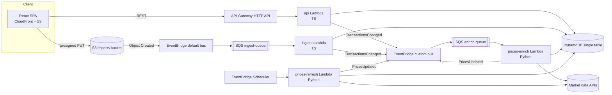
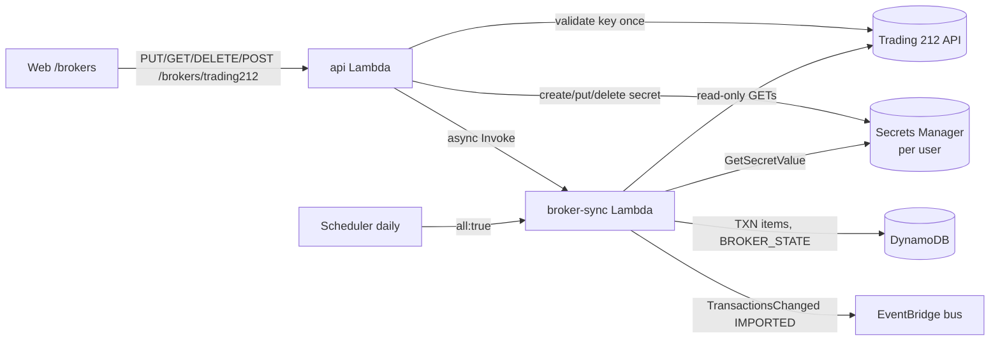

# Architecture & cross-team contracts

Source of truth for conventions shared between `web/`, `services/*`, and `infra/`.
Domain types, API shapes, DynamoDB keys and event schemas live in code in
[`packages/shared/src`](../packages/shared/src) — this document covers everything else.

## Overview



Every SQS queue has a DLQ (`maxReceiveCount = 3`). SQS-triggered Lambdas use
`ReportBatchItemFailures` (partial batch responses) and must be idempotent.

## Naming

`{app}-{component}-{env}` with `app = portfolio-tracker`, `env ∈ {local, dev, prod}`.

| Resource | Name |
|---|---|
| DynamoDB table | `portfolio-tracker-{env}` (PK/SK strings, PAY_PER_REQUEST) |
| Imports bucket | `portfolio-tracker-imports-{env}-{accountId}` (`portfolio-tracker-imports-local` locally) |
| Custom event bus | `portfolio-tracker-{env}` |
| Ingest queue / DLQ | `portfolio-tracker-ingest-{env}` / `…-ingest-dlq-{env}` |
| Enrich queue / DLQ | `portfolio-tracker-enrich-{env}` / `…-enrich-dlq-{env}` |
| Lambdas | `portfolio-tracker-api-{env}`, `…-ingest-{env}`, `…-prices-refresh-{env}`, `…-prices-enrich-{env}` |
| SSM params | `/portfolio-tracker/{env}/<provider>-api-key` (SecureString) |

## Environment variables (all Lambdas)

| Var | Used by | Notes |
|---|---|---|
| `TABLE_NAME` | all | |
| `EVENT_BUS_NAME` | api, ingest, prices | |
| `IMPORT_BUCKET` | api, ingest | |
| `BASE_CURRENCY` | api, prices | default `EUR` |
| `AUTH_MODE` | api | `cognito` (default; JWT `sub` required, else 401) or `demo` (local dev/tests only) — see [Authentication](#authentication) |
| `DEMO_USER_ID` | api | default `demo`; only used with `AUTH_MODE=demo` |
| `CORS_ALLOWED_ORIGIN` | api | |
| `LOG_LEVEL` | all | default `INFO` |
| `MARKET_DATA_PROVIDER` | prices | `mock` or a real provider id (see services/prices README) |
| `*_API_KEY_PARAM` | prices | SSM parameter name(s) holding provider API keys |
| `BROKER_SECRET_PREFIX` | api, broker-sync | Secrets Manager prefix of the per-user Trading 212 credentials (see "Trading 212 sync") |
| `BROKER_SYNC_FUNCTION` | api | name of the broker-sync Lambda; unset locally (sync runs in-process) |
| `AWS_ENDPOINT_URL` | all (local only) | `http://localhost:4566` (LocalStack); both AWS SDK v3 and boto3 honour it |

## Build artifacts (consumed by Terraform)

| Service | Command | Artifact | Handler | Runtime |
|---|---|---|---|---|
| `services/api` | `pnpm --filter @portfolio/api package` | `services/api/dist/api.zip` | `index.handler` | nodejs22.x, arm64 |
| `services/ingest` | `pnpm --filter @portfolio/ingest package` | `services/ingest/dist/ingest.zip` | `index.handler` | nodejs22.x, arm64 |
| `services/broker-sync` | `pnpm --filter @portfolio/broker-sync package` | `services/broker-sync/dist/broker-sync.zip` | `index.handler` | nodejs22.x, arm64 |
| `services/prices` | `services/prices/scripts/package.sh` | `services/prices/dist/prices.zip` | `prices.handlers.scheduled_refresh` / `prices.handlers.on_transactions_changed` | python3.12, arm64 |

TS bundles: esbuild, ESM (`index.mjs`), `--platform=node --target=node22`, AWS SDK v3 **bundled** (pinned version; the presign fix `requestChecksumCalculation` needs a recent SDK).

## Symbols

Canonical symbols are Yahoo-style: US tickers bare (`AAPL`), exchange suffix otherwise
(`ASML.AS` Euronext Amsterdam, `SAP.DE` XETRA, `MC.PA` Paris, `VWRL.AS`), crypto `BTC-EUR`.
Market-data adapters map canonical ↔ provider symbols.

## CSV import format

Header (case-insensitive, any order): `date,type,symbol,quantity,price,fee,currency[,note][,fxRate]`.
`fxRate` = units of `currency` per 1 EUR as applied by the broker (optional; ECB fixing used when empty).
Validated by `csvRowSchema`. Max 1 MB / 5000 rows. **All-or-nothing**: if any row fails validation
or the import would oversell a position, nothing is written and the import is `FAILED` with
row-level errors. Transaction ids from imports are deterministic (`{importId}-{rowNumber}`) so
SQS redelivery is idempotent.

## API & item conventions

- HTTP status: `200` reads, `201` POST create (body = created resource), `204` DELETE (no body),
  `400 VALIDATION_ERROR`, `404 NOT_FOUND`, `422 UNPROCESSABLE` (e.g. oversell), `503 FX_UNAVAILABLE`, `500 INTERNAL`.
- Import `errors[].row`: 1-based CSV data row (header excluded); `0` = file-level error (size, header, encoding).
- Same-day ordering: `buildPositions` orders by `date`, then `createdAt`. Writers must make `createdAt`
  strictly increasing within a batch (ingest uses processing time + row number in ms).
- Registry items: `USERS` → `{ userId, createdAt, updatedAt }`; `TRACKED` → `TrackedTicker` (`currency` optional; written with
  `if_not_exists` / conditional puts so concurrent writers never clobber `createdAt`).
- Profile `country`: full English name (`United States`, `Netherlands`); `Global` for world funds/crypto.
  `sector`: free text from the provider, `Diversified` for broad ETFs.
- FX items (`LATEST` and `DAY#{date}`, entityType `FX` / `FX_DAY`): `rates` is a DynamoDB **map** (exception to
  "stored flat") and excludes the base currency. `FX_DAY` also stores `date`.
- Minor-unit quotes (`GBX`/`GBp`, LSE) are converted to the major currency (`GBP`, ÷100) by the prices
  service before writing, so every stored price/amount is in an ISO-4217 major currency.

## Local development

`docker compose up -d` starts LocalStack (dynamodb, s3, sqs, events, ssm). An init hook in
`infra/localstack/` creates the local table, bucket, bus, queues and an S3 → SQS notification
on the ingest queue (S3 *notification* shape locally vs. EventBridge shape in AWS — the ingest
handler accepts both). Then:

1. `pnpm --filter @portfolio/api seed` — demo user, transactions, profiles, 1y EOD prices, FX, dividend events.
2. `pnpm --filter @portfolio/api dev` — local HTTP server on `:3001` wrapping the Lambda handler.
3. `pnpm --filter @portfolio/ingest dev` — long-polls the local ingest queue and invokes the handler.
4. `pnpm --filter @portfolio/web dev` — Vite on `:5173`, proxies `/api/*` → `:3001` (prefix stripped).
5. Optional: `cd services/prices && python -m prices.local refresh` with `MARKET_DATA_PROVIDER=mock`.

## Portfolios

A user owns 1..`MAX_PORTFOLIOS` (20) portfolios, e.g. one per broker account. `default` ("Main portfolio")
is created on first `GET /portfolios`. Transactions live under `USER#{userId}` with sort key
`TXN#{portfolioId}#{date}#{id}`, so one portfolio is a `begins_with(TXN#{portfolioId}#)` query and the
combined view is `begins_with(TXN#)` — no GSI needed.

- Read endpoints take `?portfolioId=`; omitted or `all` = all portfolios combined (same symbol is merged).
- Writes (manual transactions, CSV imports) target one portfolio; oversell checks use that portfolio only.
- A symbol must have the same currency in every portfolio of a user, so the combined view never mixes currencies.
- Deleting a non-empty portfolio needs `?force=true` (cascades); the last portfolio cannot be deleted.
- All portfolios share the global base currency (EUR).
- `TransactionsChanged` events carry `portfolioId`; the prices service ignores it (prices are per ticker).

## Currency conversion (base currency EUR)

Every monetary value in API responses is in the portfolio base currency (`DEFAULT_BASE_CURRENCY = 'EUR'`)
unless its field name ends in `Local`. Conversion is done only in `packages/shared` (`FxTimeline`):

| Amount | Rate used |
|---|---|
| BUY cost, SELL proceeds, DIVIDEND received | `transaction.fxRate` (broker-applied) → ECB fixing of the transaction date (previous business day on weekends/holidays) → latest rate |
| Market value, day change, upcoming dividends | latest rate (`FX#EUR` / `LATEST`) |
| Value history | ECB fixing of each day; `invested` = cost basis at purchase-date rates |

Realized P&L = proceeds at sell-date rate − average cost at purchase-date rates. `currencyEffect` = market value −
value at the cost-weighted purchase rates, i.e. the part of unrealized P&L caused by EUR moving against the
instrument currency. Daily fixings come from Frankfurter (ECB reference rates) and are stored as
`FX#EUR` / `DAY#{date}` items by the prices service (backfilled from `FX_HISTORY_START`).

## Known limitations

- Single demo user in local development and the GitHub Pages demo; deployed environments use Cognito users (see Authentication).

## Authentication

Deployed environments authenticate every API call with an Amazon Cognito user pool; local development and the
GitHub Pages demo run without login.

```
Browser (SPA)                         Cognito user pool                 API Gateway (HTTP API)        api Lambda
  SRP sign-in ───────────────────────► new password / TOTP challenge
  ◄──────────── ID + access + refresh tokens
  Authorization: Bearer <ID token> ─────────────────────────────────────► JWT authorizer (issuer + client id)
                                                                           └─ claims.sub ───────────────► resolveUserId()
```

- **Pool** (`infra/terraform/auth.tf`): self sign-up disabled (users are created with `admin-create-user`),
  email username, 12+ character password with upper/lower/number/symbol, **MFA `ON` with software-token (TOTP)
  only — SMS is not configured**, account recovery by verified email, advanced security off (cost), deletion
  protection in prod. App client: no secret, `ALLOW_USER_SRP_AUTH` + `ALLOW_REFRESH_TOKEN_AUTH`, 30-minute
  ID/access tokens, 30-day refresh token, token revocation on, user-existence errors hidden.
- **Fail closed.** `enable_auth` (Terraform) is `true` for `env=prod` when unset, must be chosen explicitly
  for other environments, and `false` is rejected for prod (`terraform_data.auth_guard` preconditions). With auth on the
  Lambda gets `AUTH_MODE=cognito`: `resolveUserId` (`services/api/src/lib/auth.ts`) requires
  `requestContext.authorizer.jwt.claims.sub` (also validated against `^[A-Za-z0-9._-]{1,128}$`) and answers
  `401 UNAUTHENTICATED` otherwise — evaluated before routing, so even unknown routes and `/health` need a token
  (CORS preflight is answered by API Gateway). An unset `AUTH_MODE` means `cognito`; unknown values fail at cold start.
  `AUTH_MODE=demo` (the `pnpm --filter @portfolio/api dev` default, tests) serves requests without claims as
  `DEMO_USER_ID`, and still honours a validated `sub` when present.
- **User isolation.** The user id is derived in exactly one place and handed to handlers as `RouteContext.userId`.
  DynamoDB keys (`USER#<sub>`) and S3 import keys (`imports/<sub>/<importId>.csv`) are built from it only; the
  request body and query string are never consulted (`services/api/src/auth.test.ts` proves it with two users
  across transactions, portfolios, imports and upload keys).
- **Web** (`web/src/features/auth/`): `amazon-cognito-identity-js` (SRP, the password is never sent). Screens:
  sign in, new-password challenge (first login with the temporary password), TOTP enrolment (QR code rendered locally
  as inline SVG + manual key; the secret never leaves the page), TOTP code entry, forgot password (emailed code).
  `AuthGate` guards every route; the API client sends `Authorization: Bearer <ID token>`, refreshes silently when
  the token expired (concurrent requests share one refresh) and the app signs out automatically on a `401`
  (clearing the React Query cache). Tokens: ID/access tokens in memory only; the refresh token + "last user" pointer in
  `localStorage` so reloads and new tabs stay signed in. Trade-off: localStorage is readable by any script on the
  origin, mitigated by the CloudFront CSP (`script-src 'self'`, `connect-src` limited to the API, S3 and
  `cognito-idp.<region>.amazonaws.com`), a 30-day lifetime and server-side revocation on sign-out; sessionStorage would
  force a full password + TOTP sign-in in every tab.
- **Build-time switches**: `VITE_AUTH_MODE=cognito|none`, `VITE_COGNITO_USER_POOL_ID`, `VITE_COGNITO_CLIENT_ID`,
  `VITE_COGNITO_REGION`. Mock mode (`pnpm dev:mock`, GitHub Pages) always runs with auth off. `VITE_AUTH_MODE=cognito`
  with missing settings renders an error screen instead of the app.
- **Local development**: LocalStack's free tier has no Cognito, so the local API runs `AUTH_MODE=demo` and the SPA
  with `VITE_AUTH_MODE=none`. There is deliberately no token-minting shim and no bypass in the deployed path.
- **Other services**: the ingest Lambda is event-driven and takes the user id from the S3 key written by the API.
  Any new API route must use `ctx.userId` and nothing else for identity; per-user data (e.g. secrets) must be keyed by it.
- **Existing demo data.** Environments that ran before auth stored everything under `USER#demo` (and
  `imports/demo/…`). A Cognito user has a new `sub`, so that data is not visible after switching; re-key it
  (copy the items to `USER#<sub>`) if it should be kept.

- Single demo user unless a JWT authorizer (Cognito) is enabled.

## Analytics

Read-only performance, risk and income analysis. The maths is pure and lives in `packages/shared`
(`analytics.ts` XIRR/TWR/risk/drawdown/beta/goal simulation, `analytics-income.ts` passive income and dividend
growth, `analytics-insights.ts` rules, `analytics-compute.ts` response builders, `analytics-api.ts` contract and
query schemas). The Lambda (`services/api/src/routes/analytics.ts`) loads transactions, quotes, FX, end-of-day
prices and dividend events and calls the same builders as the web demo's MSW handlers
(`web/src/mocks/analyticsHandlers.ts`), so the GitHub Pages demo shows real numbers. No new tables, IAM or
infrastructure: the paths are covered by the API Gateway `$default` route, and the data comes from the existing
`TXN#`, `QUOTE#LATEST`, `EOD#`, `DIV#`, `PROFILE` and `FX#` items.

| Endpoint (all accept `?portfolioId=`) | Content |
|---|---|
| `GET /analytics/summary` | IRR, TWR (+ annualised), passive income, top 5 day gainers/losers, insights |
| `GET /analytics/returns?period=year\|quarter\|month` | TWR per calendar period (+ IRR per year) |
| `GET /analytics/risk?benchmark=` | volatility, Sharpe, Sortino, max drawdown (+ dates), beta, correlation |
| `GET /analytics/benchmark?benchmark=&range=` | portfolio vs a benchmark ETF replayed with the same cash flows |
| `GET /analytics/dividend-growth` | year-over-year dividends by year, month and per share |
| `GET /analytics/goal?targetIncome=&…` | passive-income goal projection (cautious / base / optimistic) |

Malformed query parameters return `400 VALIDATION_ERROR` in the standard error envelope.

Definitions:

- **XIRR** solves Σ cf / (1+r)^(days/365) = 0 over dated cash flows (buys negative, sells, dividends and the
  terminal market value positive) with Newton's method and a bisection fallback; `null` without both signs.
  For less than a year of history the period return is shown instead of an annualised figure (`irrAnnualised`).
- **TWR** chains daily returns of the daily value history, removing buys and sells as external flows (dividends count
  as return). Sub-period (year/quarter/month) returns are chained from the same daily series.
- **Risk** uses weekday returns: annualised volatility (√252), Sharpe and Sortino against a constant 2.5% risk-free
  rate (`DEFAULT_RISK_FREE_RATE`), max drawdown from the wealth index, beta/correlation against the benchmark's daily
  returns. Fewer than `MIN_RISK_OBSERVATIONS` (20) returns yields `null` metrics.
- **Benchmark**: default `IWDA.AS` (also `VWRL.AS`) from the tracked end-of-day prices. Without prices the response
  has `benchmark.available = false` and a `message` instead of an error.
- **Passive income**: next 12 months = declared events (ex-date ahead × quantity) + estimated payments implied by the
  holding's payment frequency (1/2/4/12 per year from the gaps of its last payments), net of observed withholding tax.
  Yield on value = income / market value, yield on cost = income / cost basis.
- **Goal projection**: monthly simulation of the income run-rate; existing income grows at the dividend growth rate and
  each month the contribution (and reinvested dividends) buys income at the yield on new money. Cautious/optimistic
  shift growth by ∓2 points and the new-money yield by ∓0.5 points; `yearsToGoal` is `null` beyond the horizon.

Insight thresholds (`INSIGHT_THRESHOLDS`, a rule fires when the measure is strictly above, except dead weight):

| Rule | Threshold |
|---|---|
| Top holding | > 25% of portfolio value |
| Sector | > 40% (Diversified/unknown ignored) |
| Country | > 50% (Global/unknown ignored) |
| Single non-EUR currency | > 40% |
| Non-EUR share | > 50% |
| Dead weight | return below −15% and weight below 2% |
| Income concentration | one holding > 40% of forward income |

Web: dashboard widgets (`features/analytics/`) read `GET /analytics/summary`; insights can be dismissed for the
browser session (`sessionStorage`, per scope). `/analytics` is lazy-loaded and has tabs Returns, Risk, Benchmark,
Dividend growth and Income goal (`?tab=`); everything follows the active portfolio scope. Not investment advice.

**Scope with cash tracking and custom assets.** Return figures (IRR, TWR, returns by period, benchmark) measure the
*invested holdings*: only BUY, SELL and DIVIDEND transactions are flows, and the value they are measured against is the
market value of the holdings. DEPOSIT, WITHDRAWAL, FEE, INTEREST and SPLIT are ignored as flows (a split changes units,
not value; positions and value history still apply it), and the "since" date is the first investment transaction.
Cash balances and custom assets are therefore not part of these returns yet. A cash-inclusive IRR would use
`externalCashFlows()` (deposits/withdrawals for portfolios with cash tracking) against a terminal value that includes cash
and custom assets; that is a follow-up.


## Portfolio management

Cash, splits, categories with target allocation and rebalancing, custom assets, a watchlist, a dividend
withholding-tax helper and exports. Pure logic lives in `packages/shared` (`management.ts`, `rebalance.ts`,
contract and routes in `management-api.ts`); the API wiring is in `services/api/src/routes/{categories,assets,watchlist,rebalance,export}.ts`
with persistence in `management-repository.ts`; the web pages are `/rebalance`, `/assets`, `/watchlist` plus the
settings/export actions on `/transactions`.

### Transaction types

`TRANSACTION_TYPES` = `BUY | SELL | DIVIDEND | DEPOSIT | WITHDRAWAL | SPLIT | FEE | INTEREST`.

| Type | symbol | quantity | price | fee |
|---|---|---|---|---|
| `DEPOSIT`, `INTEREST` | `CASH.<ccy>` | amount | 1 | 0 |
| `WITHDRAWAL`, `FEE` (account fee) | `CASH.<ccy>` | amount | 1 | 0 |
| `SPLIT` | the held symbol | new shares per old share (`4` = 4:1, `0.1` = 1:10 reverse) | ignored (`0`) | 0 |

Validation (`transactionInputSchema`, CSV rows, API, ingest — all-or-nothing as before): a cash symbol is
`CASH.` + 3 letters and must match the transaction currency, `price > 0`, `fee` must be 0 for everything but
BUY/SELL/DIVIDEND, `CASH.*` and `CUSTOM:*` symbols cannot be traded. A split needs an open position and a ratio `> 0`
(`PortfolioError` → 422 / import row error).

### Cash tracking

Per-portfolio setting `trackCash` (default **off**: then the engine behaves exactly as before and cash movements
are ignored). When on, every transaction of the portfolio moves the cash balance of its own currency:
BUY `−(qty·price+fee)`, SELL/DIVIDEND `+(qty·price−fee)`, DEPOSIT/INTEREST `+amount`, WITHDRAWAL/FEE `−amount`
(`cashDelta`). `applyManagement` adds one `CASH.<ccy>` holding per currency (asset class `CASH`, sector `Cash`, valued at
the **latest** FX rate, cost = value so no P&L) to holdings, summary (`cashValue`, included in `totalValue`/`totalCost`),
allocation and history (`managementHistoryExtra`, daily FX). Interest and account fees are part of `totalReturn`
(`cashIncome`). Cash is allowed to go negative (no overdraft check). `externalCashFlows()` returns the money that
crossed the portfolio boundary for later XIRR/TWR work: DEPOSIT (+) / WITHDRAWAL (−) for cash-tracking portfolios,
BUY (+) / SELL and DIVIDEND (−) for the others, in EUR at the transaction's rate.

### Stock splits

`applyTransaction` multiplies the quantity by the ratio; total cost (local and base) is unchanged, so the average cost
per share divides by the ratio. The same split entered in several portfolios counts once in the combined view
(`dropDuplicateSplits`, key symbol+date+ratio). **Assumption:** provider EOD closes are *split-adjusted* (Yahoo-style:
history is restated as if the latest share basis always applied). `buildValueHistory` therefore values units held before
a later split at `units × ratio × adjusted close`, so the value line does not jump on the split date; the fallback
price (average cost) uses the same basis. Quotes/day change are current and need no adjustment. If a provider returns
unadjusted closes the history before the split would be understated.

### Categories and rebalancing

A portfolio has up to 20 categories (name, `#rrggbb`, target weight %; targets sum ≤ 100, the rest is "unallocated").
A holding (market symbol, `CASH.<ccy>`, `CUSTOM:<id>`) is in at most one category (assigning moves it).
`GET /allocation?by=category&portfolioId=` groups by category (+ "Uncategorized").
`calculateRebalance({ holdings, categories, mode, amount?, wholeUnits?, minTrade? })` is pure:
`buy-only` invests `amount` without selling, pro rata to each category's shortfall below target (scaled down when
the budget is short); `full` also sells what is above target and uses the proceeds plus optional new money for the buys. Targets are computed on `portfolio value + amount`;
within a category money is spread pro rata to current holding values. Cash and custom assets count towards their
category but are never traded. Result: trades per holding (units, price, value), per-category drift before/after
(percentage points and EUR), leftover cash (new money + proceeds − buys) and warnings (e.g. a category below target
with nothing buyable). `wholeUnits` floors units and tops up leftover cash with single units where a category is still furthest below target;
trades below `minTrade` are dropped.

### Custom assets

Real estate, savings, P2P loans, private equity: `CUSTOM:<assetId>` symbol (reserved prefix), own currency, `costBasis`,
optional `growthRate` %/year and a list of valuation points. Value on a date = latest valuation on or before it,
compounded at the growth rate for the days since (365-day year); 0 before the first valuation. Converted to EUR at the
latest rate, included in totals, allocation (`ASSET_CLASSES` gained `REAL_ESTATE` and `DEPOSIT`) and history. `CASH.*` and
`CUSTOM:*` are never written to `TRACKED` and never published in `TransactionsChanged` (`isMarketSymbol`,
`trackTickerUpdates`, `publishChange`, ingest), so the prices service never fetches them.

### Watchlist

Per user. `GET /watchlist` joins the symbols with `QUOTE`/`PROFILE` items (price, day change). `POST /watchlist`
stores the entry, registers the symbol in `TRACKED` and publishes the existing `TransactionsChanged` event with
`portfolioId: "watchlist"`; `services/prices` `on_transactions_changed` only reads `detail.symbols`, so no change was
needed there. A new symbol shows "Waiting for price…" until enrichment has run.

### Withholding tax helper

`PortfolioSettings.withholdingTaxRate` (%). The transaction form prefills a dividend's `fee` with
`withholdingFee(quantity, price, rate)` until the user edits it; the API stores only the resulting `fee`.

### Export

`GET /export/transactions[?portfolioId=]` answers `text/csv` with the importer's header (`transactionsToCsv`, round-trip
tested against the ingest parser). `GET /export/backup` answers one JSON document (`BackupResponse`: portfolios, settings,
transactions, categories + assignments, custom assets, watchlist; no secrets).

### Routes (`MANAGEMENT_ROUTES`)

`GET|PUT /portfolios/{id}/settings` · `GET|POST /portfolios/{id}/categories` · `PATCH|DELETE /portfolios/{id}/categories/{cid}` ·
`PUT /portfolios/{id}/categories/{cid}/holdings` · `GET /portfolios/{id}/rebalance?mode=&amount=&wholeUnits=&minTrade=` ·
`GET|POST /portfolios/{id}/assets` · `PATCH|DELETE /portfolios/{id}/assets/{aid}` · `PUT /portfolios/{id}/assets/{aid}/valuations` ·
`DELETE /portfolios/{id}/assets/{aid}/valuations/{date}` · `GET|POST /watchlist` · `DELETE /watchlist/{symbol}` ·
`GET /export/transactions` · `GET /export/backup`. A malformed or unknown `{id}` is a 404.

### DynamoDB items (single table, all under `PK = USER#{userId}`; keys in `managementKeys`)

| Entity | SK | entityType |
|---|---|---|
| Portfolio settings | `PSETTINGS#{portfolioId}` | `PORTFOLIO_SETTINGS` |
| Category | `CATEGORY#{portfolioId}#{categoryId}` | `CATEGORY` |
| Category assignment | `CATASSIGN#{portfolioId}#{symbol}` | `CATEGORY_ASSIGNMENT` |
| Custom asset | `ASSET#{portfolioId}#{assetId}` | `CUSTOM_ASSET` |
| Watchlist entry | `WATCH#{symbol}` | `WATCHLIST` |

Deleting a portfolio also removes its settings, categories, assignments and custom assets.

### Demo mode

The MSW mock (`web/src/mocks/management-db.ts`, `management-handlers.ts`) implements all of the above with the shared
calculators. The seed has cash tracking on in the main portfolio (deposits, withdrawal, interest, fee, 15% default
withholding), a 2-for-1 JNJ split, five categories whose targets drift from the holdings, three custom assets and a
three-symbol watchlist.

## Trading 212 sync

Automatic, **read-only** import of the owner's own Trading 212 account (Invest / Stocks ISA) into one portfolio.
Trading 212's API terms only allow access to the account holder's own account, so this is a single-owner feature,
not a multi-tenant one: every user stores one credential set and can only ever sync their own account. The browser
(and the GitHub Pages demo) never calls Trading 212; CI never receives real credentials (fixtures only).



### Endpoints (`packages/shared/src/broker.ts`, `api.ts`)

| Route | Behaviour |
|---|---|
| `GET /brokers/trading212?portfolioId=` | Connection status of one portfolio (`connected: false` when none). Never contains credentials. |
| `PUT /brokers/trading212` `{portfolioId, apiKey, apiSecret, environment}` | Calls Trading 212 `account/summary` once with the key; on success stores it in Secrets Manager under the caller's `userId` and records the connection → `204`. `422 T212_AUTH_REJECTED` for a rejected key, `409 BROKER_ALREADY_CONNECTED` when another portfolio of the user is connected (one credential set per user). The only place secrets are accepted; they are never logged or echoed. |
| `DELETE /brokers/trading212` | Deletes the secret and the state items → `204`. Imported transactions stay. |
| `POST /brokers/trading212/sync` `{portfolioId}` | Starts an asynchronous sync (Lambda `Event` invoke) → `202`. `404 NOT_CONNECTED` otherwise. |

All handlers use `ctx.userId` only (never identity from the body or query). Without the sync wired (`deps.broker`
absent) the routes answer `503 BROKER_UNAVAILABLE`.

### Data

| Entity | PK | SK | entityType |
|---|---|---|---|
| Broker sync state | `USER#{userId}` | `BROKER#trading212#{portfolioId}` | `BROKER_STATE` |

State: `status` (`CONNECTED` / `RUNNING` / `SUCCEEDED` / `FAILED`), `environment`, `accountCurrency`, `lastSyncAt`,
`lastSuccessAt`, `cursors` (newest processed timestamp per source), `counts`, `unmapped` (skipped instruments with a
reason), `warnings`, `lastError` (`CODE: message`, never credentials). `RUNNING` is an optimistic lock (conditional
update, taken over after 15 minutes).

Credentials: Secrets Manager secret `/portfolio-tracker/{env}/broker/trading212/{userId}` with
`{"apiKey","apiSecret","environment"}`. Terraform creates **no** secret or value (`infra/terraform/broker.tf`): the
sync Lambda may only `GetSecretValue` under that prefix; the API may create/put/delete/describe (never read) and
invoke the sync function. Synced transactions have deterministic ids (`t212-{orderId}-{fillId}`,
`t212-div-{reference}`, `t212-split-{ticker}_{epochMs}`) and `importId = trading212`.

### Sync run

1. Take the run lock; read credentials; `account/summary` (account currency).
2. Read orders, dividends and cash movements newest-first. First run: whole history. Later runs stop at the first
   page older than `watermark - 7 days` (re-writes are idempotent). `--full` / `{full:true}` rebuilds.
3. Map (below), then validate **before writing**: the merged transactions of the target portfolio must not oversell
   and a symbol must keep one currency across all portfolios of the user (`VALIDATION_FAILED`, nothing written, error
   recorded in the state). Only changed transactions are written; stored dividends are final unless `full`.
4. Emit one `TransactionsChanged` (`reason: IMPORTED`, affected symbols) so prices are enriched; update tracked
   tickers and the state. Deposits, withdrawals, fees and interest are **counted, not imported** (cash tracking is
   a separate feature).

Trading 212 rate limits (orders/dividends/transactions 20 requests/min, positions 1/s, instruments 1 per 50 s) are
honoured with `x-ratelimit-*` headers, jittered retries on 429/5xx and a request timeout. A first sync of a large
history therefore takes minutes (about 20 pages of 50 items per minute); the Lambda timeout is 15 minutes.

### Mapping rules

- **Orders:** filled `BUY`/`SELL` fills become BUY/SELL (price = fill price in the instrument currency, quantity
  absolute, fee = `walletImpact.taxes[]` converted to the instrument currency). Cancelled/unfilled orders are
  ignored. `GBX`/`ZAC`/`ILA` prices are divided by 100 and relabelled `GBP`/`ZAR`/`ILS`.
- **Dividends:** DIVIDEND with quantity = eligible shares, price = `grossAmountPerShare`, fee = withholding tax
  derived as gross − net (net converted at the rate of the nearest imported order of that currency, else the stored
  ECB rate). The same rate is stored as `fxRate`, so the EUR amount received equals the amount Trading 212 reports.
- **Corporate actions:** `SPIN_OFF` and other share distributions become a zero-cost BUY at the reported price. A
  stock split (a SELL of the old and a BUY of the new shares at the same instant, both at market price) becomes
  **one zero-cost BUY of the net share increase** (cost basis unchanged, average cost drops). Reverse splits and other
  fill types (`EQUITY_RIGHTS`, …) are skipped and listed as `UNSUPPORTED_FILL_*`.
- **FX convention:** Trading 212's `walletImpact.fxRate` (and the CSV "Exchange rate") is *instrument-currency units
  per 1 unit of account currency*, which for a EUR account is exactly our `Transaction.fxRate` convention. It is only
  stored when the account currency is EUR and the rate agrees with the trade amounts (within 5 %, direction-checked,
  GBX pence normalised); otherwise it is omitted and the ECB fixing applies.
- **Symbols:** `AAPL_US_EQ` → `AAPL`, `ASMLa_EQ` → `ASML.AS`, `VUSAl_EQ` → `VUSA.L`, `.DE`, `.PA`, `.MI`, … from the
  ticker shape, then instrument/exchange metadata (only fetched when needed), then the ISIN country (never IE/LU),
  and the result must have a currency that fits the venue. Share classes (`BRK/A`, `BF.B`) map to `BRK-A`, `BF-B`. A closed list of well-known renames that Trading 212 history
  still reports under the old ticker is applied (`FB` → `META`, `DAI.DE` → `MBG.DE`); an override bypasses it.
  `T212_SYMBOL_OVERRIDES` (JSON, ticker or ISIN → symbol) wins. **Nothing is guessed:** unmapped instruments are
  skipped and shown as `UNMAPPED` (CLI, state, web card).

### Errors

`T212_AUTH_REJECTED` (HTTP 401/403): "Trading 212 rejected the credentials. Check the key/secret, that the key has
the read scopes, that the environment (live/demo) matches, and — if the key has an IP allowlist — that this machine's
public IP is on it." Surfaced in the CLI, `lastError` and the web card, and never retried in a loop. Other codes:
`T212_RATE_LIMITED`, `T212_HTTP_ERROR`, `T212_NETWORK`, `T212_BAD_RESPONSE`, `NO_CREDENTIALS`, `VALIDATION_FAILED`.
A key without the `history:transactions` scope only loses the cash counts (warning). The key may optionally be
IP-restricted at Trading 212; leave it unrestricted for AWS Lambda (no fixed egress IP).

### Local CLI

```bash
# credentials: T212_API_KEY / T212_API_SECRET / T212_ENV, or the gitignored .env.trading212.local (T212_ENV_FILE overrides)
pnpm --filter @portfolio/broker-sync sync -- --whoami                    # public IPv4 only, no credentials sent
pnpm --filter @portfolio/broker-sync sync -- --dry-run                   # counts, mapped symbols, UNMAPPED list; no AWS, no writes
pnpm --filter @portfolio/broker-sync sync -- --user demo --portfolio trading-212 --reconcile   # real sync into LocalStack
```

`--reconcile` compares the open positions from `GET /equity/positions` with the positions replayed from the
imported transactions. Use `AWS_ENDPOINT_URL`, dummy AWS keys, `TABLE_NAME`, `EVENT_BUS_NAME` for LocalStack (the
compose file includes `secretsmanager` for connecting through the API locally).

### Trading 212 CSV preset

`convertTrading212Csv` (`packages/shared/src/broker-csv.ts`) turns a Trading 212 *History* export (`Action, Time
(UTC), ISIN, Ticker, …, Exchange rate, Total, …`) into this app's import CSV. The web CSV import detects the export
by its header and converts it in the browser, so the ingest service is unchanged. Trades and dividends are imported;
deposits, withdrawals, interest, card actions and conversions are counted as ignored. The export only has bare
tickers, so instruments are mapped by ISIN country and currency and the ambiguous ones (for example an EUR-quoted
instrument with a US ISIN) are listed as not imported: use the API sync for those. "Exchange rate" has the same
convention as the API's `walletImpact.fxRate` (instrument units per 1 unit of the account currency). That was verified
against the live API only; the CSV column itself could not be checked against a real export, so the converter keeps the
same sanity check (rate must agree with the row's amounts, otherwise it is dropped and the ECB fixing applies).

### Verified API behaviour (against a live account)

- `GET /equity/history/transactions` rejects `time` without `cursor` (HTTP 400), so there is no start-time filter:
  cash history is paged newest-first and cut off at the watermark like the other sources.
- Orders include `CANCELLED` ones without a fill; fills of sells carry a **negative** quantity; autoinvest orders are
  fractional; split and spin-off fills have `type` `STOCK_SPLIT` / `SPIN_OFF`.
- Dividends have no `tickerCurrency` in practice; the instrument currency is the currency of `grossAmountPerShare`.
- Live run on a EUR account with thousands of orders, hundreds of dividends and thousands of cash movements (first
  sync ≈ 8 minutes at the history rate limit; an incremental re-sync writes nothing and emits no event): the replayed positions matched
  `GET /equity/positions` for every open instrument (and every closed one replays to zero); `walletImpact.fxRate` is in
  the plausible range of instrument units per EUR for every USD/GBP fill (the instrument-vs-wallet amounts agree within
  5 %, one fill without usable FX data falls back to the ECB fixing); our EUR cost basis (fees included) is 0.14-0.15 %
  above Trading 212's `walletImpact.totalCost` for every open position, consistent with the 0.15 % currency-conversion fee, which
  Trading 212 appears not to count as cost; dividend withholding derived as gross − net clusters around 15 % (US treaty rate),
  with outliers only on cent-sized payments (rounding).

## Dividends page

`/dividends` is a dashboard (top to bottom): Yield and Dividends KPIs next to a Yield / payout chart; passive income
diversification; payment consistency; average annual growth next to future payments; dividends received over time next to
received by holding; calendar-month comparison of the last three years (`GET /analytics/dividend-growth`); and the payment
history (received and upcoming, collapsible). Every card has an info tip with the metric, source and assumptions, loading /
error (retry) / empty states, a chart text alternative and a "Show data table" disclosure. Everything follows the portfolio
scope (`?portfolioId=`, omitted or `all` = combined). Code: `web/src/features/dividends/`.

Data sources: `GET /dividends` (received, upcoming, monthly; the received cards group client-side by period and
granularity), `GET /analytics/dividend-growth` (calendar-month comparison), portfolio categories (`GET
/portfolios/{id}/categories`, single portfolio only, for "group by categories") and one new read endpoint:

`GET /dividends/overview[?portfolioId=]` → `DividendsOverviewResponse` (`packages/shared/src/dividends-overview.ts`, computed by the
pure `computeDividendsOverview`, route in `services/api/src/routes/dividends-overview.ts`, mocked by `web/src/mocks/dividendsOverviewHandlers.ts`;
same error envelope and scope rules as the other reads, no new infrastructure):

| Field | Meaning |
|---|---|
| `summary` | `forward12m` (= `passiveIncome.forward12m` of `/analytics/summary`), `declared`, `estimated`, `monthlyAverage`, `yieldOnValuePct`, `yieldOnCostPct`, `last12m` (net received in the last 12 months) and `growthVsLast12mPct` (forward vs `last12m`; null without `last12m`) |
| `holdings[]` | current holdings that pay or paid dividends, largest forward income first: forward income (declared / estimated / share), yield on value and on cost, market value, cost basis, net received (12 months / ever), `growthPct` (per-share CAGR) and `consistency` |
| `futureMonths[]` | 12 months from the current one: declared and estimated income per month; sums to `summary.forward12m`. Declared income sits in the pay month (or ex-month without pay date). Estimated income takes the schedule of the last payment shifted a year (`paymentsPerYear` slots), minus the slots announced events fill. The window is 365 days, so a payment in this calendar month next year counts in the first bar |

Forward income is declared plus estimated, net of the withholding tax seen in the last 12 months (see `calculatePassiveIncome`).
EODHD dividend events cover about two years of history, which is why the per-holding history merges the received payments with
the stored *past* events (an event within 20 days of a received payment is the same payment).

### Payment consistency score

Replaces a proprietary dividend rating (which needs company fundamentals we do not have). It is computed only from the
user's own data and is **not a forecast or advice**. Per holding, from its payment history (received payments plus past events,
one point per payment date; per-share amounts in the paying currency) it adds up four parts to 0-100:

| Part | Max | Rule |
|---|---|---|
| History | 30 | 6 points for each of the last 5 years (12-month periods counted back from today) with at least one payment |
| Regularity | 30 | gaps between payments: 30 when their variation (standard deviation ÷ mean) is ≤ 0.05, falling linearly to 0 at 0.5; a wait since the last payment longer than 1.5 × the median gap counts as one more gap; 15 with fewer than 3 payments |
| Cuts | 25 | 25 − 13 per cut (floor 0). A *year* is a block of consecutive payments (as many as the implied payments per year: 1, 2, 4 or 12, newest block first, at most 6); a cut is a year whose per-share total is more than 0.5 % below the year before; 12 without two full years |
| Growth | 15 | 3 points for each consecutive year (newest first, at most 5) whose per-share total is more than 0.5 % above the year before |

Badges: **Reliable** ≥ 70, **OK** 40-69, **Irregular** < 40, **New** with fewer than 2 known payments (no score). The score is
rounded per part so the parts add up exactly. `growthPct` is the compound growth of the per-share total over the same full
years. Special dividends count as regular payments. The constants are exported from `dividends-overview.ts` (`CONSISTENCY_*`)
and used by the help text on the page; known-value tests pin the behaviour.

Demo mode: the MSW handler runs `computeDividendsOverview` on the demo fixtures. The fixtures give the dividend payers
different growth, a cut, an irregular payer and a recent payer, plus ~2.5 years of past dividend events, so every card shows
meaningful data.
## Growth

First and default tab of `/analytics` (`?tab=growth`): benchmark chips, portfolio value, cumulative performance, monthly
return dynamics and the return per holding. Pure maths in `packages/shared/src/growth.ts` (contract and query schemas in
`growth-api.ts`); routes in `services/api/src/routes/growth.ts`; the demo's MSW handlers (`web/src/mocks/growthHandlers.ts`)
call the same functions on the demo data. No new tables, IAM or infrastructure.

| Endpoint (accept `?portfolioId=`) | Content |
|---|---|
| `GET /analytics/growth?range=&benchmarks=a,b,c` | `period` (start/end value, invested, gain, TWR), `series` (value, invested, cumulative return %), one aligned `benchmarks[]` series each (`available:false` + `message` without prices), `headline`, `monthly` returns, selectable benchmark `options` |
| `GET /analytics/holdings-performance?range=` | return % and gain per open holding, best first |

`range` = `7D 1M 3M 6M YTD 1Y 5Y ALL` (default `1Y`; never before the first investment). `benchmarks` holds at most 3 symbols;
omitted = `IWDA.AS`, empty = none; an invalid list is a `400 VALIDATION_ERROR`, an unknown portfolio a `404`. Series are
downsampled to at most 400 points.

- **Portfolio value** = market value plus dividends received since the start of the range; **invested** = start value plus
  net purchases (BUY/SELL only; deposits, withdrawals, fees, interest and splits are no flows, see "Scope with cash tracking").
- **Benchmarks** are replayed with identical cash flows (`replay` of `/analytics/benchmark`): the start value buys the
  benchmark on day one, later flows trade it that day. The benchmark shows price only. Missing symbols never fail the page.
- **Cumulative return** = chained daily TWR rebased to 0 % on the first day; benchmarks are their price return rebased the same way.
- **Headline** = first benchmark with data: gain minus the gain of the same money in the benchmark (€) and the return
  difference in percentage points.
- **Monthly returns** = TWR per calendar month (current month so far); web: last 12 months or one calendar year.
- **Holdings** = TWR plus money made per open holding from the range start, or from the first purchase when bought inside the
  range (`sincePurchase`); closed positions and positions bought on the last day are omitted.
- FX: transactions at their own rate, value history at the ECB fixing of each day (see "Currency conversion").
- **Benchmark options**: tracked symbols (held, watchlist, selected) with end-of-day data first, then five suggested index
  ETFs (`BENCHMARK_SUGGESTIONS`) that work once tracked: add the symbol to the Watchlist. The selection lives in `?benchmarks=`
  and `sessionStorage` (`pt-growth-benchmarks`).
## Metrics

Analytics → Metrics (`/analytics?tab=metrics`, the first tab) shows five cards for the selected portfolio scope next to
one benchmark ("the market", `IWDA.AS` or `VWRL.AS`): lifetime TWR, portfolio P/E, volatility/beta, Sharpe and Sortino.
One read serves all of them: `GET /analytics/metrics?benchmark=` (+ `?portfolioId=`; omitted or `all` = combined). `400
VALIDATION_ERROR` for a malformed benchmark/scope, `404` for an unknown portfolio. The maths reuses the existing
calculators (`chainReturns`, `riskStats`, `betaVs`, `benchmarkPrices`); the new pure code is `packages/shared/src/metrics.ts`
(P/E, verdict bands, gauge geometry, `riskFigures`), the response builder `metrics-compute.ts` and the contract
`metrics-api.ts`. Lambda route: `services/api/src/routes/metrics.ts`; demo: the MSW handler in `web/src/mocks/analyticsHandlers.ts`
runs the same builder on the fixtures. No new tables, IAM or infrastructure.

Response: `{ baseCurrency, riskFreeRatePct, benchmark: {symbol, available, message?}, twr, pe, volatility, sharpe, sortino }`.

| Field | Content |
|---|---|
| `twr` | `portfolio` lifetime TWR % (first investment transaction → today, dividends included), `benchmark` price return % over its window, `difference` in percentage points, `from`/`to`/`days`, `benchmarkFrom` (later than `from` when the benchmark's history starts after your first buy; the portfolio is then measured over the same shorter window) |
| `pe` | `portfolio` P/E, `benchmark` P/E (only when the benchmark's profile has one; ETFs usually do not), `coverage` (`includedStocks`, `totalStocks`, `nonStockHoldings`, values, `portfolioSharePct`, `stockSharePct`), `excluded[]` (`symbol`, `name`, `reason` `missing`\|`non-positive`, `marketValue`), `asOf` (oldest `fundamentalsAsOf` among the covered stocks) |
| `volatility` | `portfolio`/`benchmark` annualised volatility %, `beta`, `verdict`, `observations`, `benchmarkObservations` |
| `sharpe`, `sortino` | `portfolio`, `benchmark`, `verdict`, `observations`, `benchmarkObservations` |

A benchmark without end-of-day prices is not an error: `benchmark.available` is `false` with a `message` and every benchmark
figure is `null`. Verdicts are `{ level, label, tone }` objects, `null` when there is no figure.

Definitions:

- **Portfolio and benchmark are measured identically.** Volatility, Sharpe and Sortino of the benchmark come from its own
  end-of-day prices (converted to EUR like the holdings, carried over gaps) through the same `riskFigures` function and the
  same window (daily returns from the day before the portfolio's first return, collapsed to weekdays, ×√252, 2.5 %
  risk-free rate = `DEFAULT_RISK_FREE_RATE`). Fewer than `MIN_RISK_OBSERVATIONS` (20) returns → `null`; fewer than
  `SHORT_HISTORY_OBSERVATIONS` (60) → figures are shown with a "short history" warning. Ratios are rounded to 3 decimals.
  Benchmark returns are price returns (no dividends). Only BUY, SELL and DIVIDEND are investment flows (see the scope note
  under Analytics), so cash movements and splits do not distort TWR or risk.
- **Portfolio P/E** is the weighted harmonic mean of trailing-twelve-month P/Es: `Σ value ÷ Σ (value ÷ P/E)` = total value of the
  covered stocks ÷ the earnings they represent (1 ÷ the value-weighted earnings yield). Two equal holdings with P/E 10 and 40
  give 16, not the arithmetic 25. Only holdings with asset class `STOCK` count (ETFs, crypto, bonds, funds, custom assets and
  cash are excluded); a stock whose profile has no `peRatio`, or one that is not positive, is left out and listed under `excluded`.
  Coverage is always reported: "based on 4 of 5 stocks, 26 % of portfolio value" (`portfolioSharePct` = covered value ÷ market
  value of all invested holdings, i.e. the positions built from transactions, without cash balances and custom assets; `stockSharePct` = covered value ÷ value of the stocks held). With no covered stock the UI shows an empty
  state explaining that earnings data is missing (or that the portfolio has no individual stocks).
- **Verdict bands** (inclusive at the upper bound of the middle band): beta below 0.9 *lower than the market*, 0.9–1.1 *in line
  with the market*, above 1.1 *higher than the market*. Sharpe below 0 *poor*, below 1 *requires attention*, 1–2 *good*, above 2
  *very good*. Sortino below 0 *poor*, below 1 *requires attention*, 1–2 *acceptable*, above 2 *good*. Bands are applied to the
  rounded value that is returned and shown. The volatility verdict follows beta, the gauge shows annualised volatility.
- **Gauges** are accessible: markers carry their values as text, a native `<meter>` exposes the portfolio value and a text
  equivalent lists both values, the scale and the verdict. Scales: P/E 0×–70×, Sharpe −1…3, Sortino −1…4, volatility 0 %…≥ 40 %
  (widened in steps of 10 to fit every marker); values outside a scale pin to its end.

Data: `InstrumentProfile` gets the optional `peRatio` (trailing twelve months) and `fundamentalsAsOf` (`YYYY-MM-DD` it was
fetched). The prices service writes both on the `PROFILE` item only when present (`peRatio` as a number, `fundamentalsAsOf`
as a string); a profile without them is treated as "no earnings data". Alpha Vantage `OVERVIEW` already returns `PERatio`;
`"None"`, `"-"`, `"0"`, negative or unparsable values count as absent. It is read from the same call that fills the profile
today, so there is no extra provider traffic (free tier: 25 calls/day). Profiles are only written during enrichment of a
*new* symbol, so existing profiles get a P/E when they are re-enriched (delete the `PROFILE` item of a symbol to have it
fetched again); until then the card says earnings data is missing. Values older than 90 days are flagged in the card. The mock
provider returns deterministic P/Es for stocks only; ETFs and crypto never have one. Twelve Data and EODHD profiles carry no P/E.
## Goals

A saved, fuller version of the Analytics "Income goal" tab: one goal per user and scope (a portfolio or all portfolios
combined) that is loaded on page open and **recalculated with today's data**, so the projection follows the portfolio.
Pure maths in `packages/shared/src/goals.ts`, contract/schemas/keys in `goals-api.ts`, API in
`services/api/src/routes/goals.ts` (persistence via `ManagementRepository.getGoal/putGoal/deleteGoal`), web in
`web/src/features/goals/` + `pages/GoalsPage.tsx` (`/goals`, lazy-loaded). The GitHub Pages demo uses the same shared
functions through MSW (`web/src/mocks/goals-handlers.ts`, goals in memory). No new infrastructure or IAM.

| Endpoint (all accept `?portfolioId=`, omitted/`all` = combined) | Content |
|---|---|
| `GET /goals` | `{ saved, updatedAt, settings, projection }`: the saved settings (or the defaults) and today's projection |
| `PUT /goals` | body = settings; validates, saves, returns the same as GET |
| `DELETE /goals` | removes the saved goal (`204`, also when none exists) |
| `POST /goals/calculate` | body = settings; stateless preview `{ settings, projection }`, nothing is written |

Errors use the standard envelope: `400 VALIDATION_ERROR` (zod issues with `path` in `details`), `404` for an unknown portfolio.

**Item** (`PK = USER#{userId}`, `SK = GOAL#{portfolioId|all}`, `entityType = GOAL`; keys in `goalKeys`): `GoalSettings`
(`goalType` `value|income`, `targetAmount`, `targetYear`, `monthlyContribution`, `priceReturnPct`, `startYieldPct`
(null = the portfolio's current forward yield), `dividendGrowthPct`, `yieldOnNewMoneyPct`, `inflationPct`,
`adjustForInflation`, `reinvestDividends`) plus `userId`, `portfolioId`, `createdAt`, `updatedAt`. Identity comes from
`ctx.userId` and the validated scope only. Deleting a portfolio removes its goal with the rest of its management data
(`deletePortfolioData`); the `all` goal stays. A stored target year that has passed moves to next year; unreadable items
fall back to the defaults.

**Validation** (`goalSettingsSchemaFor(today)`): target > 0 and ≤ 1e9, target year between next year and 60 years ahead,
contribution 0..1e6, every rate 0..30 %.

**Model** (monthly steps, year-end points, rows from "today" up to the target year + 20 years, at most 60):

- Starting value, forward income and yield come from the Analytics calculators (`computeGoal`: `calculatePortfolio`,
  passive income), so the scope rules are the same as Analytics (cash balances, custom assets and non-investment flows
  are not part of the holdings; splits are applied to positions only).
- *Value goal*: value × (1+price return)^(1/12) + contribution + (when reinvesting) the dividends of the month; the
  dividend run-rate grows at the dividend growth rate, and contributions/reinvested dividends buy extra income at the yield
  on new money.
- *Income goal*: the Analytics income projection (`projectIncomeGoal`'s unshifted scenario), so results equal the
  Analytics Goal tab for equivalent inputs (tested; with inflation off "Your plan" equals its Base scenario). Price return
  plays no role here.
- *Inflation*: the goal in year *n* is `target × (1+inflation)^n` when "adjust goal for inflation" is on (default 2 %);
  contributions stay flat nominal amounts.
- *Scenarios*: **Your plan** = the entered parameters; **Safe** = −2 pp price return, −1 pp dividend growth, −0.5 pp yield
  on new money; **Alternative** = +2 / +1 / +0.5 pp (`GOAL_SCENARIO_ADJUSTMENTS`, rates never below 0). Dividend cuts are
  not modelled.
- *Reached*: the first whole year in which a scenario's value/income is at least the (inflated) goal; the verdict follows
  "Your plan" (on time, years early/later, or not within the horizon). `earlierScenario` is the other scenario that beats
  the plan.
- *Required contribution*: the smallest whole-euro monthly amount (bisection on 0..€ 1.000.000, `solveRequiredContribution`)
  for which "Your plan" reaches the goal in the target year; `none-needed` when 0 suffices, `unattainable` beyond the cap.

Web: form (goal type, target, achieve-by year, monthly contribution, expandable "Returns and inflation") next to the
results (verdict, chart with data-table alternative, insight chips, year-by-year `<table>` with CSV download, parameters
panel). While the form is valid and unsaved for 400 ms the page shows a stateless `POST /goals/calculate` preview.
Not investment advice.
