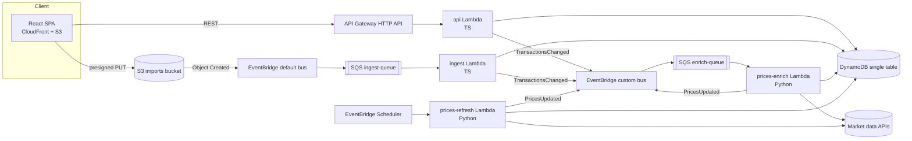

# Architecture & cross-team contracts

Source of truth for conventions shared between `web/`, `services/*`, and `infra/`.
Domain types, API shapes, DynamoDB keys and event schemas live in code in
[`packages/shared/src`](../packages/shared/src) — this document covers everything else.

## Overview



Every SQS queue has a DLQ (`maxReceiveCount = 3`). SQS-triggered Lambdas use
`ReportBatchItemFailures` (partial batch responses) and must be idempotent.

## Naming

`{app}-{component}-{env}` with `app = portfolio-tracker`, `env ∈ {local, dev, prod}`.

| Resource | Name |
|---|---|
| DynamoDB table | `portfolio-tracker-{env}` (PK/SK strings, PAY_PER_REQUEST) |
| Imports bucket | `portfolio-tracker-imports-{env}-{accountId}` (`portfolio-tracker-imports-local` locally) |
| Custom event bus | `portfolio-tracker-{env}` |
| Ingest queue / DLQ | `portfolio-tracker-ingest-{env}` / `…-ingest-dlq-{env}` |
| Enrich queue / DLQ | `portfolio-tracker-enrich-{env}` / `…-enrich-dlq-{env}` |
| Lambdas | `portfolio-tracker-api-{env}`, `…-ingest-{env}`, `…-prices-refresh-{env}`, `…-prices-enrich-{env}` |
| SSM params | `/portfolio-tracker/{env}/<provider>-api-key` (SecureString) |

## Environment variables (all Lambdas)

| Var | Used by | Notes |
|---|---|---|
| `TABLE_NAME` | all | |
| `EVENT_BUS_NAME` | api, ingest, prices | |
| `IMPORT_BUCKET` | api, ingest | |
| `BASE_CURRENCY` | api, prices | default `EUR` |
| `AUTH_MODE` | api | `cognito` (default; JWT `sub` required, else 401) or `demo` (local dev/tests only) — see [Authentication](#authentication) |
| `DEMO_USER_ID` | api | default `demo`; only used with `AUTH_MODE=demo` |
| `CORS_ALLOWED_ORIGIN` | api | |
| `LOG_LEVEL` | all | default `INFO` |
| `MARKET_DATA_PROVIDER` | prices | `mock` or a real provider id (see services/prices README) |
| `*_API_KEY_PARAM` | prices | SSM parameter name(s) holding provider API keys |
| `AWS_ENDPOINT_URL` | all (local only) | `http://localhost:4566` (LocalStack); both AWS SDK v3 and boto3 honour it |

## Build artifacts (consumed by Terraform)

| Service | Command | Artifact | Handler | Runtime |
|---|---|---|---|---|
| `services/api` | `pnpm --filter @portfolio/api package` | `services/api/dist/api.zip` | `index.handler` | nodejs22.x, arm64 |
| `services/ingest` | `pnpm --filter @portfolio/ingest package` | `services/ingest/dist/ingest.zip` | `index.handler` | nodejs22.x, arm64 |
| `services/prices` | `services/prices/scripts/package.sh` | `services/prices/dist/prices.zip` | `prices.handlers.scheduled_refresh` / `prices.handlers.on_transactions_changed` | python3.12, arm64 |

TS bundles: esbuild, ESM (`index.mjs`), `--platform=node --target=node22`, AWS SDK v3 **bundled** (pinned version; the presign fix `requestChecksumCalculation` needs a recent SDK).

## Symbols

Canonical symbols are Yahoo-style: US tickers bare (`AAPL`), exchange suffix otherwise
(`ASML.AS` Euronext Amsterdam, `SAP.DE` XETRA, `MC.PA` Paris, `VWRL.AS`), crypto `BTC-EUR`.
Market-data adapters map canonical ↔ provider symbols.

## CSV import format

Header (case-insensitive, any order): `date,type,symbol,quantity,price,fee,currency[,note][,fxRate]`.
`fxRate` = units of `currency` per 1 EUR as applied by the broker (optional; ECB fixing used when empty).
Validated by `csvRowSchema`. Max 1 MB / 5000 rows. **All-or-nothing**: if any row fails validation
or the import would oversell a position, nothing is written and the import is `FAILED` with
row-level errors. Transaction ids from imports are deterministic (`{importId}-{rowNumber}`) so
SQS redelivery is idempotent.

## API & item conventions

- HTTP status: `200` reads, `201` POST create (body = created resource), `204` DELETE (no body),
  `400 VALIDATION_ERROR`, `404 NOT_FOUND`, `422 UNPROCESSABLE` (e.g. oversell), `503 FX_UNAVAILABLE`, `500 INTERNAL`.
- Import `errors[].row`: 1-based CSV data row (header excluded); `0` = file-level error (size, header, encoding).
- Same-day ordering: `buildPositions` orders by `date`, then `createdAt`. Writers must make `createdAt`
  strictly increasing within a batch (ingest uses processing time + row number in ms).
- Registry items: `USERS` → `{ userId, createdAt, updatedAt }`; `TRACKED` → `TrackedTicker` (`currency` optional; written with
  `if_not_exists` / conditional puts so concurrent writers never clobber `createdAt`).
- Profile `country`: full English name (`United States`, `Netherlands`); `Global` for world funds/crypto.
  `sector`: free text from the provider, `Diversified` for broad ETFs.
- FX items (`LATEST` and `DAY#{date}`, entityType `FX` / `FX_DAY`): `rates` is a DynamoDB **map** (exception to
  "stored flat") and excludes the base currency. `FX_DAY` also stores `date`.
- Minor-unit quotes (`GBX`/`GBp`, LSE) are converted to the major currency (`GBP`, ÷100) by the prices
  service before writing, so every stored price/amount is in an ISO-4217 major currency.

## Local development

`docker compose up -d` starts LocalStack (dynamodb, s3, sqs, events, ssm). An init hook in
`infra/localstack/` creates the local table, bucket, bus, queues and an S3 → SQS notification
on the ingest queue (S3 *notification* shape locally vs. EventBridge shape in AWS — the ingest
handler accepts both). Then:

1. `pnpm --filter @portfolio/api seed` — demo user, transactions, profiles, 1y EOD prices, FX, dividend events.
2. `pnpm --filter @portfolio/api dev` — local HTTP server on `:3001` wrapping the Lambda handler.
3. `pnpm --filter @portfolio/ingest dev` — long-polls the local ingest queue and invokes the handler.
4. `pnpm --filter @portfolio/web dev` — Vite on `:5173`, proxies `/api/*` → `:3001` (prefix stripped).
5. Optional: `cd services/prices && python -m prices.local refresh` with `MARKET_DATA_PROVIDER=mock`.

## Portfolios

A user owns 1..`MAX_PORTFOLIOS` (20) portfolios, e.g. one per broker account. `default` ("Main portfolio")
is created on first `GET /portfolios`. Transactions live under `USER#{userId}` with sort key
`TXN#{portfolioId}#{date}#{id}`, so one portfolio is a `begins_with(TXN#{portfolioId}#)` query and the
combined view is `begins_with(TXN#)` — no GSI needed.

- Read endpoints take `?portfolioId=`; omitted or `all` = all portfolios combined (same symbol is merged).
- Writes (manual transactions, CSV imports) target one portfolio; oversell checks use that portfolio only.
- A symbol must have the same currency in every portfolio of a user, so the combined view never mixes currencies.
- Deleting a non-empty portfolio needs `?force=true` (cascades); the last portfolio cannot be deleted.
- All portfolios share the global base currency (EUR).
- `TransactionsChanged` events carry `portfolioId`; the prices service ignores it (prices are per ticker).

## Currency conversion (base currency EUR)

Every monetary value in API responses is in the portfolio base currency (`DEFAULT_BASE_CURRENCY = 'EUR'`)
unless its field name ends in `Local`. Conversion is done only in `packages/shared` (`FxTimeline`):

| Amount | Rate used |
|---|---|
| BUY cost, SELL proceeds, DIVIDEND received | `transaction.fxRate` (broker-applied) → ECB fixing of the transaction date (previous business day on weekends/holidays) → latest rate |
| Market value, day change, upcoming dividends | latest rate (`FX#EUR` / `LATEST`) |
| Value history | ECB fixing of each day; `invested` = cost basis at purchase-date rates |

Realized P&L = proceeds at sell-date rate − average cost at purchase-date rates. `currencyEffect` = market value −
value at the cost-weighted purchase rates, i.e. the part of unrealized P&L caused by EUR moving against the
instrument currency. Daily fixings come from Frankfurter (ECB reference rates) and are stored as
`FX#EUR` / `DAY#{date}` items by the prices service (backfilled from `FX_HISTORY_START`).

## Known limitations

- Single demo user in local development and the GitHub Pages demo; deployed environments use Cognito users (see Authentication).

## Authentication

Deployed environments authenticate every API call with an Amazon Cognito user pool; local development and the
GitHub Pages demo run without login.

```
Browser (SPA)                         Cognito user pool                 API Gateway (HTTP API)        api Lambda
  SRP sign-in ───────────────────────► new password / TOTP challenge
  ◄──────────── ID + access + refresh tokens
  Authorization: Bearer <ID token> ─────────────────────────────────────► JWT authorizer (issuer + client id)
                                                                           └─ claims.sub ───────────────► resolveUserId()
```

- **Pool** (`infra/terraform/auth.tf`): self sign-up disabled (users are created with `admin-create-user`),
  email username, 12+ character password with upper/lower/number/symbol, **MFA `ON` with software-token (TOTP)
  only — SMS is not configured**, account recovery by verified email, advanced security off (cost), deletion
  protection in prod. App client: no secret, `ALLOW_USER_SRP_AUTH` + `ALLOW_REFRESH_TOKEN_AUTH`, 30-minute
  ID/access tokens, 30-day refresh token, token revocation on, user-existence errors hidden.
- **Fail closed.** `enable_auth` (Terraform) is `true` for `env=prod` when unset, must be chosen explicitly
  for other environments, and `false` is rejected for prod (`terraform_data.auth_guard` preconditions). With auth on the
  Lambda gets `AUTH_MODE=cognito`: `resolveUserId` (`services/api/src/lib/auth.ts`) requires
  `requestContext.authorizer.jwt.claims.sub` (also validated against `^[A-Za-z0-9._-]{1,128}$`) and answers
  `401 UNAUTHENTICATED` otherwise — evaluated before routing, so even unknown routes and `/health` need a token
  (CORS preflight is answered by API Gateway). An unset `AUTH_MODE` means `cognito`; unknown values fail at cold start.
  `AUTH_MODE=demo` (the `pnpm --filter @portfolio/api dev` default, tests) serves requests without claims as
  `DEMO_USER_ID`, and still honours a validated `sub` when present.
- **User isolation.** The user id is derived in exactly one place and handed to handlers as `RouteContext.userId`.
  DynamoDB keys (`USER#<sub>`) and S3 import keys (`imports/<sub>/<importId>.csv`) are built from it only; the
  request body and query string are never consulted (`services/api/src/auth.test.ts` proves it with two users
  across transactions, portfolios, imports and upload keys).
- **Web** (`web/src/features/auth/`): `amazon-cognito-identity-js` (SRP, the password is never sent). Screens:
  sign in, new-password challenge (first login with the temporary password), TOTP enrolment (QR code rendered locally
  as inline SVG + manual key; the secret never leaves the page), TOTP code entry, forgot password (emailed code).
  `AuthGate` guards every route; the API client sends `Authorization: Bearer <ID token>`, refreshes silently when
  the token expired (concurrent requests share one refresh) and the app signs out automatically on a `401`
  (clearing the React Query cache). Tokens: ID/access tokens in memory only; the refresh token + "last user" pointer in
  `localStorage` so reloads and new tabs stay signed in. Trade-off: localStorage is readable by any script on the
  origin, mitigated by the CloudFront CSP (`script-src 'self'`, `connect-src` limited to the API, S3 and
  `cognito-idp.<region>.amazonaws.com`), a 30-day lifetime and server-side revocation on sign-out; sessionStorage would
  force a full password + TOTP sign-in in every tab.
- **Build-time switches**: `VITE_AUTH_MODE=cognito|none`, `VITE_COGNITO_USER_POOL_ID`, `VITE_COGNITO_CLIENT_ID`,
  `VITE_COGNITO_REGION`. Mock mode (`pnpm dev:mock`, GitHub Pages) always runs with auth off. `VITE_AUTH_MODE=cognito`
  with missing settings renders an error screen instead of the app.
- **Local development**: LocalStack's free tier has no Cognito, so the local API runs `AUTH_MODE=demo` and the SPA
  with `VITE_AUTH_MODE=none`. There is deliberately no token-minting shim and no bypass in the deployed path.
- **Other services**: the ingest Lambda is event-driven and takes the user id from the S3 key written by the API.
  Any new API route must use `ctx.userId` and nothing else for identity; per-user data (e.g. secrets) must be keyed by it.
- **Existing demo data.** Environments that ran before auth stored everything under `USER#demo` (and
  `imports/demo/…`). A Cognito user has a new `sub`, so that data is not visible after switching; re-key it
  (copy the items to `USER#<sub>`) if it should be kept.

- Single demo user unless a JWT authorizer (Cognito) is enabled.

## Analytics

Read-only performance, risk and income analysis. The maths is pure and lives in `packages/shared`
(`analytics.ts` XIRR/TWR/risk/drawdown/beta/goal simulation, `analytics-income.ts` passive income and dividend
growth, `analytics-insights.ts` rules, `analytics-compute.ts` response builders, `analytics-api.ts` contract and
query schemas). The Lambda (`services/api/src/routes/analytics.ts`) loads transactions, quotes, FX, end-of-day
prices and dividend events and calls the same builders as the web demo's MSW handlers
(`web/src/mocks/analyticsHandlers.ts`), so the GitHub Pages demo shows real numbers. No new tables, IAM or
infrastructure: the paths are covered by the API Gateway `$default` route, and the data comes from the existing
`TXN#`, `QUOTE#LATEST`, `EOD#`, `DIV#`, `PROFILE` and `FX#` items.

| Endpoint (all accept `?portfolioId=`) | Content |
|---|---|
| `GET /analytics/summary` | IRR, TWR (+ annualised), passive income, top 5 day gainers/losers, insights |
| `GET /analytics/returns?period=year\|quarter\|month` | TWR per calendar period (+ IRR per year) |
| `GET /analytics/risk?benchmark=` | volatility, Sharpe, Sortino, max drawdown (+ dates), beta, correlation |
| `GET /analytics/benchmark?benchmark=&range=` | portfolio vs a benchmark ETF replayed with the same cash flows |
| `GET /analytics/dividend-growth` | year-over-year dividends by year, month and per share |
| `GET /analytics/goal?targetIncome=&…` | passive-income goal projection (cautious / base / optimistic) |

Malformed query parameters return `400 VALIDATION_ERROR` in the standard error envelope.

Definitions:

- **XIRR** solves Σ cf / (1+r)^(days/365) = 0 over dated cash flows (buys negative, sells, dividends and the
  terminal market value positive) with Newton's method and a bisection fallback; `null` without both signs.
  For less than a year of history the period return is shown instead of an annualised figure (`irrAnnualised`).
- **TWR** chains daily returns of the daily value history, removing buys and sells as external flows (dividends count
  as return). Sub-period (year/quarter/month) returns are chained from the same daily series.
- **Risk** uses weekday returns: annualised volatility (√252), Sharpe and Sortino against a constant 2.5% risk-free
  rate (`DEFAULT_RISK_FREE_RATE`), max drawdown from the wealth index, beta/correlation against the benchmark's daily
  returns. Fewer than `MIN_RISK_OBSERVATIONS` (20) returns yields `null` metrics.
- **Benchmark**: default `IWDA.AS` (also `VWRL.AS`) from the tracked end-of-day prices. Without prices the response
  has `benchmark.available = false` and a `message` instead of an error.
- **Passive income**: next 12 months = declared events (ex-date ahead × quantity) + estimated payments implied by the
  holding's payment frequency (1/2/4/12 per year from the gaps of its last payments), net of observed withholding tax.
  Yield on value = income / market value, yield on cost = income / cost basis.
- **Goal projection**: monthly simulation of the income run-rate; existing income grows at the dividend growth rate and
  each month the contribution (and reinvested dividends) buys income at the yield on new money. Cautious/optimistic
  shift growth by ∓2 points and the new-money yield by ∓0.5 points; `yearsToGoal` is `null` beyond the horizon.

Insight thresholds (`INSIGHT_THRESHOLDS`, a rule fires when the measure is strictly above, except dead weight):

| Rule | Threshold |
|---|---|
| Top holding | > 25% of portfolio value |
| Sector | > 40% (Diversified/unknown ignored) |
| Country | > 50% (Global/unknown ignored) |
| Single non-EUR currency | > 40% |
| Non-EUR share | > 50% |
| Dead weight | return below −15% and weight below 2% |
| Income concentration | one holding > 40% of forward income |

Web: dashboard widgets (`features/analytics/`) read `GET /analytics/summary`; insights can be dismissed for the
browser session (`sessionStorage`, per scope). `/analytics` is lazy-loaded and has tabs Returns, Risk, Benchmark,
Dividend growth and Income goal (`?tab=`); everything follows the active portfolio scope. Not investment advice.
