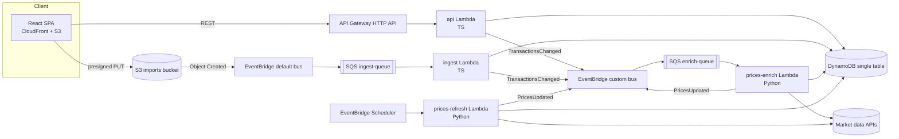

# Architecture & cross-team contracts

Source of truth for conventions shared between `web/`, `services/*`, and `infra/`.
Domain types, API shapes, DynamoDB keys and event schemas live in code in
[`packages/shared/src`](../packages/shared/src) — this document covers everything else.

## Overview

Every SQS queue has a DLQ (`maxReceiveCount = 3`). SQS-triggered Lambdas use
`ReportBatchItemFailures` (partial batch responses) and must be idempotent.

## Naming

`{app}-{component}-{env}` with `app = portfolio-tracker`, `env ∈ {local, dev, prod}`.

| Resource | Name |
|---|---|
| DynamoDB table | `portfolio-tracker-{env}` (PK/SK strings, PAY_PER_REQUEST) |
| Imports bucket | `portfolio-tracker-imports-{env}-{accountId}` (`portfolio-tracker-imports-local` locally) |
| Custom event bus | `portfolio-tracker-{env}` |
| Ingest queue / DLQ | `portfolio-tracker-ingest-{env}` / `…-ingest-dlq-{env}` |
| Enrich queue / DLQ | `portfolio-tracker-enrich-{env}` / `…-enrich-dlq-{env}` |
| Lambdas | `portfolio-tracker-api-{env}`, `…-ingest-{env}`, `…-prices-refresh-{env}`, `…-prices-enrich-{env}` |
| SSM params | `/portfolio-tracker/{env}/<provider>-api-key` (SecureString) |

## Environment variables (all Lambdas)

| Var | Used by | Notes |
|---|---|---|
| `TABLE_NAME` | all | |
| `EVENT_BUS_NAME` | api, ingest, prices | |
| `IMPORT_BUCKET` | api, ingest | |
| `BASE_CURRENCY` | api, prices | default `EUR` |
| `DEMO_USER_ID` | api | default `demo`; used when no JWT authorizer claim |
| `CORS_ALLOWED_ORIGIN` | api | |
| `LOG_LEVEL` | all | default `INFO` |
| `MARKET_DATA_PROVIDER` | prices | `mock` or a real provider id (see services/prices README) |
| `*_API_KEY_PARAM` | prices | SSM parameter name(s) holding provider API keys |
| `AWS_ENDPOINT_URL` | all (local only) | `http://localhost:4566` (LocalStack); both AWS SDK v3 and boto3 honour it |

## Build artifacts (consumed by Terraform)

| Service | Command | Artifact | Handler | Runtime |
|---|---|---|---|---|
| `services/api` | `pnpm --filter @portfolio/api package` | `services/api/dist/api.zip` | `index.handler` | nodejs22.x, arm64 |
| `services/ingest` | `pnpm --filter @portfolio/ingest package` | `services/ingest/dist/ingest.zip` | `index.handler` | nodejs22.x, arm64 |
| `services/prices` | `services/prices/scripts/package.sh` | `services/prices/dist/prices.zip` | `prices.handlers.scheduled_refresh` / `prices.handlers.on_transactions_changed` | python3.12, arm64 |

TS bundles: esbuild, ESM (`index.mjs`), `--platform=node --target=node22`, AWS SDK v3 **bundled** (pinned version; the presign fix `requestChecksumCalculation` needs a recent SDK).

## Symbols

Canonical symbols are Yahoo-style: US tickers bare (`AAPL`), exchange suffix otherwise
(`ASML.AS` Euronext Amsterdam, `SAP.DE` XETRA, `MC.PA` Paris, `VWRL.AS`), crypto `BTC-EUR`.
Market-data adapters map canonical ↔ provider symbols.

## CSV import format

Header (case-insensitive, any order): `date,type,symbol,quantity,price,fee,currency[,note][,fxRate]`.
`fxRate` = units of `currency` per 1 EUR as applied by the broker (optional; ECB fixing used when empty).
Validated by `csvRowSchema`. Max 1 MB / 5000 rows. **All-or-nothing**: if any row fails validation
or the import would oversell a position, nothing is written and the import is `FAILED` with
row-level errors. Transaction ids from imports are deterministic (`{importId}-{rowNumber}`) so
SQS redelivery is idempotent.

## API & item conventions

- HTTP status: `200` reads, `201` POST create (body = created resource), `204` DELETE (no body),
  `400 VALIDATION_ERROR`, `404 NOT_FOUND`, `422 UNPROCESSABLE` (e.g. oversell), `503 FX_UNAVAILABLE`, `500 INTERNAL`.
- Import `errors[].row`: 1-based CSV data row (header excluded); `0` = file-level error (size, header, encoding).
- Same-day ordering: `buildPositions` orders by `date`, then `createdAt`. Writers must make `createdAt`
  strictly increasing within a batch (ingest uses processing time + row number in ms).
- Registry items: `USERS` → `{ userId, createdAt, updatedAt }`; `TRACKED` → `TrackedTicker` (`currency` optional; written with
  `if_not_exists` / conditional puts so concurrent writers never clobber `createdAt`).
- Profile `country`: full English name (`United States`, `Netherlands`); `Global` for world funds/crypto.
  `sector`: free text from the provider, `Diversified` for broad ETFs.
- FX items (`LATEST` and `DAY#{date}`, entityType `FX` / `FX_DAY`): `rates` is a DynamoDB **map** (exception to
  "stored flat") and excludes the base currency. `FX_DAY` also stores `date`.
- Minor-unit quotes (`GBX`/`GBp`, LSE) are converted to the major currency (`GBP`, ÷100) by the prices
  service before writing, so every stored price/amount is in an ISO-4217 major currency.

## Local development

`docker compose up -d` starts LocalStack (dynamodb, s3, sqs, events, ssm). An init hook in
`infra/localstack/` creates the local table, bucket, bus, queues and an S3 → SQS notification
on the ingest queue (S3 *notification* shape locally vs. EventBridge shape in AWS — the ingest
handler accepts both). Then:

1. `pnpm --filter @portfolio/api seed` — demo user, transactions, profiles, 1y EOD prices, FX, dividend events.
2. `pnpm --filter @portfolio/api dev` — local HTTP server on `:3001` wrapping the Lambda handler.
3. `pnpm --filter @portfolio/ingest dev` — long-polls the local ingest queue and invokes the handler.
4. `pnpm --filter @portfolio/web dev` — Vite on `:5173`, proxies `/api/*` → `:3001` (prefix stripped).
5. Optional: `cd services/prices && python -m prices.local refresh` with `MARKET_DATA_PROVIDER=mock`.

## Currency conversion (base currency EUR)

Every monetary value in API responses is in the portfolio base currency (`DEFAULT_BASE_CURRENCY = 'EUR'`)
unless its field name ends in `Local`. Conversion is done only in `packages/shared` (`FxTimeline`):

| Amount | Rate used |
|---|---|
| BUY cost, SELL proceeds, DIVIDEND received | `transaction.fxRate` (broker-applied) → ECB fixing of the transaction date (previous business day on weekends/holidays) → latest rate |
| Market value, day change, upcoming dividends | latest rate (`FX#EUR` / `LATEST`) |
| Value history | ECB fixing of each day; `invested` = cost basis at purchase-date rates |

Realized P&L = proceeds at sell-date rate − average cost at purchase-date rates. `currencyEffect` = market value −
value at the cost-weighted purchase rates, i.e. the part of unrealized P&L caused by EUR moving against the
instrument currency. Daily fixings come from Frankfurter (ECB reference rates) and are stored as
`FX#EUR` / `DAY#{date}` items by the prices service (backfilled from `FX_HISTORY_START`).

## Known limitations

- Single demo user unless a JWT authorizer (Cognito) is enabled.
